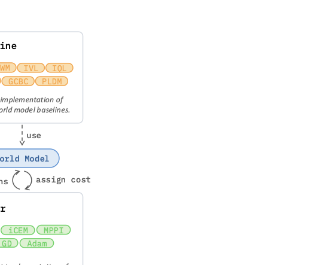
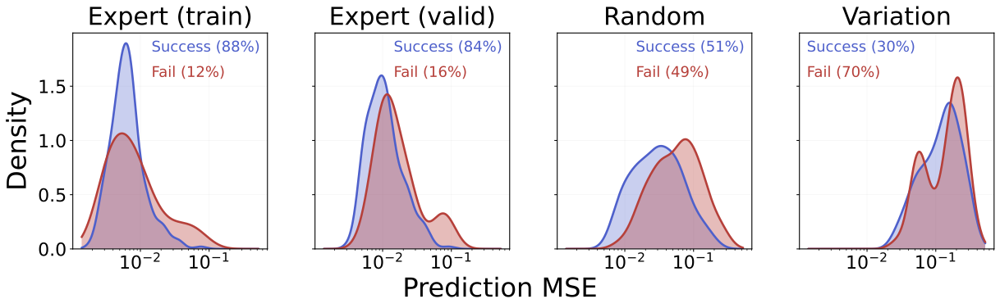
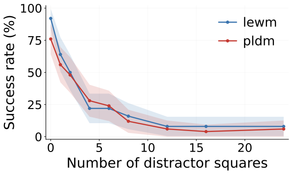

**`stable-worldmodel` (swm) argues that the bottleneck in world-model research is no longer ideas but plumbing: every lab re-implements the same encoder, predictor, CEM planner, and data loader, and the inconsistencies between those copies make published comparisons untrustworthy.** The paper's fix is a single PyTorch and Gymnasium platform built on three abstractions (`World`, `Policy`, `Solver`), a Lance-based data layer that loads multimodal trajectories 3 to 4 times faster than HDF5 or MP4, and a factors-of-variation system that turns any environment into a controlled out-of-distribution (OOD) test. The infrastructure claims are concrete and well-supported. The scientific headline, that current world models are brittle under mild distribution shift, is real but rests almost entirely on a single environment (Push-T). This is a close read of [the paper](https://arxiv.org/abs/2605.21800v1) from the data layer to the last solver.

{/* truncate */}

## TL;DR

- **Claim**: world-model research is fragmented across one-off codebases; a shared, well-tested platform with standardized data loading, baselines, solvers, and generalization benchmarks would make results reproducible and comparisons fair.
- **Method**: three minimal abstractions (`World`, `Policy`, `Solver`); a Lance columnar data layer with converters for MP4, HDF5, and LeRobot; baselines across two paradigms (latent world models DINO-WM, PLDM, LeWM, TD-MPC2; goal-conditioned RL baselines GCBC, GCIQL, GCIVL); nine planning solvers (CEM, iCEM, MPPI, predictive sampling, categorical CEM, gradient descent, PGD, GRASP, Lagrangian); and factors of variation (FoV) plus visual wrappers that inject controlled visual, geometric, and physical shifts on the fly.
- **Result**: Lance hits ~4.8k samples/sec locally and ~3.2k from S3, beating HDF5 (1.4k local, 9 from S3) and MP4 (1.3k). Baselines reproduce published Push-T success rates. Under FoV perturbations, planning success collapses (e.g. LeWM drops from 50.8% to 6.0% when the canvas color changes). Prediction MSE correlates poorly with planning success.
- **Verdict**: the engineering is the contribution and it holds up. The "world models are brittle" finding is plausible and useful, but the experimental base is thin (one environment, two or three models, 50 to 256 trajectories) for a claim that broad.

## Notation

The paper's notation is light and mostly consistent. The one collision to watch: $L$ is the number of solver iterations in the planning sections, while $L_\tau^2$ is the expectile loss in the GCRL sections, and $H$ is a planning horizon almost everywhere but a "history length" in the DINO-WM and GCBC training loops.

| Symbol | Meaning |
| --- | --- |
| $\mathbf{o}_t \in \mathbb{R}^n$ | observation at time $t$ (e.g. an RGB frame), possibly partial |
| $\mathbf{s}_t \in \mathbb{R}^D$ | latent state at time $t$ |
| $\mathbf{a}_t \in \mathbb{R}^A$ | action at time $t$ |
| $\mathcal{E}: \mathbb{R}^n \to \mathbb{R}^D$ | encoder, observation to latent |
| $\mathcal{P}: \mathbb{R}^D \times \mathbb{R}^A \to \mathbb{R}^D$ | predictor (latent dynamics) |
| $\pi: \mathbb{R}^D \to \mathbb{R}^A$ | policy |
| $c(\mathbf{s}_t, \mathbf{a}_t)$ | stage cost measuring progress toward the goal |
| $\mathbf{s}_g \in \mathbb{R}^D$ | goal state |
| $A = (\mathbf{a}_0, \dots, \mathbf{a}_{H-1})$ | candidate action sequence over a horizon |
| $H$ | planning horizon (model steps); also "history" in some training loops |
| $J_\theta(\mathbf{s}_0, A)$ | rollout cost of action sequence $A$ from $\mathbf{s}_0$ |
| $N, L, E$ | solver candidates, iterations, elites |
| $\sigma, \lambda$ | sampling scale; MPPI temperature |
| $\Delta(\mathcal{A})$ | probability simplex over discrete action set $\mathcal{A}$ |
| $Q_\psi, V_\theta$ | critic and value networks (GCRL) |
| $\tau$ | expectile parameter; $L_\tau^2$ is the expectile loss |
| $\alpha$ | advantage-weighted regression temperature |
| $\gamma$ | discount factor; $m_t$ is a terminal mask |
| FoV | factor of variation (a controllable scene property) |

## The problem: research that cannot be reproduced

The framing is blunt and, I think, correct. World models (learned predictive models of how observations and states evolve under actions) have become a central paradigm, with Dreamer-style reconstruction models, TD-MPC2-style reward-implicit models, and JEPA-style self-supervised models all competing. But each lab builds its own end-to-end pipeline for data collection, training, and evaluation, and routinely re-implements the same components.

The paper's sharpest example: the Cross-Entropy Method planner has been independently re-implemented "with varying degrees of fidelity" in at least five recent papers (TD-MPC, PLDM, DINO-WM, LeWM, V-JEPA2). When five copies of the same algorithm disagree, you cannot tell whether a reported gain comes from a better method or a luckier implementation. The paper names three concrete bottlenecks it sets out to remove:

1. **Implementation fragmentation**: re-implemented baselines and solvers introduce subtle inconsistencies that break fair comparison.
2. **Data loading**: world-model training needs *contiguous temporal blocks* of multimodal data (frames, actions, proprioception), which neither frame-per-file storage nor video clips serve well, leading to GPU starvation.
3. **Evaluation**: standard benchmarks test close to the training distribution, so a model can look successful while having learned exploitable correlations rather than reusable dynamics.

That third point is the scientific spine of the paper, and it is worth stating precisely: a world model is *not* a policy. It is a learned representation of dynamics that a downstream planner (MPC or model-based RL) consumes. So "high task success in-distribution" does not certify that the latent dynamics are stable, intervention-robust, or useful for counterfactual reasoning. The paper cites recent work showing high-capacity sequence models can fit trajectories accurately while failing to recover the local dynamical laws that generated them.

## Background: the world-model pipeline

A world model is "mostly the association of two core components, an encoder and a predictor." The encoder $\mathcal{E}: \mathbb{R}^n \to \mathbb{R}^D$ maps an observation $\mathbf{o}_t$ to a latent state $\mathbf{s}_t$; the predictor $\mathcal{P}: \mathbb{R}^D \times \mathbb{R}^A \to \mathbb{R}^D$ predicts $\mathbf{s}_{t+1}$ from $(\mathbf{s}_t, \mathbf{a}_t)$. Everything else in the paper (baselines, solvers) is a variation on how you train these two objects and how you use them at test time.

### Planning as optimal control

Once you have a predictor, control becomes optimization. Given an initial state $\mathbf{s}_0$, find the policy that minimizes cumulative cost under the *learned* dynamics:

$$
\pi^* = \operatorname*{arg\,min}_{\pi} \sum_{t} c(\mathbf{s}_t, \mathbf{a}_t) \quad \text{s.t.} \quad \mathbf{s}_{t+1} = \mathcal{P}(\mathbf{s}_t, \mathbf{a}_t), \quad \mathbf{a}_t = \pi(\mathbf{s}_t).
$$

**Symbols.** $c(\mathbf{s}_t, \mathbf{a}_t)$ is a task-dependent stage cost measuring distance to a goal $\mathbf{s}_g$; the constraint $\mathbf{s}_{t+1} = \mathcal{P}(\mathbf{s}_t, \mathbf{a}_t)$ says future states are rolled out by the *model*, not the real environment; $\mathbf{a}_t = \pi(\mathbf{s}_t)$ ties the actions to the policy being optimized.

**Intuition.** This is the standard optimal-control objective with one substitution: the true transition function is replaced by the learned predictor $\mathcal{P}$. That substitution is the entire bet of model-based control. If $\mathcal{P}$ is accurate, optimizing actions against it transfers to the real system; if $\mathcal{P}$ is wrong off-distribution, the optimizer happily exploits its errors (a failure mode the experiments later show vividly with TD-MPC2).

The paper notes two ways to solve this: RL learns $\pi$ offline or online over many trajectories, while Model Predictive Control (MPC) solves a finite-horizon ($T$-step) version *at test time* by directly optimizing predicted trajectories. swm commits to MPC for its case studies (the world model is used directly as part of the agent), but claims RL compatibility since both target the same problem.

## The three abstractions

The design philosophy is "impose as few restrictions as possible on the user's model and training code, while strongly standardizing data, evaluation, and control." The reasoning is pragmatic: researchers will not adopt a framework that dictates their training loop, but they happily standardize the parts that exist only to enable fair comparison. Three abstractions carry this:

- **`World`**: a unified wrapper over one or more vectorized Gymnasium environments. Notably, `World.reset()` and `World.step()` do *not* return observations or rewards in the Gym style. Instead they update an internal `world.infos` dictionary in place, holding RGB frames, states, rewards, terminations, and truncations for all environments at once. This is an opinionated break from Gym, justified by the need to expose the full multi-environment state for recording and evaluation.
- **`Policy`**: maps observations (or latent states) to actions through a single `get_actions(info)` method. After `world.set_policy(p)`, every `step()` queries the policy automatically. Random, expert (SAC), feed-forward (RL), and `MPCPolicy` (planning) all share this interface.
- **`Solver`**: a self-contained MPC planner. Each solver only needs the world model to implement `get_cost`, and returns an optimized finite-horizon action sequence. swm executes the first $K$ actions, then replans.

The whole research loop collapses to a short script: create a `World` of 8 Push-T environments, collect 5000 episodes with a random policy into a `.lance` file, train any PyTorch model, wrap it in a `CEMSolver` then an `MPCPolicy`, and call `world.evaluate(...)` with an `options={'variation': ['agent.size', 'background.color']}` dictionary to inject distribution shift. The factor-of-variation perturbation is a one-line argument, which is exactly what makes the robustness sweeps later "trivial to run."

## The data layer: the cleanest win

The data argument is the most quantitatively convincing part of the paper. Training world models requires loading *temporally contiguous* blocks (you need consecutive frames to estimate velocities, three or more for accelerations), which creates a trade-off:

- **Frame-per-file** (the computer-vision default): fast random sampling, but prohibitive I/O and storage from redundant per-file header decoding.
- **Compressed video (MP4)**: tiny on disk, but terrible random access, since retrieving a late frame may require decoding every preceding frame in the clip.

Neither scales. swm adopts [Lance](https://lancedb.github.io/lance/), a columnar ML-optimized format offering fast random access, high compression, zero-copy reads, native versioning, and cloud streaming, while keeping converters for MP4, HDF5, and LeRobot. The Push-T throughput numbers (samples/sec):

| Format | Local (no cache) | Local (cache) | S3 |
| --- | --- | --- | --- |
| HDF5 | 1,416 | 1,474 | 9 / 757 |
| Lance | 4,815 | 4,431 | 3,184 / 3,253 |
| Video | 1,331 | 1,348 | — |

The standout is remote streaming: HDF5 from S3 collapses to **9 samples/sec** uncached (it cannot stream contiguous blocks efficiently), while Lance sustains ~3.2k. For training that streams data from object storage (the realistic large-scale regime), this is the difference between feasible and not. The Two-Room benchmark in the appendix replicates the pattern, with MP4 winning only on disk footprint (220 MB) at the cost of random access. This is the rare benchmark in the paper where the conclusion is unambiguous and the mechanism is well understood.

## The model layer: baselines and their objectives

swm ships baselines across two paradigms (the paper says six, though it describes seven distinct algorithms). Goal-conditioned RL (GCRL) methods parameterize a `FeedForwardPolicy` with no solver; latent world models wrap a learned dynamics model in an `MPCPolicy`. All learn offline from a dataset $D$ of trajectories $(o_0, a_0, o_1, \dots, o_T)$, and (a swm-specific choice) all GCRL baselines encode observations and goals into frozen DINOv2 patch embeddings first.

### Goal-conditioned behavioral cloning (GCBC)

The simplest baseline: imitate expert actions given state and goal. With a frozen encoder $\mathcal{E}$ and a history of length $H$, the loss is plain regression:

$$
\mathcal{L} = \frac{1}{H} \sum_{i=0}^{H-1} \|\hat{a}_i - a_i\|_2^2, \quad \hat{a}_i = \pi_\theta(\mathcal{E}(o_i), \mathcal{E}(g)).
$$

**Intuition.** No dynamics model, no planning. It learns a direct map from (encoded observation, encoded goal) to action. It is the supervised-learning floor against which planning methods must justify their extra machinery.

### Implicit Q-learning (GCIQL)

IQL learns a critic and value function offline, then extracts a policy, all without ever querying out-of-dataset actions (the property that makes it "implicit" and offline-safe). The Q-network regresses to a bootstrapped target:

$$
\mathcal{L}_{Q} = \mathbb{E}_{(s_t, a_t, s_{t+1}, g)} \left[ \left( Q_\psi(s_t, a_t, g) - \left( r(s_t, g) + \gamma \, m_t \, V_{\bar{\theta}}(s_{t+1}, g) \right) \right)^2 \right].
$$

**Symbols.** $V_{\bar{\theta}}$ is a *target* value network (a slowly-updated copy, for stability); $m_t = 0$ when $s_t = g$ (terminal) and $1$ otherwise, so the bootstrap term vanishes at the goal; $r(s_t, g)$ is the goal-reaching reward (the algorithm box uses $r = -m$, i.e. a cost of $1$ per step until the goal is reached).

The value network is trained by *expectile regression* against the target Q:

$$
\mathcal{L}_{V} = \mathbb{E}_{(s_t, a_t, g)} \left[ L_\tau^2\!\left( Q_{\bar{\psi}}(s_t, a_t, g) - V_\theta(s_t, g) \right) \right], \quad L_\tau^2(u) = |\tau - \mathbf{1}(u < 0)| \, u^2.
$$

**Why expectile regression.** This is the load-bearing trick of IQL, and worth unpacking. Ordinary squared loss ($\tau = 0.5$) makes $V_\theta$ predict the *mean* of $Q$ over actions in the data. The asymmetric weight $|\tau - \mathbf{1}(u<0)|$ penalizes under-prediction ($u > 0$) more heavily when $\tau > 0.5$: with $\tau$ close to 1, positive residuals get weight $\tau$ and negative residuals get weight $1-\tau$, so $V_\theta$ is pushed toward an *upper expectile* of the action-value distribution. Intuitively, $V_\theta(s)$ approximates $\max_a Q(s,a)$ but only over actions *present in the dataset*, which is how IQL gets the benefit of a max without ever evaluating $Q$ at risky out-of-distribution actions. The policy is then extracted by advantage-weighted regression: weight $w = \exp(\alpha A)$ with advantage $A = Q_\psi(s_t, a_t, g) - V_\theta(s_t, g)$, so actions that beat the value baseline get cloned more strongly.

### Implicit V-learning (GCIVL)

A lighter IQL that drops the Q-function entirely and bootstraps the value directly:

$$
\mathcal{L}_{V} = \mathbb{E}_{(s_t, s_{t+1}, g)} \left[ L_\tau^2\!\left( r(s_t, g) + \gamma \, V_{\bar{\theta}}(s_{t+1}, g) - V_\theta(s_t, g) \right) \right].
$$

The advantage for policy extraction becomes $A = V_\theta(s_{t+1}, g) - V_\theta(s_t, g)$, i.e. did this transition move us to a higher-value state. Cheaper to train (one network instead of two), at the cost of a noisier advantage signal.

### DINO-WM: the foundation-model baseline

DINO-WM freezes a pretrained DINOv2 encoder and learns *only* a predictor (a causal Transformer with a windowed attention mask of size $H$) over patch-level visual tokens. Training is teacher-forced $\ell_2$ regression toward the next frame's DINOv2 embedding:

$$
\mathcal{L} = \frac{1}{H} \sum_{i=0}^{H-1} \big\| \hat{z}_{i+k} - z_{i+k} \big\|_2^2, \quad (\hat{z}_k, \dots, \hat{z}_{H+k-1}) = \mathcal{P}_\theta(e_0, \dots, e_{H-1}),
$$

where $e_i = \mathrm{concat}(z_i, \mathcal{A}(a_i))$ concatenates the encoded observation with an action embedding, and $k$ is the prediction offset. **Why freeze the encoder.** Because the encoder is fixed, the latent targets $z_{i+k}$ are constant, so the predictor cannot cheat by collapsing all embeddings to a constant (the classic JEPA failure). DINO-WM is the proof that latent planning works on frozen foundation features, without any anti-collapse regularizer.

### PLDM: the five-term JEPA

Planning with Latent Dynamics Models trains the encoder and predictor *jointly* from raw observations (the encoder produces a single `[CLS]` embedding). Joint training reintroduces the collapse risk, so PLDM stacks five loss terms:

$$
\mathcal{L} = \mathcal{L}_\mathrm{sim} + \alpha\,\mathcal{L}_\mathrm{std} + \beta\,\mathcal{L}_\mathrm{cov} + \delta\,\mathcal{L}_\mathrm{temp} + \omega\,\mathcal{L}_\mathrm{idm}.
$$

The terms: $\mathcal{L}_\mathrm{sim}$ is next-latent prediction error; $\mathcal{L}_\mathrm{std}$ and $\mathcal{L}_\mathrm{cov}$ are the VICReg variance and covariance regularizers (each embedding dimension must keep variance above a threshold and decorrelate from the others, which prevents collapse); $\mathcal{L}_\mathrm{temp}$ aligns consecutive latents; $\mathcal{L}_\mathrm{idm}$ is an inverse-dynamics term, where a separate model $\mathrm{IDM}_\psi(z_i, z_{i+1})$ must recover the action $a_i$ from two consecutive latents (forcing the latent to retain action-relevant information). **The cost of joint training** is four extra weighted terms ($\alpha, \beta, \delta, \omega$) to tune, which is precisely the complexity the next baseline targets.

### LeWM: the two-term JEPA

[LeWorldModel](https://arxiv.org/abs/2603.19312) (same group; I [close-read it separately](/blog/leworldmodel)) keeps PLDM's joint-training architecture but replaces all five terms with prediction plus *one* regularizer:

$$
\mathcal{L} = \mathcal{L}_\mathrm{pred} + \lambda\,\mathcal{L}_\mathrm{SIGReg}.
$$

SIGReg pushes the latent distribution toward an isotropic Gaussian, which subsumes the variance and covariance jobs of VICReg in a single penalty. The practical payoff swm cares about: "only one effective hyperparameter that requires tuning," which is what makes LeWM the cheapest latent baseline and the workhorse of the robustness experiments.

### TD-MPC2: the reward-implicit model

TD-MPC2 is the most complex baseline, jointly training an encoder, latent dynamics, reward predictor, a $Q$-ensemble, and a stochastic policy prior. Its consistency loss matches predicted next-latents to *stop-gradded* encodings of the real next observations ($\mathcal{L}_c \mathrel{+}= \rho^t \| z'_t - \mathrm{sg}(\tilde z_{t+1}) \|_2^2$, with $\rho^t$ decaying the weight of later steps), while reward and value are trained with cross-entropy against a two-hot encoding of scalar targets, and the policy with a max-entropy objective. The two-hot cross-entropy (instead of MSE on a scalar reward) is TD-MPC2's trick for handling reward scales that vary across tasks. This baseline becomes the cautionary tale of the experiments.

## The planning solvers

All nine solvers share one interface. Given the current latent $\mathbf{s}_0$ and a world model $(\mathcal{E}_\theta, \mathcal{P}_\theta)$, they score an action sequence $A = (\mathbf{a}_0, \dots, \mathbf{a}_{H-1})$ by rolling it out:

$$
J_\theta(\mathbf{s}_0, A) = \sum_{t=0}^{H-1} c(\mathbf{s}_t, \mathbf{a}_t), \quad \mathbf{s}_{t+1} = \mathcal{P}_\theta(\mathbf{s}_t, \mathbf{a}_t), \quad A^\star = \operatorname*{arg\,min}_A J_\theta(\mathbf{s}_0, A).
$$

Everything downstream is a different strategy for that $\operatorname*{arg\,min}$. The split is zeroth-order (sampling, no gradients through $\mathcal{P}$) versus first-order (backprop through a differentiable $\mathcal{P}$).

### Sampling-based (zeroth-order)

These only need forward evaluations, so they work with non-differentiable costs and discontinuous objectives; the price is the curse of dimensionality (they need large populations). swm runs candidate rollouts in parallel on GPU.

- **Predictive sampling**: perturb a nominal sequence with Gaussian noise, keep the lowest-cost candidate. No distribution fitting; refinement comes only from MPC replanning over time.
- **CEM**: maintain a diagonal Gaussian $(\mu^\ell, \sigma^\ell)$ over the action sequence. Each iteration samples $N$ candidates, keeps the $E$ lowest-cost *elites*, and refits the Gaussian to them: $\mu^{\ell+1} = \frac{1}{E}\sum_{i \in \mathcal{E}^\ell} A_i^\ell$, with $\sigma^{\ell+1}$ the elite standard deviation. The mean drives exploitation, the shrinking $\sigma$ drives exploration. Returns the final mean.
- **MPPI**: instead of a hard elite cutoff, weight every candidate softly by $w_i \propto \exp(-(C_i - C_{\min})/\lambda)$ and update the mean as $\mu^{\ell+1} = \sum_i w_i A_i^\ell$. The temperature $\lambda$ interpolates between greedy (low $\lambda$, mass on the best candidate) and uniform averaging (high $\lambda$). A smooth cousin of CEM.
- **iCEM**: CEM plus three sample-efficiency tricks: *colored noise* (temporally correlated perturbations $\mathcal{C}_\beta$ for smoother action sequences), *elite retention* (reuse the best $E_\mathrm{keep}$ candidates across iterations), and *momentum* on $\mu, \sigma$ updates. Designed for small planning budgets.
- **Categorical CEM**: the discrete-action analog, maintaining an independent categorical distribution per timestep, sampled via Gumbel-max, refit from elite frequencies with optional smoothing $\delta$.

### Gradient-based (first-order)

These backprop through $J_\theta$, so the predictor must be differentiable. Each step gives a directed improvement signal (potentially more sample-efficient), but learned models can have poorly conditioned gradients over long horizons, producing unstable updates and local minima.

- **Gradient descent**: $A_i^{k+1} = A_i^k - \eta \nabla_{A} J_\theta(\mathbf{s}_0, A_i^k)$ over multiple random initial candidates; return the best.
- **PGD**: for discrete actions, optimize a continuous relaxation, a probability vector per step living in the simplex product $\Delta(\mathcal{A})^H$, and project back onto the simplex after each step using the projection of Duchi et al. Decode by argmax or sampling.
- **Lagrangian**: handle differentiable inequality constraints $g_j(\mathbf{s}_0, A) \le 0$ with an augmented Lagrangian,

$$
\mathcal{L}(A, \lambda, \rho) = J_\theta(\mathbf{s}_0, A) + \sum_j \lambda_j g_j(\mathbf{s}_0, A) + \rho \sum_j \max(0, g_j(\mathbf{s}_0, A))^2.
$$

  The inner loop optimizes $A$; the outer loop raises the multipliers $\lambda_j$ by dual ascent ($\lambda^{\ell+1} = [\lambda^\ell + \rho^\ell \frac{1}{N}\sum_i G_i]_+$) and grows the quadratic penalty $\rho$. The linear term enforces the constraint at the optimum; the quadratic term ($\max(0, \cdot)^2$, penalizing only violations) provides curvature so the problem stays well-conditioned.
- **GRASP**: instead of a sequential rollout, treat the intermediate latents $z_1, \dots, z_{H-1}$ as *additional optimization variables* with a parallel objective

$$
\mathcal{L}_k = \sum_{t=0}^{H-1} \left( \|\hat z_{t+1}^k - z_{t+1}^k\|_2^2 + \gamma_k \|\hat z_{t+1}^k - s_g\|_2^2 \right), \quad \hat z_{t+1}^k = \mathcal{P}_\theta(\mathrm{sg}(z_t^k), a_t^k).
$$

  The first term enforces dynamic consistency (each virtual state should match the predictor's one-step output), the second pulls states toward the goal $s_g$. Because the one-step predictions can be computed in parallel across time (the stop-gradient $\mathrm{sg}(z_t^k)$ decouples them), GRASP avoids backpropagating through a long sequential chain, which is exactly where ordinary gradient descent struggles on long horizons. It periodically synchronizes the action sequence with the true rollout cost $J_\theta$.

The breadth here is the point: nine reference solvers spanning continuous and discrete, smooth and non-smooth, constrained and unconstrained, all validated to reproduce DINO-WM and PLDM published success rates when paired with their original models.

## Evaluation: factors of variation and protocols

The evaluation machinery is the second genuine contribution. Two parallel intervention mechanisms feed one pipeline:

- **Factors of Variation (FoV)** for native `swm/*` environments: a hierarchical `variation_space` exposing dot-keyed factors like `agent.color`, `block.scale`, `physics.floor.friction`. Crucially, sampled values are applied *at reset and held constant for the episode*, so a failure is attributable to a persistent environment change, not to frame-wise noise.
- **Visual wrappers** for black-box environments (Atari ROMs, Craftax): eleven wrappers (noise, blur, color jitter, grayscale, occlusion, cutout, random conv, resolution change, and so on) that rewrite the rendered frame before it reaches the agent. These compose with FoV on a single `World`.

The appendix figure tallies factors per environment: native simulator FoV range from 0 (Atari, Craftax: closed source, wrappers only) up to ~21 for the richest native environments, with the 11 universal wrappers stacked on top.

For protocols, swm separates two evaluation modes:

- **Episodic**: standard online Gym reset, the benchmark defines the goal distribution.
- **Dataset-driven** (the DINO-WM / PLDM / LeWM protocol): both start and goal are drawn *from the same recorded trajectory*. If $\tau^i = (o^i_0, \dots, o^i_T)$, initialize at $o^i_t$ and set the goal to $o^i_{t+\Delta}$. **Why this matters**: because the goal was actually observed later in the same trajectory, it is reachable by construction, which removes the "impossible start-goal pair" confound. A failure is then unambiguously a planning or modeling failure. The offset $\Delta$ controls goal distance; the dataset split controls distribution shift, and the two vary independently.

Both cap each episode at an `eval_budget` of environment steps, so methods with wildly different per-step compute (e.g. MPPI with many samples) stay wall-clock comparable. The gap between dataset-driven and episodic success rate is proposed as a proxy for over-reliance on in-distribution behavioral coverage.

## The case study: world models are brittle

The experiments use Push-T exclusively (the appendix adds DMC for online TD-MPC2 validation). Setup: dataset-driven evaluation on the DINO-WM expert dataset, goal offset $\Delta = 25$ steps, budget $B = 50$ steps, CEM planner ($L=30$, $N=300$, $E=30$, $\sigma_0=1$), horizon $H=5$ model steps (25 env steps) in open-loop. Each run takes a few minutes on a single L40S.

**In-distribution, baselines reproduce.** Success rates on Push-T / OGB-Cube: DINO-WM 92/86, LeWM 94/72, PLDM 78/62, GCBC 75/84, TD-MPC2 12/4. The numbers track published values, which is the validation that the unified implementations introduce "no performance regression." The exception is **TD-MPC2's collapse offline (12%)**, which the paper diagnoses (and the appendix PCA confirms): TD-MPC2's actor generates out-of-distribution actions that drift off the data manifold, fooling its own predictor. The same algorithm, validated online on DMC, matches SAC's rewards (e.g. humanoid_walk 749 vs 543, hopper_hop 355 vs 265), so the offline failure is *algorithmic, not an implementation bug*. This is a nice example of the platform doing its job: isolating whether a bad number is the method or the code.

**Prediction error does not predict planning success.** Across four regimes of growing shift (expert train, expert validation, random-policy, random-policy with all FoV), the paper plots per-trajectory prediction MSE split by planning success and failure.

The success and failure MSE distributions overlap heavily even under strong shift. The paper's reading: "out-of-distribution inputs, rather than raw prediction error magnitude, are the primary driver of planning failures." This is the most interesting scientific claim in the paper, and it is a useful warning against the common practice of using validation prediction loss as a proxy for downstream control quality.

**Targeted perturbations crater success.** Under single-factor FoV shifts, planning success drops sharply (success rate %, random-policy OOD trajectories):

| FoV | Entity | LeWM | PLDM | DINO-WM |
| --- | --- | --- | --- | --- |
| None | | 50.8 | 50.8 | 20.0 |
| Color | Agent | 12.0 | 8.0 | 18.0 |
| Color | Canvas | 6.0 | 6.0 | 10.0 |
| Size | Agent | 22.0 | 18.0 | 4.0 |
| Shape | Agent | 26.0 | **52.0** | 18.0 |
| Position | Anchor | 32.0 | 18.0 | 4.0 |

The disentangled view is the value-add: it shows *which* factor breaks *which* model. Canvas color is catastrophic for all three; PLDM is oddly robust to agent shape (52%, above its own unperturbed baseline) but fragile to agent color. A distractor sweep shows roughly quadratic decay in success as visual distractor squares are added.

And a color-wheel sweep shows LeWM stays accurate near the white background and along the green axis (the color of the default target anchor) but collapses for red, blue, and purple backgrounds, suggesting it "latches onto specific background-foreground color contrasts rather than the underlying task geometry." The conclusion is consistent across every probe: current world models have limited zero-shot generalization, and even modest shifts degrade planning substantially.

## Critical Analysis

The infrastructure claims and the scientific claims deserve different levels of trust, so I will separate them.

**The engineering is real and the data-layer benchmark is the strongest evidence.** The Lance throughput numbers are mechanistically explained (header-decode overhead for frame-per-file, sequential-decode penalty for MP4, contiguous-block streaming for Lance), reproduced across two environments, and the S3 result (9 vs 3,184 samples/sec) is the kind of order-of-magnitude gap that does not depend on tuning. If you stream training data from object storage, this matters. I believe it.

**The headline scientific claim rests on one environment.** "World models remain brittle under distribution shift" is supported almost entirely by Push-T, a 2D pushing task that is, by the paper's own admission elsewhere, "the MNIST of world models." The robustness tables cover two or three models (LeWM, PLDM, sometimes DINO-WM), 50 trajectories for the headline comparison, 256 for the MSE plots. There are no error bars or seeds on the FoV success rates. A claim about the field's world models writ large is being drawn from a sample that is narrow on environments, models, and statistical power simultaneously. The platform is *built* to run this broadly (28 environment families, six baselines, nine solvers), which makes the narrowness of the actual study conspicuous: the paper demonstrates capability far more than it exercises it.

**"Prediction error does not predict success" is intriguing but under-analyzed.** The overlapping MSE distributions are shown, not explained. Is it because MSE in DINOv2/CLS latent space is a poor metric (small latent errors in task-relevant directions matter more than large errors in irrelevant ones)? Is it that open-loop planning over 25 steps is dominated by the first few steps? The paper asserts "OOD inputs, not error magnitude" drive failure, but OOD-ness and error magnitude are confounded (more OOD does raise mean error, the plots show that), so the causal story is not cleanly isolated. A per-step or task-direction-projected error analysis would have been far more convincing than aggregate trajectory MSE.

**The TD-MPC2 offline finding is the best-isolated result and slightly buries the lede.** Showing that the *same code* succeeds online (matching SAC) and fails offline, with a PCA visualization of actor drift off the data manifold, is exactly the kind of diagnosis the platform promises. It is more rigorous than the FoV sweeps, yet it sits in the appendix. It is also a known offline-RL pathology (distributional shift in actions), so the contribution is the clean demonstration, not the discovery.

**Unstated assumptions worth flagging.** (1) Forcing all GCRL baselines through a frozen DINOv2 encoder "while not in the original implementations" is a real intervention: it standardizes comparison but may not reflect each method's best configuration, so the GCRL numbers are swm's variant, not the published method. (2) The dataset-driven protocol guarantees goal reachability *under the recorded behavior policy*, which is exactly the in-distribution assumption the paper criticizes; the random-policy and FoV regimes mitigate but do not eliminate this, since starts and goals still come from realized trajectories. (3) Open-loop planning (the full 25-step plan executed before replanning) is a strong choice that inflates the role of long-horizon prediction accuracy; closed-loop MPC with frequent replanning might show very different brittleness.

**Reproducibility.** Strong by construction: code is released, configs "follow the original publications," hyperparameters for the case study are specified ($L, N, E, \sigma_0, \Delta, B$, frameskip, horizon). The main gap is the absence of seed counts and variance on the robustness tables, which is ironic for a paper whose thesis is that the field under-reports the conditions needed for trustworthy comparison.

**The most informative missing experiment.** A single robustness sweep replicated across three or four *structurally different* environments (say Push-T, an OGBench manipulation task, a MuJoCo locomotion task, and an Atari game via wrappers) with seeds and error bars. That would convert "world models are brittle" from a Push-T anecdote into a defensible cross-domain claim, and it is precisely what the platform was built to make a one-line change. Its absence is the gap between what swm *enables* and what this paper *shows*.

## Verdict

**Believe**: the platform exists, the abstractions are clean, and the Lance data layer delivers a real, well-explained 3 to 4x (and far larger for remote streaming) throughput win. The baselines reproduce published Push-T numbers, the nine solvers are validated, and the FoV/wrapper system is a genuinely useful tool for systematic robustness studies. As infrastructure, this is a credible bid to become a shared reference for world-model research, in the lineage of stable-baselines3 and CleanRL.

**Doubt**: the scientific conclusions. "World models are brittle under distribution shift" and "prediction error does not predict planning success" are plausible and worth taking seriously, but they are demonstrated on essentially one toy environment, a handful of models, and without the seeds, variance, or causal isolation that the paper's own reproducibility thesis demands. Read these as motivating observations the platform makes *easy to test*, not as established findings.

**Watch next**: whether the community actually adopts swm (network effects decide the fate of every benchmark platform), whether a public leaderboard materializes, and whether someone runs the cross-environment, multi-seed robustness study that this paper sets up but does not deliver. If that study confirms the Push-T brittleness across domains, this platform will have earned its thesis. If it does not, swm will still be valuable, just as plumbing rather than as evidence.
