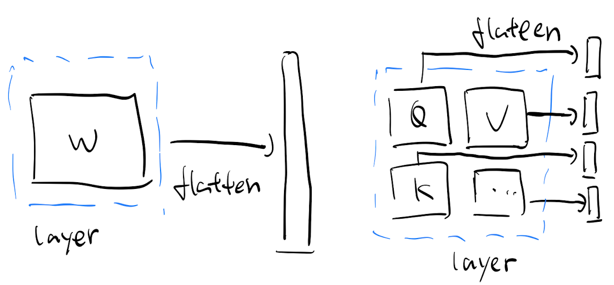
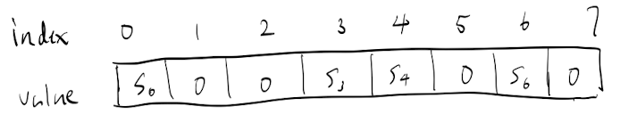
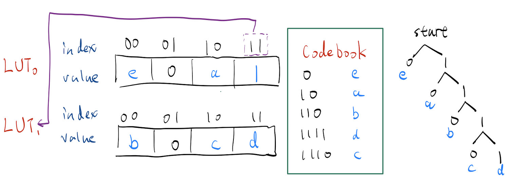
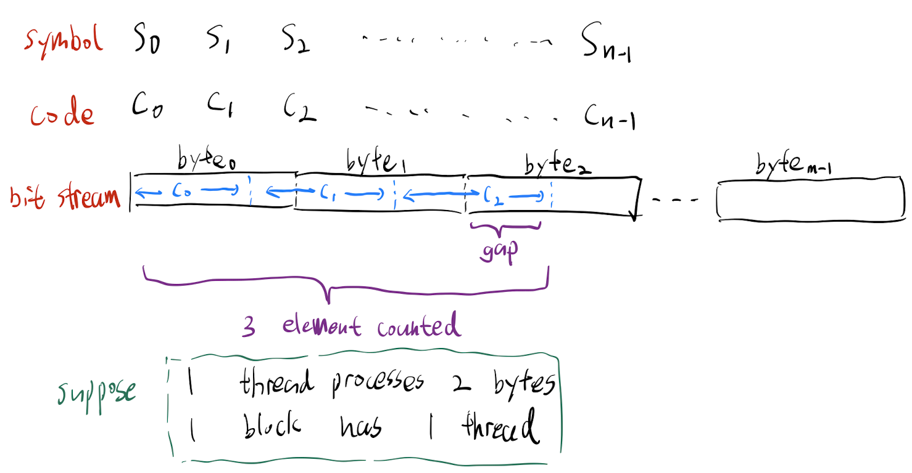
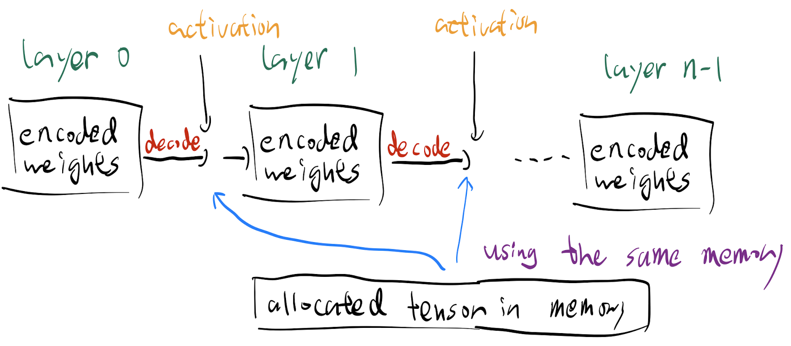
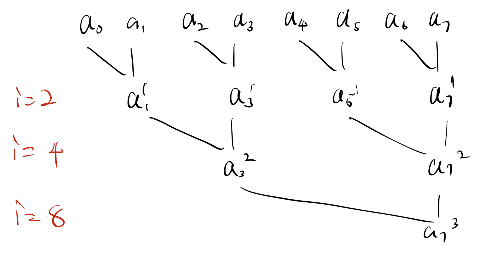
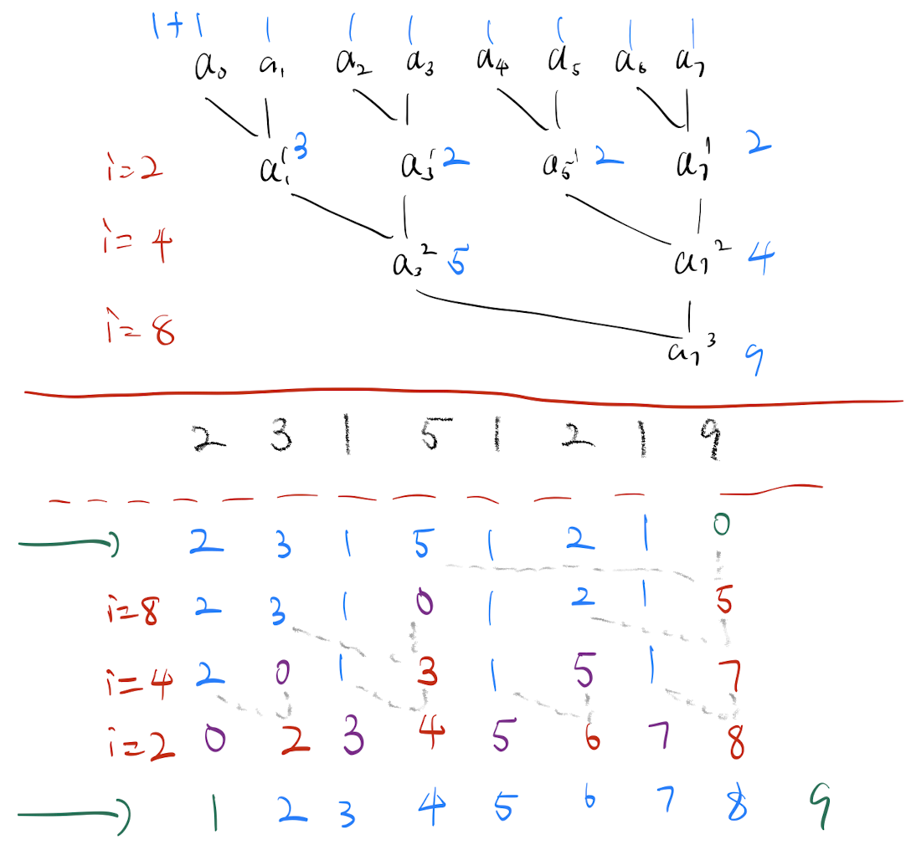
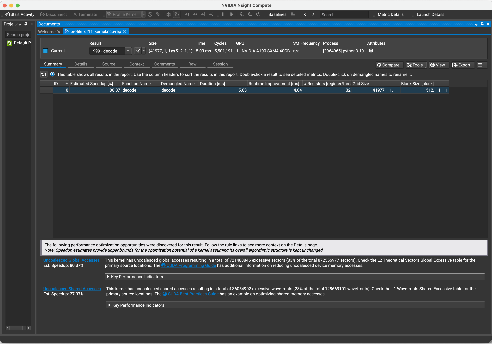
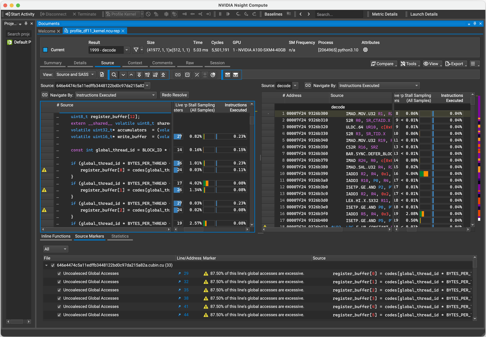

Work in submission by Zeyu Yang et al. (2025).

<!-- truncate -->

## Huffman Coding

Huffman coding is a lossless data compression algorithm that assign variable-length codes to input symbols, with more frequent symbols having shorter codes.

Key features:

- **Prefix-free codes.** The codes assigned to symbols are prefix-free, meaning no code is a prefix of any other code. This property is crucial for correct decoding, as it ensures that the decoder can uniquely identify the end of each symbol code in the compressed bitstream.
- **Huffman tree.** The algorithm builds a binary tree structure, called a Huffman tree, where the path from the root to a leaf node represents the code for that symbol.
- **Optimal encoding.** The average code length is equal to the entropy of the symbols in the dataset.

How it works:

1. **Frequency analysis.** Determine the frequency of each symbol in the dataset.
1. **Tree construction.**
   1. Start with a collection of nodes, each representing a symbol and its frequency.
   1. Repeatedly combine the two nodes with the lowest frequencies to form a new node. The new node's frequency is the sum of the two combined nodes' frequencies.
   1. The two original nodes become the left and right children of the new node.
   1. Add the new internal node back into the collection.
   1. Repeat until there is only one node (the root of the Huffman tree) remains.
1. **Code assignment.** Traverse the tree from the root to each leaf (symbol) node. Assign 0 to the left branches and 1 to the right branches. This creates the unique prefix-free Huffman codes for each symbol.

<iframe width="100%" height="400" src="https://www.youtube.com/embed/B3y0RsVCyrw" title="YouTube video player" frameborder="0" allow="accelerometer; autoplay; clipboard-write; encrypted-media; gyroscope; picture-in-picture; web-share" referrerpolicy="strict-origin-when-cross-origin" allowfullscreen></iframe>

## Implementation of Dynamic Floats

This section presents a GPU-accelerated implementation of Huffman coding, specifically focusing on its application in creating dynamic floats for efficient memory usage. We'll cover three key aspects:

- **Encoding.** How to efficiently encode data using Huffman coding.
- **Decoding.** Techniques for fast, CUDA-accelerated decompression.
- **Tensor management.** Practical applications in reducing memory footprint for neural network inference through decompression on-the-fly and tensor management.

### Encoding

In the context of dynamic floats, encoding is the process of converting the original weights (in formats such as `bfloat16` or `float8`) into an exact and compact representation with Huffman coding.

:::caution Motivation

The key motivation is that the exponents of weights in pre-trained deep learning models have a very skewed distribution thus have low entropy.

:::

:::important Why the entropy of exponents is low?

**Theorem 1.** After large-scale traning of deep learning models, the weights will follow a zero-mean Gaussian distribution.

**Theorem 2.** Given data points in the format of `float8` or `bfloat16` sampled from a zero-mean Gaussian distribution, then the entropy of the exponents converges to 2.56 regardless of the variance of the distribution.

:::

However, `float8` has 4 exponent bits and `bfloat16` has 8 exponent bits, both of which are much higher than the entropy 2.56 of the exponents of normal-distributed weights in pre-trained deep learning models. Therefore, we can utilize a lossless compression algorithm, Huffman coding in this blog, to compress the exponents of weights.

Since the model inference runs on the GPU, we need to ensure that the compressed weights are compatible with CUDA operations and memory access patterns. This requires careful consideration of several factors during the encoding process. In a high-level view, the encoding process is as follows:

1. **Computing Huffman codes.** The Huffman codes are the compact and exact representation of the exponents of weights.
1. **Getting lookup tables.** The lookup tables store the mapping from the Huffman codes to the exponents of weights, and the length of the Huffman codes for each possible symbol.
1. **Encoding and recording gaps and output positions.** The gaps are related to variable-length decoding on GPU which will be discussed later, and the output positions, on the other hand, specify where decompressed weights should be written during the decoding process.

#### Computing Huffman codes

For our implementation example, we'll use the meta-llama/Llama-3.1-8B-Instruct model in `bfloat16` format. This large language model (LLM) has a standard transformer architecture with three main components, including an embedding layer at the input, 32 transformer layers in the middle, and an output layer at the end. These components are connected sequentially to form the complete model.

We employ a layer-wise compression strategy, where we treat the weights of each layer as an independent unit for both compression and decompression. If the layer does not have any sub-layers, then we direcly flatten the weights of the layer into a 1D vector. If the layer has sub-layers, then we flatten the weights of all the sub-layers, and then concatenate them into a 1D vector, with the split positions determined by the number of parameters in each sub-layer.



Then the next step is to extract the exponents of the weights, count the frequency of each possible exponent, and then build the Huffman tree. The following code snippet shows how to do this with `HuffmanCodec` from the `dahuffman` [package](https://github.com/soxofaan/dahuffman).

<details>
<summary>Code for `get_codec()`</summary>

```python
def get_codec(weight):
    """Get the Huffman codes and frequency counts given a weight tensor.

    Args:
        weight: A tensor in `bfloat16` format.

    Returns:
        codec: A `HuffmanCodec` object.
        counter: A dictionary mapping each exponent to its frequency.
    """
    counter = {}
    W = weight.view(torch.int16)

    # Extract the exponent of the weights
    exponent_8bits = (W >> 7) & 0xFF

    # Count the frequency of each possible exponent
    vals, freqs = torch.unique(exponent_8bits, return_counts=True)
    for v, f in zip(vals.tolist(), freqs.tolist()):
        counter[v] = f

    # Build the Huffman tree
    codec = HuffmanCodec.from_frequencies(counter)

    # Return the Huffman codes and the frequency of each exponent
    return codec, counter
```

</details>

After calling the `get_codec` function above on the weights of a transformer layer, we will get the Huffman codes like this:

<details>
<summary>Output of `get_codec()`</summary>

```text
Bits Code                              Value Symbol
   2 00                                    0 119
   2 01                                    1 121
   3 100                                   4 118
   5 10100                                20 116
   6 101010                               42 115
   7 1010110                              86 114
   8 10101110                            174 113
   9 101011110                           350 112
  11 10101111100                        1404 110
  12 101011111010                       2810 109
  13 1010111110110                      5622 108
  14 10101111101110                    11246 107
  17 10101111101111000                 89976 104
  18 101011111011110010               179954 103
  19 1010111110111100110              359910 102
  20 10101111101111001110             719822 101
  21 101011111011110011110           1439646 100
  23 10101111101111001111100         5758588 98
  24 101011111011110011111010       11517178 97
  28 1010111110111100111110110000  184274864 93
  29 10101111101111001111101100010 368549730 _EOF
  29 10101111101111001111101100011 368549731 92
  27 101011111011110011111011001    92137433 94
  26 10101111101111001111101101     46068717 95
  25 1010111110111100111110111      23034359 96
  23 10101111101111001111110         5758590 125
  23 10101111101111001111111         5758591 99
  16 1010111110111101                  44989 105
  16 1010111110111110                  44990 124
  16 1010111110111111                  44991 106
  11 10101111110                        1406 123
  11 10101111111                        1407 111
   5 10110                                22 122
   5 10111                                23 117
   2 11                                    3 120
```

</details>

For GPU decoding, we need to limit Huffman codes to 32 bits (chosen empirically, 16 bits for `float8`). The challenge is that Huffman coding naturally assigns longer codes to less frequent symbols. This happens because the algorithm maintains the prefix property (no code can be a prefix of another) and as more symbols are added, the coding tree grows deeper. Rare symbols end up with very long codes. To solve this, we can modify the frequencies of the least common symbols to make them equally likely, and they will get codes of the same length. This creates a more balanced tree and prevents codes from exceeding 32 bits. While this slightly reduces compression efficiency, it's necessary for GPU compatibility. The following code snippet shows how to do this given a frequency counter.

<details>
<summary>Code for `get_32bit_codec()`</summary>

```python
def get_32bit_codec(counter):
    codec = HuffmanCodec.from_frequencies(counter)
    table = codec.get_code_table()
    max_len = 0
    for _, (l, _) in table.items():
        max_len = max(max_len, l)

    compressed_codec = codec
    compressed_counter = counter

    min_k = 2
    freq = np.array(list(counter.values()))
    while max_len > 32:
        min_indices = np.argpartition(freq, min_k)[:min_k]
        min_k += 1
        min_keys = np.array(list(counter.keys()))[min_indices]

        compressed_counter = copy(counter)
        for k in min_keys:
            compressed_counter[k] = 1
        compressed_codec = HuffmanCodec.from_frequencies(compressed_counter)
        table = compressed_codec.get_code_table()
        max_len = 0
        for _, (l, _) in table.items():
            max_len = max(max_len, l)

        print(min_k - 1, max_len)

    return compressed_codec, compressed_counter, table
```

</details>

Congradulations! We have successfully computed the Huffman codes and the frequency counts for the exponents of weights in a transformer layer. The next step is to use lookup tables to store the mapping from the Huffman codes to the exponents of weights as well as the length of the Huffman codes for each possible symbol.

#### Getting lookup tables

After computing the Huffman codes, we create a mapping between the codes and their corresponding exponents. To efficiently use this mapping during decoding, we need to build two lookup tables: one that stores the mapping from Huffman codes to exponents, and another that records the length of each code.

Let's define the structure of our lookup tables. Each table maps a Huffman code (key) to its corresponding exponent (value). Both the Huffman code and exponent are stored as binary strings, which can be converted to decimal values. The key is the Huffman code's decimal representation, and the value is the exponent's decimal representation. Therefore, we can declare an array and use its index as the Huffman code and the value as the symbol. If the longest Huffman code is 8 bits, then the array should be 256 elements long. For `bfloat16` data, the exponent is 8 bits wide, so we can store it as an `int8` value in our lookup table.

:::note FP8

In `float8` weights, the exponent is 4 bits wide, so we can store it as an `int4` value in our lookup table.

:::

Let's use a simple example with 3-bit Huffman codes. This creates a lookup table with 8 elements (2^3). Suppose we have 4 symbols, only 4 entries contain actual values while the remaining entries are set to 0. The GPU can use this array to decode the Huffman codes by looking up the corresponding exponent for each code in the bit stream.



**However, the lookup table size grows exponentially with the Huffman code length.** For instance, with 32-bit codes, the table would need 2^32 elements (over 4 billion entries), which is far too large for GPU shared memory. We can solve this using **trees of lookup tables**, where each table handles 8 bits (1 byte) of the Huffman code. **Note that the prefix-free property of Huffman codes ensures that the cascaded lookup tables are able to decode the Huffman codes correctly.** This approach is efficient because each table has 256 (2^8) entries, making it manageable for GPU memory and byte-level operations are hardware-optimized. In addition, the cascaded lookup tables align perfectly with our 32-bit (4-byte) Huffman code limit (as earlier in the encoding process we limit the Huffman code length to 32 bits, a multiple of 8).

Here we examine the structure of the tree of lookup tables. There are two scenarios based on the Huffman code length:

1. The code length is less than or equal to 8 bits. In this case, the first lookup table can directly map the Huffman code to the exponent.
1. For codes longer than 8 bits, we use multiple lookup tables as a tree where each table handles 8 bits of the code. This creates a chain of lookups until we reach the final table that contains the actual exponent value.

To illustrate this process, please refer to the following figure using 4-bit Huffman codes and trees of 2-bit lookup tables. The Huffman tree is generated from inputing `aaabbcddeeeee` to this [online Huffman calculator](https://huffman-coding-online.vercel.app/).



As we can see from the figure above, the code for `e` and `a` is no longer than 2 bits so the symbol is in the first lookup table. By contrast, the code for `b`, `d`, and `e` is longer than 2 bits and starts with `11`, so the index `11` in the first lookup table will point to another lookup table representing codes starting with `11`. And the index of the lookup table is `1` so that the value at the index `11` in the first lookup table is `1`. After locating the right lookup table (for codes starting with `11`), we will do another lookup to decode the symbol.

Following the same logic, this tree of lookup tables can be generalized to longer Huffman codes. For `bfloat16` data with 8-bit exponents, we need 4 8-bit lookup tables, each with 256 entries, and we constraint the longest Huffman code to 32 bits. Now we have the tree of lookup tables for the Huffman codes, and they are saved in the format of a list of 1D arrays, where the index of the list corresponds to the lookup table responsible for a specific prefix of the Huffman code.

Lastly, we also append the length of the Huffman codes for each symbol in the last row of the lookup table. The last row is indexed by the decimal value of the symbol (8-bit exponent for `bfloat16` data), and valued by the length of the Huffman code for that symbol.

The following code snippet demonstrates how to construct these lookup tables from the generated Huffman codes.

<details>
<summary>Code for `get_luts()`</summary>

```python
def get_luts(table):
    prefixes = ['']

    for key, (bits, val) in table.items():
        if isinstance(key, int):
            prefix = bin(val)[2:].rjust(bits, "0")[:((bits - 1) // 8 * 8)]
            if prefix not in prefixes:
                prefixes.append(prefix)

    prefixes.sort(key=len)

    luts = np.zeros((len(prefixes), 256), dtype=np.uint8)

    for pi, p in enumerate(prefixes):
        bytes_dict = {}
        pl = len(p) // 8
        for key, (bits, val) in table.items():
            if isinstance(key, int):
                bin_val = bin(val)[2:].rjust(bits, '0')

                if bin_val.startswith(p):
                    if (bits - 1) // 8 == pl:
                        dict_key = int(bin_val[(pl * 8):].ljust(8, '0'), 2)
                        dict_value = key
                    else:
                        dict_key = int(bin_val[(pl * 8):(pl * 8 + 8)], 2)
                        dict_value = 256 - prefixes.index(bin_val[:(pl * 8 + 8)])

                    if dict_key in bytes_dict and bytes_dict[dict_key] != dict_value:
                        raise ValueError(f"Key {dict_key} already exists in {bytes_dict}")
                    else:
                        bytes_dict[dict_key] = dict_value

        print(bytes_dict)

        for i in range(256):
            if i in bytes_dict:
                curr_val = bytes_dict[i]
            luts[pi, i] = curr_val

    lens = np.zeros((1, 256), dtype=np.uint8)
    for key, (bits, val) in table.items():
        if isinstance(key, int):
            lens[-1, key] = bits

    return torch.from_numpy(
        np.concatenate((luts, lens), axis=0)
    )
```

</details>

<details>
<summary>Code for `get_luts()` with comments</summary>

```python
def get_luts(table):
    prefixes = ['']

    for symbol, (bits, decimal_val) in table.items():
        # Ignore the `_EOF` symbol
        if not isinstance(symbol, int):
            continue

        # `rjust` is used to pad 0s to the left of the string to make the string the 8-bit long
        binary_val = bin(decimal_val)[2:].rjust(bits, '0')

        # The prefix is n bytes long where n = (bits - 1) // 8
        prefix_len = (bits - 1) - (bits - 1) % 8
        prefix = binary_val[:prefix_len]
        print(f'bits: {bits:3d} | binary: {bin(decimal_val):>15} | decimal: {decimal_val:4d} | '
            f'padded binary: {binary_val:>15} | prefix: {prefix:>8}')

        if prefix not in prefixes:
            prefixes.append(prefix)

    prefixes.sort(key=len)
    print()
    print(f'prefixes: {prefixes}')
    print()

    # Initialize a lookup table where each row corresponds to a prefix
    luts = np.zeros((len(prefixes), 2 ** 8), dtype=np.uint8)

    # Iterate over each prefix to fill the lookup table
    for prefix_idx, prefix in enumerate(prefixes):
        bytes_dict = {}
        prefix_n_bytes = len(prefix) // 8
        prefix_n_bits = prefix_n_bytes * 8

        # Iterate over each code in the Huffman tree
        for symbol, (bits, decimal_val) in table.items():
            # Ignore the `_EOF` symbol
            if not isinstance(symbol, int):
                continue

            # If the code starts with the current prefix, then there are two cases
            binary_val = bin(decimal_val)[2:].rjust(bits, '0')
            if binary_val.startswith(prefix):
                # Case 1: When the first `prefix_n_bytes` bits of the code are the same as the prefix
                # time to map the code to the symbol
                if (bits - 1) // 8 == prefix_n_bytes:
                    # The suffix is the remaining bits after the prefix
                    # `ljust` is used to pad 0s to the right of the string to make the string the 8-bit long
                    suffix = binary_val[prefix_n_bits:]
                    padded_suffix = suffix.ljust(8, '0')
                    padded_suffix_int = int(padded_suffix, 2)

                    dict_key = padded_suffix_int
                    dict_value = symbol

                    print(f'prefix: {prefix:>8} | binary: {binary_val:>17} | suffix: {suffix:>8} | padded suffix: {padded_suffix:>8} | padded suffix int: {padded_suffix_int:>3d}')

                # Case 2: When the current prefix is a subset of the first n bytes of the code, and that n > `prefix_n_bytes`
                # map the next byte in the code to the longer prefix
                else:
                    assert (bits - 1) // 8 > prefix_n_bytes
                    next_byte = binary_val[prefix_n_bits:prefix_n_bits + 8]
                    next_byte_int = int(next_byte, 2)

                    # NOTE: due to the nature of the Huffman coding, if the current prefix is a subset of the first n bytes of the code,
                    # then the current prefix including the next byte MUST be in the prefixes list
                    prefix_and_next_byte = binary_val[:prefix_n_bits + 8]
                    prefix_next_byte_index = prefixes.index(prefix_and_next_byte)

                    dict_key = next_byte_int
                    dict_value = 2 ** 8 - prefix_next_byte_index

                    print(f'index: {prefix_next_byte_index}')
                    print(f'prefix: {prefix:>8} | binary: {binary_val:>17} | next byte: {next_byte:>8} | next byte int: {next_byte_int:>3d}')

                # Make sure that the mappings in case 1 and case 2 have no duplicates
                if dict_key in bytes_dict and bytes_dict[dict_key] != dict_value:
                    raise ValueError(f'Key {dict_key} already exists in {bytes_dict}')
                else:
                    bytes_dict[dict_key] = dict_value

        print(bytes_dict)

        for byte_node_int in range(2 ** 8):
            # `byte_node_int` could be either a suffix or a byte in the prefix
            if byte_node_int in bytes_dict:
                curr_val = bytes_dict[byte_node_int]
                luts[prefix_idx, byte_node_int] = curr_val

    # The last row of `luts` is the length of binary code for each symbol
    lens = np.zeros((1, 2 ** 8), dtype=np.uint8)
    for symbol, (bits, decimal_val) in table.items():
        if isinstance(symbol, int):
            lens[-1, symbol] = bits

    print(lens)

    # In summary, `luts` is a 2D array of shape `(len(prefixes) + 1, 256)`
    # Each row corresponds to a prefix, and the last row corresponds to the length of binary code for each possible symbol
    luts = torch.from_numpy(np.concatenate((luts, lens), axis=0))
    return luts
```

</details>

#### Encoding and recording gaps and output positions

Now we have lookup tables in 2D matrix format to save the sufficient information about the Huffman codes and bit length for each symbol. The next step is to encode the exponents of weights into bit stream.

A key point to notice is that we are going to do parallel decoding on GPU, that is, each thread block will be in charge of decoding a subset of the weights, and a thread block consists of a number of threads. As a result, a block needs to know the start and end position of the weights it writes, and a thread needs to know the position of the weights it writes as well. As an example to illustrate the concept, let's consider a thread block with only 1 thread, and each thread processes 2 bytes.



Let's think about how to coordinate data.

- **Block-level.** Since we know the threads per block and bytes per thread, we can then compute bits per block. Then according to the bits per block and the bit stream of the Huffman codes, we can compute how many elements are encoded in a thread block.
- **Thread-level.** By default, given a fixed number (let's say 2) of bytes as input, the thread should read from the beginning of the input. However, as shown in the figure, `c2` spans both `byte1` and `byte2`. That says:
  - The first a few bits in `byte2` should be used by the previous thread for decoding, and the next thread needs to skip those bits.
  - The current thread should look ahead by some bytes to ensure the decoding is complete. For example, if we set a thread to be in charge of 2 bytes, and the longest Huffman code is 8 bits, then the current thread should look ahead by 1 byte to ensure the decoding is complete even in the worst case, where the last symbol begins at the end of `byte2` and has the longest Huffman code with 8 bits.

Great! Now every thread block knows how many elements it should decode, and every thread knows where to start reading the bit stream given a number of bytes and the gap.

After writing all the encoded data to bytes, we can know the total number of bytes to be decoded. Since we know threads per block and bytes per thread, we can compute how many bytes a thread block will handle, and the compute the number of thread blocks needed. Note that we ceil the number of thread blocks to ensure that they can handle all the data, but as a result, some threads in the last thread block will be idle.

```python
blocks_per_grid = int(np.ceil(n_bytes_total / (threads_per_block * bytes_per_thread)))
```

Finnaly, we will have the following coming from the encoding process:

- The encoded bit stream (byte by byte).
- The gap array (at most 32 as we specified for `bfloat16` data, saved as a 5-bit binary stream) for every individual thread in the grid. The gap array consisting of binary streams is packed compactly into bytes.
- The output positions array (saved as a 32-bit unsigned integer array) for every thread block in the grid.

:::info GPU architecture

A GPU has a grid of thread blocks, and each thread block has a number of threads.

Every thread block has a fast shared memory. The shared memory is shared by all threads in the block, and it is much faster than the global memory.

:::

The following code snippet shows how to encode the exponents of weights into bit stream.

<details>
<summary>Code for `encode()`</summary>

```python
def encode(data, codec, bytes_per_thread, threads_per_block):
    """
    Encode given data in streaming fashion.

    :param data: sequence of symbols (e.g. byte string, unicode string, list, iterator)
    :return: generator of bytes
    """
    encoded = []

    gaps = []
    output_positions = []

    # Buffer value and size
    buffer = 0
    size = 0
    total_size = 0
    element_count = 0
    for s in tqdm(data):
        if total_size // (8 * bytes_per_thread) + 1 > len(gaps):
            gaps.append(total_size - total_size // (8 * bytes_per_thread) * (8 * bytes_per_thread))

        if total_size // (8 * bytes_per_thread * threads_per_block) + 1 > len(output_positions):
            output_positions.append(element_count)

        # TODO: raise custom EncodeException instead of KeyError?
        b, v = codec._table[s]
        # Shift new bits in the buffer
        buffer = (buffer << b) + v
        size += b
        total_size += b
        element_count += 1
        while size >= 8:
            byte = buffer >> (size - 8)
            encoded.append(byte)
            buffer = buffer - (byte << (size - 8))
            size -= 8

    # Handling of the final sub-byte chunk.
    # The end of the encoded bit stream does not align necessarily with byte boundaries,
    # so we need an "end of file" indicator symbol (_EOF) to guard against decoding
    # the non-data trailing bits of the last byte.
    # As an optimization however, while encoding _EOF, it is only necessary to encode up to
    # the end of the current byte and cut off there.
    # No new byte has to be started for the remainder, saving us one (or more) output bytes.
    if size > 0:
        if total_size // (8 * bytes_per_thread) + 1 > len(gaps):
            gaps.append(total_size - total_size // (8 * bytes_per_thread) * (8 * bytes_per_thread))

        if total_size // (8 * bytes_per_thread * threads_per_block) + 1 > len(output_positions):
            output_positions.append(element_count)

        b, v = codec._table[codec._eof]
        buffer = (buffer << b) + v
        size += b
        if size >= 8:
            byte = buffer >> (size - 8)
        else:
            byte = buffer << (8 - size)
        encoded.append(byte)

    output_positions.append(len(data))

    blocks_per_grid = int(np.ceil(len(encoded) / (threads_per_block * bytes_per_thread)))

    gaps.extend([0] * (threads_per_block * blocks_per_grid - len(gaps)))
    binary_str_gaps = [format(gap, '05b') for gap in gaps]
    binary_gaps = [int(bit) for binary in binary_str_gaps for bit in binary]

    return np.frombuffer(bytes(encoded), dtype=np.uint8), np.packbits(binary_gaps), np.array(output_positions, dtype=np.uint32)
```

</details>

<details>
<summary>Code for `encode()` with comments</summary>

```python
def encode(exponents_lst, codec, bytes_per_thread=8, threads_per_block=512):
    bits_per_thread = 8 * bytes_per_thread
    bits_per_block = bits_per_thread * threads_per_block
    encoded = []
    gaps = []
    output_positions = []

    # Python int is 64 bits
    buffer = 0
    size = 0
    total_size = 0
    element_count = 0
    for symbol in tqdm(exponents_lst):
        # Record the gaps for each thread, where gaps are the number of unaligned bits coming from the previous thread
        # `total_size // bits_per_thread` is the number of threads that have already encoded data
        # `+ 1` is to account for the current thread
        # So `total_size // bits_per_thread + 1` is the index of the current thread
        if total_size // bits_per_thread + 1 > len(gaps):
            # `gap` represents the number of unaligned bits coming from the previous thread
            # See the example below (if `bits_per_thread` is 8):
            # total size: 0 | gap: 0
            # total size: 8 | gap: 0
            # total size: 17 | gap: 1
            # total size: 24 | gap: 0
            gap = total_size % bits_per_thread
            gaps.append(gap)
            print(f'total size: {total_size} | gap: {gap}')

        # Record the output positions for each block, where output positions are the number of elements that have been encoded,
        # so that during decoding, we can know where to write the decoded data
        if total_size // bits_per_block + 1 > len(output_positions):
            output_positions.append(element_count)

        bits, decimal_val = codec._table[symbol]
        print(f'symbol: {symbol} | bits: {bits} | code int: {decimal_val}')

        # Shift code bits for the current symbol into the buffer at the rightmost position
        buffer = (buffer << bits) + decimal_val
        print(f'buffer binary: {bin(buffer)}')

        # Update the size of the buffer and the number of encoded elements
        size += bits
        total_size += bits
        element_count += 1

        # When the buffer is larger than 8 bits, extract the leftmost 8 bits
        # from the buffer and write it to the encoded list
        while size >= 8:
            # Extract the leftmost 8 bits from the buffer
            byte = buffer >> (size - 8)
            print(f'byte binary: {bin(byte)}')

            # Write the extracted byte to the encoded list
            encoded.append(byte)

            # Remove the leftmost 8 bits from the buffer
            buffer = buffer - (byte << (size - 8))
            size -= 8

    # Handling of the final sub-byte chunk
    # The encoded bit stream may not align with byte boundaries at the end
    # We need an EOF marker to prevent the decoder from interpreting the remaining bits as valid data
    # However, we only need to encode up to the current byte boundary
    # since the decoder knows it's the end of data, saving us from creating a new byte for the `_EOF` symbol
    if size > 8:
        if total_size // (8 * bytes_per_thread) + 1 > len(gaps):
            gap = total_size % bits_per_thread
            gaps.append(gap)

        if total_size // bits_per_block + 1 > len(output_positions):
            output_positions.append(element_count)

        bit, decimal_val = codec._table[codec._eof]
        # Shift the EOF bits into the buffer (including the remaining bits) at the rightmost position
        buffer = (buffer << bit) + decimal_val
        size += bit
        # If the buffer is larger than 8 bits, extract the leftmost 8 bits from the buffer
        # The leftmost 8 bits are the remaining bits for the encoded data and some bits of the EOF symbol
        if size >= 8:
            byte = buffer >> (size - 8)
        # If the buffer is smaller than 8 bits, shift the remaining bits to the left
        # But actually this case should never happen because the bit length of the EOF symbol is quite large in most cases
        else:
            byte = buffer << (8 - size)
        encoded.append(byte)

    # The last position marks the total length of the input data
    # Helps locate the output positions of the last block
    output_positions.append(len(exponents_lst))

    # Compute the number of blocks needed to decode the encoded data
    # Total number of bytes divided by the number of bytes per block
    # `np.ceil` is used to round up to the nearest integer
    # As a result, some threads in the last block could not be used
    # and those unused threads do not have gaps marked since we only mark gaps for threads that encode data
    n_bytes_total = len(encoded)
    blocks_per_grid = int(np.ceil(n_bytes_total / (threads_per_block * bytes_per_thread)))

    # Pads the gaps array with 0s to ensure it has the correct length for all threads
    n_used_threads = len(gaps)
    n_unused_threads = blocks_per_grid * threads_per_block - n_used_threads
    gaps.extend([0] * n_unused_threads)
    # The maximum possible number of bits for a symbol is 16 which is 2 ** 4
    # So the maximum number of bits for a gap is 4,
    # and it happens when a 16-bit code placed at the end of a thread
    binary_str_gaps = [format(gap, '04b') for gap in gaps]
    binary_gaps = [int(bit) for binary in binary_str_gaps for bit in binary]

    # Convert the encoded data to a numpy array
    # `bytes(encoded)` converts the list of bytes to a bytes object
    # `np.frombuffer` converts the bytes object to a numpy array,
    # Use `np.array(encoded, dtype=np.uint8)` would also work,
    # but it creates a new array by copying the data, converts each element individually
    # so it has more memory overhead and is slower for large data
    np_encoded = np.frombuffer(bytes(encoded), dtype=np.uint8)

    # `np.packbits` packs the binary gaps into a single array
    packed_binary_gaps = np.packbits(binary_gaps)

    # Convert the output positions to a numpy array
    output_positions = np.array(output_positions, dtype=np.uint32)

    return np_encoded, packed_binary_gaps, output_positions
```

</details>

:::danger Milestone

We have finished the encoding process and get all the information we need to decode the data from the bit stream.

- Blocks per grid.
- Threads per block.
- The lookup tables $\rightarrow$ Huffman codes and bit length for each symbol.
- The encoded bit stream $\rightarrow$ Encoded exponents of data.
- The other bits of the data except the exponents.
- The gap array $\rightarrow$ Gap for each thread in the grid.
- The output positions array $\rightarrow$ Output position for each thread block in the grid.
- The number of lookup tables.
- The total number of bytes to be decoded.
- The total number of elements in the data.

And we can precisely compute the size of shared memory needed for the decoding process based on the above information.

:::

### Decoding

Decoding is done in parallel on GPU. Each thread block will be in charge of decoding a subset of the data, and a thread block consists of a number of threads, where each thread is responsible for decoding a number of bytes in the encoded bit stream. We will explain this when we explain the CUDA kernel for decoding.

### Tensor Management

During model inference, we decode the weights from their encoded bit stream. For sequentially connected layers, we use a hook that triggers before each forward pass. This hook decodes the encoded weights back to their original form and stores them at a specific GPU memory location. As we move to the next layer, we repeat this process, decoding its weights and storing them at the same memory address as the previous layer. The process is illustrated in the figure below.



## CUDA Kernel for Decoding

In this section, we will explain the CUDA kernel for decoding in a really beginner-friendly way.

<details>
<summary>Code for `decode()` in CUDA</summary>

```cpp
#define THREAD_ID           threadIdx.x
#define BLOCK_ID            blockIdx.x
#define N_THREADS           blockDim.x
#define BYTES_PER_THREAD    8

typedef unsigned char       uint8_t;
typedef unsigned short      uint16_t;
typedef unsigned int        uint32_t;
typedef unsigned long long  uint64_t;

extern "C"
__global__ void decode(
    const uint8_t * __restrict__    luts,               // (n_luts, 256)
    const uint8_t * __restrict__    codes,              // (n_bytes, )
    const uint8_t * __restrict__    sign_mantissa,      // (n_elements, )
    const uint32_t * __restrict__   position_offsets,   // one entry per thread block
    const uint8_t * __restrict__    gaps,               // one entry per thread
    uint16_t * __restrict__         outputs,            // (n_elements, )
    const int n_luts, const int n_bytes, const int n_elements
) {
    uint8_t register_buffer[12];
    extern __shared__ volatile uint8_t shared_mem[];
    volatile uint32_t* accumulators  = (volatile uint32_t*) shared_mem;
    volatile uint16_t* write_buffer  = (volatile uint16_t*) (shared_mem + N_THREADS * 4 + 4);

    const int global_thread_id = BLOCK_ID * N_THREADS + THREAD_ID;

    // Load data from global memory to register buffer
    if (global_thread_id * BYTES_PER_THREAD < n_bytes) {
        register_buffer[0] = codes[global_thread_id * BYTES_PER_THREAD];
    }
    if (global_thread_id * BYTES_PER_THREAD + 1 < n_bytes) {
        register_buffer[1] = codes[global_thread_id * BYTES_PER_THREAD + 1];
    }
    if (global_thread_id * BYTES_PER_THREAD + 2 < n_bytes) {
        register_buffer[2] = codes[global_thread_id * BYTES_PER_THREAD + 2];
    }
    if (global_thread_id * BYTES_PER_THREAD + 3 < n_bytes) {
        register_buffer[3] = codes[global_thread_id * BYTES_PER_THREAD + 3];
    }
    if (global_thread_id * BYTES_PER_THREAD + 4 < n_bytes) {
        register_buffer[4] = codes[global_thread_id * BYTES_PER_THREAD + 4];
    }
    if (global_thread_id * BYTES_PER_THREAD + 5 < n_bytes) {
        register_buffer[5] = codes[global_thread_id * BYTES_PER_THREAD + 5];
    }
    if (global_thread_id * BYTES_PER_THREAD + 6 < n_bytes) {
        register_buffer[6] = codes[global_thread_id * BYTES_PER_THREAD + 6];
    }
    if (global_thread_id * BYTES_PER_THREAD + 7 < n_bytes) {
        register_buffer[7] = codes[global_thread_id * BYTES_PER_THREAD + 7];
    }
    if (global_thread_id * BYTES_PER_THREAD + 8 < n_bytes) {
        register_buffer[8] = codes[global_thread_id * BYTES_PER_THREAD + 8];
    }
    if (global_thread_id * BYTES_PER_THREAD + 9 < n_bytes) {
        register_buffer[9] = codes[global_thread_id * BYTES_PER_THREAD + 9];
    }
    if (global_thread_id * BYTES_PER_THREAD + 10 < n_bytes) {
        register_buffer[10] = codes[global_thread_id * BYTES_PER_THREAD + 10];
    }
    if (global_thread_id * BYTES_PER_THREAD + 11 < n_bytes) {
        register_buffer[11] = codes[global_thread_id * BYTES_PER_THREAD + 11];
    }
    __syncthreads();

    // Memory views
    alignas(8) uint8_t buffer[12];
    uint64_t &long_buffer   = *reinterpret_cast<uint64_t *>(buffer);
    uint32_t &int_buffer    = *reinterpret_cast<uint32_t *>(buffer + 8);
    uint16_t &short_buffer  = *reinterpret_cast<uint16_t *>(buffer + 8);

    // Load gap for the current thread
    buffer[8] = gaps[global_thread_id * 5 / 8 + 1];
    buffer[9] = gaps[global_thread_id * 5 / 8];
    const uint8_t gap = (short_buffer >> (11 - (global_thread_id * 5 % 8))) & 0x1f;

    // Do the decoding to get the output position
    uint32_t thread_counter = 0;

    buffer[0] = register_buffer[7];
    buffer[1] = register_buffer[6];
    buffer[2] = register_buffer[5];
    buffer[3] = register_buffer[4];
    buffer[4] = register_buffer[3];
    buffer[5] = register_buffer[2];
    buffer[6] = register_buffer[1];
    buffer[7] = register_buffer[0];

    long_buffer <<= gap;
    uint8_t free_bits = gap;
    uint8_t decoded;

    while (free_bits < 32) {
        decoded = __ldg(&luts[long_buffer >> 56]);
        if (decoded >= 240) {
            decoded = __ldg(&luts[256 * (256 - decoded) + ((long_buffer >> 48) & 0xff)]);
            if (decoded >= 240) {
                decoded = __ldg(&luts[256 * (256 - decoded) + ((long_buffer >> 40) & 0xff)]);
                if (decoded >= 240) {
                    decoded = __ldg(&luts[256 * (256 - decoded) + ((long_buffer >> 32) & 0xff)]);
                }
            }
        }
        thread_counter += 1;
        decoded = __ldg(&luts[256 * (n_luts - 1) + decoded]);
        long_buffer <<= decoded;
        free_bits += decoded;
    }

    buffer[8]   = register_buffer[11];
    buffer[9]   = register_buffer[10];
    buffer[10]  = register_buffer[9];
    buffer[11]  = register_buffer[8];

    long_buffer |= static_cast<uint64_t>(int_buffer) << (free_bits - 32);
    free_bits -= 32;

    while (4 + free_bits / 8 < BYTES_PER_THREAD) {
        decoded = __ldg(&luts[long_buffer >> 56]);
        if (decoded >= 240) {
            decoded = __ldg(&luts[256 * (256 - decoded) + ((long_buffer >> 48) & 0xff)]);
            if (decoded >= 240) {
                decoded = __ldg(&luts[256 * (256 - decoded) + ((long_buffer >> 40) & 0xff)]);
                if (decoded >= 240) {
                    decoded = __ldg(&luts[256 * (256 - decoded) + ((long_buffer >> 32) & 0xff)]);
                }
            }
        }
        thread_counter += 1;
        decoded = __ldg(&luts[256 * (n_luts - 1) + decoded]);
        long_buffer <<= decoded;
        free_bits += decoded;
    }

    // Efficiently do the cumulative sum of the thread counters starts here
    if (THREAD_ID == 0) {
        accumulators[0] = position_offsets[BLOCK_ID] + thread_counter;
    } else {
        accumulators[THREAD_ID] = thread_counter;
    }
    __syncthreads();

    int i;
    for (i = 2; i <= N_THREADS; i <<= 1) {
        if (((THREAD_ID + 1) & (i - 1)) == 0) {
            accumulators[THREAD_ID] += accumulators[THREAD_ID - (i >> 1)];
        }
        __syncthreads();
    }

    if (THREAD_ID == 0) {
        accumulators[N_THREADS - 1] = 0;
    }
    __syncthreads();

    for (i = N_THREADS; i >= 2; i >>= 1) {
        if (((THREAD_ID + 1) & (i - 1)) == 0) {
            accumulators[THREAD_ID] += accumulators[THREAD_ID - (i >> 1)];
            accumulators[THREAD_ID - (i >> 1)] = accumulators[THREAD_ID] - accumulators[THREAD_ID - (i >> 1)];
        }
        __syncthreads();
    }

    if (THREAD_ID == 0) {
        accumulators[0] = position_offsets[BLOCK_ID];
        accumulators[N_THREADS] = position_offsets[BLOCK_ID+1];
    }
    __syncthreads();
    // Cumulative sum ends here

    // Get the output position of the current thread block
    uint32_t output_idx = accumulators[THREAD_ID], write_offset = accumulators[0];
    const uint32_t end_output_idx = min(output_idx + thread_counter, n_elements);

    // Now we have known the output position of the current thread block and the current thread
    // Do the decoding again and write the result to the write buffer in shared memory
    buffer[0] = register_buffer[7];
    buffer[1] = register_buffer[6];
    buffer[2] = register_buffer[5];
    buffer[3] = register_buffer[4];
    buffer[4] = register_buffer[3];
    buffer[5] = register_buffer[2];
    buffer[6] = register_buffer[1];
    buffer[7] = register_buffer[0];

    long_buffer <<= gap;
    free_bits = gap;

    while (free_bits < 32 && output_idx < end_output_idx) {
        decoded = __ldg(&luts[long_buffer >> 56]);
        if (decoded >= 240) {
            decoded = __ldg(&luts[256 * (256 - decoded) + ((long_buffer >> 48) & 0xff)]);
            if (decoded >= 240) {
                decoded = __ldg(&luts[256 * (256 - decoded) + ((long_buffer >> 40) & 0xff)]);
                if (decoded >= 240) {
                    decoded = __ldg(&luts[256 * (256 - decoded) + ((long_buffer >> 32) & 0xff)]);
                }
            }
        }

        buffer[8] = sign_mantissa[output_idx];
        buffer[9] = (buffer[8] & 128) | (decoded >> 1);
        buffer[8] = (decoded << 7) | (buffer[8] & 127);
        write_buffer[output_idx - write_offset] = short_buffer;

        output_idx += 1;
        decoded = __ldg(&luts[256 * (n_luts - 1) + decoded]);
        long_buffer <<= decoded;
        free_bits += decoded;
    }

    buffer[8]   = register_buffer[11];
    buffer[9]   = register_buffer[10];
    buffer[10]  = register_buffer[9];
    buffer[11]  = register_buffer[8];

    long_buffer |= static_cast<uint64_t>(int_buffer) << (free_bits - 32);
    free_bits -= 32;

    while (output_idx < end_output_idx) {
        decoded = __ldg(&luts[long_buffer >> 56]);
        if (decoded >= 240) {
            decoded = __ldg(&luts[256 * (256 - decoded) + ((long_buffer >> 48) & 0xff)]);
            if (decoded >= 240) {
                decoded = __ldg(&luts[256 * (256 - decoded) + ((long_buffer >> 40) & 0xff)]);
                if (decoded >= 240) {
                    decoded = __ldg(&luts[256 * (256 - decoded) + ((long_buffer >> 32) & 0xff)]);
                }
            }
        }

        buffer[8] = sign_mantissa[output_idx];
        buffer[9] = (buffer[8] & 128) | (decoded >> 1);
        buffer[8] = (decoded << 7) | (buffer[8] & 127);
        write_buffer[output_idx - write_offset] = short_buffer;

        output_idx += 1;
        decoded = __ldg(&luts[256 * (n_luts - 1) + decoded]);
        long_buffer <<= decoded;
        free_bits += decoded;
    }
    __syncthreads();

    // Write the decoding result from shared memory to global memory
    for (i = THREAD_ID; i < min(accumulators[N_THREADS] - write_offset, n_elements - write_offset); i += N_THREADS) {
        outputs[i + write_offset] = write_buffer[i];
    }
}
```

</details>

Please refer to the code above. Next we will explain the code line by line. Note that some codes in the following sections are refactored from the original code for better readability.

TODO: Please change the complete kernel above to the refactored version.

### Preliminary Setup

#### Defining macros

<details>
<summary>Code for defining macros</summary>

```cpp
#define THREAD_ID           threadIdx.x
#define BLOCK_ID            blockIdx.x
#define N_THREADS           blockDim.x
#define BYTES_PER_THREAD    8
```

</details>

Macros are preprocessor directives that define constants or functions for use throughout the code.

- `#define` tells the compiler to perform text substitution before compilation
- `THREAD_ID` is our custom macro name for better code readability
- `threadIdx.x` is the actual CUDA variable that provides each thread's unique identifier

In CUDA programming, parallel execution on the GPU requires each thread to know its position. The key identifiers are:

- `threadIdx.x`: Thread's ID within its block
- `blockIdx.x`: Block's ID
- `blockDim.x`: Number of threads per block

We also define `BYTES_PER_THREAD` to be 8, which means each thread will process 8 bytes of data.

#### Creating type aliases

<details>
<summary>Code for creating type aliases</summary>

```cpp
typedef unsigned char       uint8_t;
typedef unsigned short      uint16_t;
typedef unsigned int        uint32_t;
typedef unsigned long long  uint64_t;
```

</details>

Type aliases are a way to give a nickname to a data type.

- `typedef` is a keyword that tells the compiler we're creating a new name for an existing type.
- `unsigned char` is the original type. An `unsigned char` is a data type that can store numbers from 0 to 255 (8 bits of data). The "unsigned" means it can only store positive numbers.
- `uint8_t` is the new name we're giving to `unsigned char`.

Similarly, `uint16_t`, `uint32_t`, and `uint64_t` are type aliases for `unsigned short`, `unsigned int`, and `unsigned long long` respectively.

#### C-style linkage

<details>
<summary>Code for C-style linkage</summary>

```cpp
extern "C"
```

</details>

The `extern "C"` keyword is used to tell the compiler that the function should be compiled using C-style linkage. This is important because CUDA uses a C-compatible calling convention. - **Name mangling.** C++ compilers typically "mangle" (modify) function names to support features like function overloading. C compilers don't do this name mangling. `extern "C"` tells the compiler to use the original function name without any modifications. - **Linking compatibility.** This makes the function callable from both C and C++ code. It's particularly important in CUDA because the GPU code needs to be callable from both C and C++ host code. - **Why it's used in this CUDA file.** The `decode` function in this file is a CUDA kernel that needs to be called from the host (CPU) code. Using `extern "C"` ensures that the function can be called from any C or C++ code without naming conflicts. This is especially important for CUDA programs where you often mix C++ host code with CUDA device code.

### Kernel Declaration

#### Declaring the kernel function

<details>
<summary>Code for declaring the kernel function</summary>

```cpp
__global__ void decode(
    const uint8_t* __restrict__  luts,             // (n_luts, 256)
    const uint8_t* __restrict__  encoded,          // (n_bytes,)
    const uint8_t* __restrict__  sign_mantissa,    // (n_elements,)
    const uint32_t* __restrict__ output_positions, // one entry per block
    const uint8_t* __restrict__  gaps,             // one entry per thread
    uint8_t* __restrict__        output,           // (n_elements,)
    const int                    n_luts,           // number of lookup tables
    const int                    n_bytes,          // number of bytes in the encoded data
    const int                    n_elements        // number of elements in the output data
) {
    // Do something
    if (threadIdx.x == 0 && blockIdx.x == 0) {
        printf("Hello world from first thread\n");
    }
}
```

</details>

A kernel in CUDA (and GPU programming in general) is a special function that runs on the GPU. In CUDA, kernels are marked with the `__global__` keyword. When you call a kernel, it launches many threads in parallel. Each thread executes the same code but can work on different data.

Kernels can't return values directly. Instead, they operate on data in GPU memory. They're designed to perform the same operation on many pieces of data simultaneously.

To declare a kernel function, we should have the function name, the return type which is always `void` in CUDA, the arguments, and the function body.

- `__global__` is a keyword that tells the compiler that the function is a kernel.
- `void` means the function doesn't return any value.
- `decode` is the name of the kernel function.

In the arguments declaration for example `const uint8_t * __restrict__ luts`,

- `const` indicates that the data pointed to cannot be modified. The values in the array will remain unchanged during the kernel execution, which helps the compiler optimize the code.
- `uint8_t` is the type, unsigned 8-bit integer, of the argument, defined earlier in the code.
- `*` indicates this is a pointer that points to an array of `uint8_t` values, and the array is stored in the GPU memory. If not using `*`, the argument will be a copy of the data (we do not want this).
- `__restrict__` is a CUDA-specific keyword that tells the compiler that this pointer is the only way to access the memory it points to. This helps the compiler optimize the code by assuming no aliasing (no other pointer points to the same memory).
- `luts` is the name of the argument. It's a pointer to an array of `uint8_t` values stored in the GPU memory.

### Registers and Shared Memory Allocation

#### Register buffer

<details>
<summary>Code for register buffer</summary>

```cpp
uint8_t register_buffer[12];
```

</details>

Here we declare `register_buffer`, an unsigned 8-bit integer array that will be stored in the GPU registers. `[12]` means the array has 12 elements. Registers are the fastest type of memory in a GPU, much faster than global and shared memory. Each register is 32 bits and each thread has 32, 64, 256 registers depending on the GPU architecture. Newer version of GPUs have more registers per thread.

This buffer `register_buffer` is used to temporarily store data during the decoding process. It's declared at the start of the kernel function. Each thread gets its own copy of this buffer. The data in this buffer is processed and then used to generate the output.

#### Dynamic shared memory

<details>
<summary>Code for dynamic shared memory</summary>

```cpp
extern __shared__ volatile uint8_t shared_mem[];
```

</details>

- `extern` is a keyword that indicates this is an external declaration, and the actual size of the array will be determined when the kernel is launched. This is required for dynamic shared memory allocation in CUDA.
- `__shared__` is a CUDA keyword that specifies this memory is in shared memory, which is
  - faster than global memory,
  - slower than registers,
  - shared among all threads in the same block,
  - limited in size (typically 48 KB per block).
- `volatile` is a CUDA keyword that tells the compiler that this memory can be modified by other threads, preventing the compiler from optimizing away memory operations, which is important for shared memory to ensure thread synchronization works correctly.
- `uint8_t` is the type of the elements in the array, defined earlier in the code.
- `shared_mem[]` is the name of the array, whose size is not specified here (that's why it's `extern`). The size will be determined when the kernel is launched.
- `shared_mem` points to the very beginning of the shared memory block, it is the starting point from which all other memory locations are calculated. All pointer arithmetic starts from this base address.

#### Creating an accumulator array in shared memory

<details>
<summary>Code for creating an accumulator array in shared memory</summary>

```cpp
volatile uint32_t* accumulators = (volatile uint32_t*) shared_mem;
```

</details>

- Left side: `volatile uint32_t* accumulators`
  - `volatile`: Tells compiler this memory can be modified by other threads
  - `uint32_t`: 32-bit unsigned integer type defined earlier in the code
  - `*`: Indicates this is a pointer
  - `accumulators`: Name of the pointer variable
- Right side: `(volatile uint32_t*) shared_mem`
  - `(volatile uint32_t*)`: Type cast that converts the shared memory from `uint8_t*` to `uint32_t*`
  - `shared_mem`: the original shared memory array

What this line does to create memory view. It takes the original shared memory and reinterpret it as an array of 32-bit unsigned integers. Each element now takes 4 bytes instead of 1 byte. The same memory is used, but is now viewed in a different way.

Think of it like this:

- Original memory: A sequence of bytes (like a string of beads)
- After casting: The same memory viewed as larger 32-bit numbers (like grouping beads into sets of 4)
- `volatile`: Ensures all threads see the same values when they read/write

This is a common pattern in CUDA for thread coordination and data sharing within a block.

The size of `accumulators` is determined by `N_THREADS` because each thread needs one accumulator.

#### Creating a write buffer in shared memory

<details>
<summary>Code for creating a write buffer in shared memory</summary>

```cpp
volatile uint16_t* write_buffer  = (volatile uint16_t*) (shared_mem + N_THREADS * 4 + 4);
```

</details>

- Left side: `volatile uint16_t* write_buffer`
  - `volatile`: Tells compiler this memory can be modified by other threads
  - `uint16_t`: 16-bit unsigned integer type defined earlier in the code
  - `*`: Indicates this is a pointer
  - `write_buffer`: Name of the pointer variable
- Right side: `(volatile uint16_t*) (shared_mem + N_THREADS * 4 + 4)` -> This calculates the starting address for the write buffer
  - `(volatile uint16_t*)`: Type cast to `uint16_t*` from `uint8_t*`
  - `(shared_mem + N_THREADS * 4 + 4)` is a pointer arithmetic expression that calculates the starting address for the write buffer
    - `shared_mem`: base address of shared memory
    - `N_THREADS * 4`: skips past the accumulators array, as `N_THREADS` is the number of threads in a block and each accumulator is 4 bytes
    - `+ 4`: additional 4-byte offset to skip the 4-byte gap between the accumulators array and the write buffer array

Then the memory layout looks like this:

```text
shared_mem: [accumulators array][4 bytes][write_buffer array]
            ^                  ^        ^
            |                  |        |
            |                  |        write_buffer starts here
            |                  4-byte gap
            accumulators array (N_THREADS * 4 bytes)
```

The purpose of this line is to create a write buffer in shared memory for storing output data.

### Data Loading

#### Locate thread ID

<details>
<summary>Code for locating thread ID</summary>

```cpp
const int global_thread_id = BLOCK_ID * N_THREADS + THREAD_ID;
```

</details>

Recall that:

```cpp
#define THREAD_ID           threadIdx.x
#define BLOCK_ID            blockIdx.x
#define N_THREADS           blockDim.x
#define BYTES_PER_THREAD    8
```

Here we calculate the global thread ID as the following line. The purpose is to calculate a unique global thread ID for each thread across all blocks.

Here is how the blocks and threads are organized in a grid. In CUDA, block ID and thread ID start from 0.

```text
Grid: [Block 0][Block 1][Block 2][...][Block m]
Block 0: [Thread 0][Thread 1][Thread 2][...][Thread n-1]
Block 1: [Thread 0][Thread 1][Thread 2][...][Thread n-1]
Block 2: [Thread 0][Thread 1][Thread 2][...][Thread n-1]
...
Block m: [Thread 0][Thread 1][Thread 2][...][Thread n-1]
```

#### Load some bytes of encoded data into a thread's register buffer

<details>
<summary>Code for loading some bytes of encoded data into a thread's register buffer</summary>

```cpp
if (global_thread_id * BYTES_PER_THREAD < n_bytes) {
    register_buffer[0] = encoded[global_thread_id * BYTES_PER_THREAD];
}
if (global_thread_id * BYTES_PER_THREAD + 1 < n_bytes) {
    register_buffer[1] = encoded[global_thread_id * BYTES_PER_THREAD + 1];
}
if (global_thread_id * BYTES_PER_THREAD + 2 < n_bytes) {
    register_buffer[2] = encoded[global_thread_id * BYTES_PER_THREAD + 2];
}
if (global_thread_id * BYTES_PER_THREAD + 3 < n_bytes) {
    register_buffer[3] = encoded[global_thread_id * BYTES_PER_THREAD + 3];
}
if (global_thread_id * BYTES_PER_THREAD + 4 < n_bytes) {
    register_buffer[4] = encoded[global_thread_id * BYTES_PER_THREAD + 4];
}
if (global_thread_id * BYTES_PER_THREAD + 5 < n_bytes) {
    register_buffer[5] = encoded[global_thread_id * BYTES_PER_THREAD + 5];
}
if (global_thread_id * BYTES_PER_THREAD + 6 < n_bytes) {
    register_buffer[6] = encoded[global_thread_id * BYTES_PER_THREAD + 6];
}
if (global_thread_id * BYTES_PER_THREAD + 7 < n_bytes) {
    register_buffer[7] = encoded[global_thread_id * BYTES_PER_THREAD + 7];
}
if (global_thread_id * BYTES_PER_THREAD + 8 < n_bytes) {
    register_buffer[8] = encoded[global_thread_id * BYTES_PER_THREAD + 8];
}
if (global_thread_id * BYTES_PER_THREAD + 9 < n_bytes) {
    register_buffer[9] = encoded[global_thread_id * BYTES_PER_THREAD + 9];
}
if (global_thread_id * BYTES_PER_THREAD + 10 < n_bytes) {
    register_buffer[10] = encoded[global_thread_id * BYTES_PER_THREAD + 10];
}
if (global_thread_id * BYTES_PER_THREAD + 11 < n_bytes) {
    register_buffer[11] = encoded[global_thread_id * BYTES_PER_THREAD + 11];
}

__syncthreads();
```

</details>

Let's break down the code.

- Condition check (prevents threads from accesssing beyond the input data)
  - `global_thread_id * BYTES_PER_THREAD < n_bytes` is to check if this thread has data to process
  - `BYTES_PER_THREAD` is the number of bytes each thread will process, which is 8 defined in the macros
  - `n_bytes` is the total size of the encoded data
- Data loading
  - `register_buffer[0] = encoded[global_thread_id * BYTES_PER_THREAD];`
  - Load one byte from the encoded data `encoded` into the first element of `register_buffer`
  - The position is calculated using `global_thread_id * BYTES_PER_THREAD`

```cpp
if (global_thread_id * BYTES_PER_THREAD < n_bytes) {
  register_buffer[0] = encoded[global_thread_id * BYTES_PER_THREAD];
}
```

The following code loads 12 bytes of encoded data into the register buffer. Why there are 12 bytes? Because we set `BYTES_PER_THREAD` to 8 in the macros, and the addition 4 bytes is loaded because during the decoding process, decoding sometimes needs to lood at multiple bytes after the current byte to determine the correct symbol. And the largest possible code length is 32 bits, so we need to load 4 bytes.

Then synchronize the threads to ensure all threads have loaded their data before proceeding. `__syncthreads()` is a CUDA synchronization barrier.

```text
Thread 0: Load data → __syncthreads() → Wait for others → Continue
Thread 1: Load data → __syncthreads() → Wait for others → Continue
Thread 2: Load data → __syncthreads() → Wait for others → Continue
Thread 3: Load data → __syncthreads() → Wait for others → Continue
```

If we do not have `__syncthreads()`, then the threads will not wait for each other to finish loading their data and proceed to the next steps.

### Buffer Declaration and Memory Views

#### Creating memory views

<details>
<summary>Code for creating memory views</summary>

```cpp
alignas(8) uint8_t buffer[12];
uint64_t &long_buffer   = *reinterpret_cast<uint64_t *>(buffer);
uint32_t &int_buffer    = *reinterpret_cast<uint32_t *>(buffer + 8);
uint16_t &short_buffer  = *reinterpret_cast<uint16_t *>(buffer + 8);
```

</details>

`alignas(8)` forces the buffer to start at the memory address divisible by 8, and this is called 8-byte alignment. Below is an example of how the memory access looks like when using `alignas(8)` and without `alignas(8)`. `buffer` is used for 64-bit operations later in the code so that's why we use `alignas(8)` to improve the efficiency.

```text
Aligned (with alignas(8)):
[64-bit value] - Can be read in one operation

Unaligned (without alignas(8)):
[part of 64-bit value][rest of 64-bit value] - Might need two operations
```

Here `buffer` is an array consisting of 12 `uint8_t` elements. We need a buffer to do manipulation on the data.

```cpp
alignas(8) uint8_t buffer[12];
```

- Left side: `uint64_t &long_buffer`:
  - `uint64_t`: 64-bit unsigned integer type defined earlier in the code
  - `&` creates a reference (not a pointer)
    - reference must be initialized when declared, and cannot be changed to refer to a different memory location
    - pointer instead, can be null when initialized and can be changed to refer to a different memory location
  - This allows us to modify the value directly through the reference
- Right side: `*reinterpret_cast<uint64_t *>(buffer)`:
  - `buffer` is an array of 12 `uint8_t` elements
  - when `buffer` is used in the expression, the array automatically decays to a pointer to the first element, which is a C/C++ feature where arrays automatically convert to pointers when used in expressions.
  - `reinterpret_cast<uint64_t*>` is a C++ type cast operator that tells the compiler to reinterpret the memory as a different type. No acctual data conversion happens, it is just a different way of looking at the same memory. What it does is to take `buffer` which is a `uint8_t*` pointer after array decay, and reinterpret it as a `uint64_t*` pointer. This means we are now viewing 8 consecutive bytes as one 64-bit value, and the remaining bytes are not used.
  - `*` dereferences the pointer to get the actual 64-bit value, this gives us access to the first 8 bytes as a single 64-bit value

```text
buffer: [byte0][byte1][...][byte7][byte8][byte9][byte10][byte11]
        ^ long_buffer (8 bytes)   ^ remaining 4 bytes
```

```cpp
uint64_t &long_buffer  = *reinterpret_cast<uint64_t*>(buffer);
```

- `long_buffer` can only access and modify the first 8 bytes, the remaining 4 bytes are used by other variables
- `buffer + 8` is a pointer arithmetic expression that calculates the starting address for the `int_buffer` and `short_buffer`
  - `buffer` is an array of 12 bytes, so `buffer + 8` moves the pointer 8 bytes forward, which skips the first 8 bytes that are used by `long_buffer`
- `int_buffer` and `short_buffer` are also created using `reinterpret_cast` to view the remaining bytes as 32-bit and 16-bit values respectively.

```text
buffer: [byte0][byte1][...][byte7][byte8][byte9][byte10][byte11]
        ^ long_buffer (8 bytes)   ^ int_buffer (4 bytes)
                                  ^ short_buffer (2 bytes)
```

```cpp
uint32_t &int_buffer   = *reinterpret_cast<uint32_t*>(buffer + 8);
uint16_t &short_buffer = *reinterpret_cast<uint16_t*>(buffer + 8);
```

### Gap Processing and Buffer Setup

#### Load gap values

<details>
<summary>Code for loading gap values</summary>

```cpp
buffer[8] = gaps[global_thread_id * 5 / 8 + 1];
buffer[9] = gaps[global_thread_id * 5 / 8];
```

</details>

```cpp
#define GAP_BIT_SIZE 5
#define BIT_PER_BYTE 8
```

- `buffer[8]` is the 9th byte of the buffer, and `buffer[9]` is the 10th byte of the buffer
- `global_thread_id * GAP_BIT_SIZE / BIT_PER_BYTE` calculates which byte in the `gaps` array to read.
- Need both `+ 1` and `+ 0` because it is possible that the gap value for the current thread is stored in two consecutive bytes in the `gaps` array. Here is an example where you can see that the gap value for thread 1 is stored in both `gaps[0]` and `gaps[1]`.

```text
[bit0][bit1][bit2][bit3][bit4][bit5][bit6][bit7][bit8][bit9][...]
^                             ^                 ^
|                             |                 |
|                             |                 |
thread 0 gap                  thread 1 gap      |
byte 0                                          byte 1
```

```cpp
buffer[8] = gaps[global_thread_id * GAP_BIT_SIZE / BIT_PER_BYTE + 1];
buffer[9] = gaps[global_thread_id * GAP_BIT_SIZE / BIT_PER_BYTE];
```

#### Extract gap values

<details>
<summary>Code for extracting gap values</summary>

```cpp
const uint8_t gap = (short_buffer >> (11 - (global_thread_id * GAP_BIT_SIZE % BIT_PER_BYTE))) & 0x1f;
```

</details>

Using the example, let's get the gap value for thread 1, we want to get bit5 to bit9

```text
[bit0][bit1][bit2][bit3][bit4][bit5][bit6][bit7][bit8][bit9][...][bit15]
^                             ^                 ^
|                             |                 |
|                             |                 |
thread 0 gap                  thread 1 gap      |
byte 0                                          byte 1
```

- `short_buffer` is a reference to the 16-bit value in `buffer` starting from the 9th byte
- `global_thread_id * GAP_BIT_SIZE % BIT_PER_BYTE` is `1 * 5 % 8 = 5`, and `11 - 5 = 6`, and `short_buffer` will shift right by 6 bits, and the rightmost bit will be bit9
- `& 0x1f` is to mask the result to get the right most 5 bits, because `0x1f` is `00011111` in binary, and the and operation will keep only the right most 5 bits.

```cpp
const uint8_t gap = (short_buffer >> (11 - (global_thread_id * GAP_BIT_SIZE % BIT_PER_BYTE))) & 0x1f;
```

FP8: In FP8 the gap value is 4 bits, so it is impossible for a gap value to be stored in two consecutive bytes. We can change the kernel accordingly by only loading one byte of gap value to the buffer and then shift right by `4 - (global_thread_id * GAP_BIT_SIZE % BIT_PER_BYTE)`.

#### Initialize a counter

The `thread_counter` serves as a local counter for each thread to keep track of how many elements have been decoded. It is declared as `uint32_t` to ensure it can handle a large number.

Later in the code, this counter is incremented each time the thread successfully decodes an element. The final value of this counter is used to

- calculate the total number of elements decoded by all threads
- help coordinate between threads for writing the decoded data to the output buffer
- determine the correct output positions for each thread's decoded data

```cpp
uint32_t thread_counter = 0;
```

### Coordination of Threads and Thread Blocks

<details>
<summary>Code for coordination of threads and thread blocks</summary>

```cpp
// Do the decoding to get the output position
uint32_t thread_counter = 0;

buffer[0] = register_buffer[7];
buffer[1] = register_buffer[6];
buffer[2] = register_buffer[5];
buffer[3] = register_buffer[4];
buffer[4] = register_buffer[3];
buffer[5] = register_buffer[2];
buffer[6] = register_buffer[1];
buffer[7] = register_buffer[0];

long_buffer <<= gap;
uint8_t free_bits = gap;
uint8_t decoded;

while (free_bits < 32) {
    decoded = __ldg(&luts[long_buffer >> 56]);
    if (decoded >= 240) {
        decoded = __ldg(&luts[256 * (256 - decoded) + ((long_buffer >> 48) & 0xff)]);
        if (decoded >= 240) {
            decoded = __ldg(&luts[256 * (256 - decoded) + ((long_buffer >> 40) & 0xff)]);
            if (decoded >= 240) {
                decoded = __ldg(&luts[256 * (256 - decoded) + ((long_buffer >> 32) & 0xff)]);
            }
        }
    }
    thread_counter += 1;
    decoded = __ldg(&luts[256 * (n_luts - 1) + decoded]);
    long_buffer <<= decoded;
    free_bits += decoded;
}

buffer[8]   = register_buffer[11];
buffer[9]   = register_buffer[10];
buffer[10]  = register_buffer[9];
buffer[11]  = register_buffer[8];

long_buffer |= static_cast<uint64_t>(int_buffer) << (free_bits - 32);
free_bits -= 32;

while (4 + free_bits / 8 < BYTES_PER_THREAD) {
    decoded = __ldg(&luts[long_buffer >> 56]);
    if (decoded >= 240) {
        decoded = __ldg(&luts[256 * (256 - decoded) + ((long_buffer >> 48) & 0xff)]);
        if (decoded >= 240) {
            decoded = __ldg(&luts[256 * (256 - decoded) + ((long_buffer >> 40) & 0xff)]);
            if (decoded >= 240) {
                decoded = __ldg(&luts[256 * (256 - decoded) + ((long_buffer >> 32) & 0xff)]);
            }
        }
    }
    thread_counter += 1;
    decoded = __ldg(&luts[256 * (n_luts - 1) + decoded]);
    long_buffer <<= decoded;
    free_bits += decoded;
}

// Efficiently do the cumulative sum of the thread counters starts here
if (THREAD_ID == 0) {
    accumulators[0] = position_offsets[BLOCK_ID] + thread_counter;
} else {
    accumulators[THREAD_ID] = thread_counter;
}
__syncthreads();

int i;
for (i = 2; i <= N_THREADS; i <<= 1) {
    if (((THREAD_ID + 1) & (i - 1)) == 0) {
        accumulators[THREAD_ID] += accumulators[THREAD_ID - (i >> 1)];
    }
    __syncthreads();
}

if (THREAD_ID == 0) {
    accumulators[N_THREADS - 1] = 0;
}
__syncthreads();

for (i = N_THREADS; i >= 2; i >>= 1) {
    if (((THREAD_ID + 1) & (i - 1)) == 0) {
        accumulators[THREAD_ID] += accumulators[THREAD_ID - (i >> 1)];
        accumulators[THREAD_ID - (i >> 1)] = accumulators[THREAD_ID] - accumulators[THREAD_ID - (i >> 1)];
    }
    __syncthreads();
}

if (THREAD_ID == 0) {
    accumulators[0] = position_offsets[BLOCK_ID];
    accumulators[N_THREADS] = position_offsets[BLOCK_ID+1];
}
__syncthreads();
// Cumulative sum ends here

// Get the output position of the current thread block
uint32_t output_idx = accumulators[THREAD_ID], write_offset = accumulators[0];
const uint32_t end_output_idx = min(output_idx + thread_counter, n_elements);
```

</details>

#### Copy data

- The data in `register_buffer` was loaded from the input `encoded` array.
- The code needs to process this data in reverse byte order (endianness conversion)
- This is because in the encoding process, we shifts new bits into the rightmost position and extract bytes from the leftmost position, and appends these bytes to the encoded array. This means that in the encoded array, the first byte contains the most significant bits, and the last byte contains the least significant bits.

```cpp
buffer[0] = register_buffer[7];
buffer[1] = register_buffer[6];
buffer[2] = register_buffer[5];
buffer[3] = register_buffer[4];
buffer[4] = register_buffer[3];
buffer[5] = register_buffer[2];
buffer[6] = register_buffer[1];
buffer[7] = register_buffer[0];
```

`long_buffer <<= gap` shifts the `long_buffer` left by `gap` bits. This is because the first `gap` bits in the current `long_buffer` have already been used for decoding the previous symbol.

```cpp
long_buffer <<= gap;
```

Now finally we have the actual huffman code in the `long_buffer` and we can start decoding.

Declare a variable to store the number of free bits in `long_buffer`. `free_bits` is the number of bits not used for decoding.

```cpp
uint8_t free_bits = gap;
uint8_t decoded;
```

#### Initial Decoding Loop

1. Process the first 32 bits of the input data
1. Uses the LUT to decode variable-length codes
1. Accumulates the number of decoded symbols in `thread_counter`

```cpp
while (free_bits < 32) {
  decoded = __ldg(&luts[long_buffer >> 56]);

  if (decoded >= 240) {
    decoded = __ldg(&luts[256 * (256 - decoded) + ((long_buffer >> 48) & 0xff)]);
    if (decoded >= 240) {
      decoded = __ldg(&luts[256 * (256 - decoded) + ((long_buffer >> 40) & 0xff)]);
      if (decoded >= 240) {
        decoded = __ldg(&luts[256 * (256 - decoded) + ((long_buffer >> 32) & 0xff)]);
      }
    }
  }
  thread_counter += 1;
  decoded = __ldg(&luts[256 * (n_luts - 1) + decoded]);
  long_buffer <<= decoded;
  free_bits += decoded;
}
```

- `long_buffer >> 56`: `long_buffer` is a 64-bit value and shifting right by 56 bits extract the most significant byte
- `&luts[long_buffer >> 56]`: uses the extracted byte as an index into the LUT array, and the LUT contains pre-computed decoding values
- `__ldg`: CUDA intrinsic for loading from global memory, but cache the loaded value in L1 cache. L1 cache is a small, fast memory that is used to store frequently accessed data.

```cpp
decoded = __ldg(&luts[long_buffer >> 56]);
```

The value 240 (0xF0) is a special marker in the LUT that indicates:

- If `decoded < 240`, we have a direct symbol value (0-239)
- If `decoded >= 240`, we need to look at more bits to get the complete code

In the LUT design, values 0-239 are used for actual decoded symbols, and values 240-255 are used as indices for secondary lookups. when we get a value greater than or equal to 240, it means the first byte alone wasn't enough to determine the symbol.

The next line `decoded = __ldg(&luts[256 * (256 - decoded) + ((long_buffer >> 48) & 0xff)]);`

- `(long_buffer >> 48) & 0xff`: `long_buffer >> 48` shifts right by 48 bits to get the second byte and `& 0xff` is to mask to keep only the lowest 8 bits
- `256 * (256 - decoded)`: `256 - decoded` give us the index into the next LUT and `256 *` shifts the index to the correct row in the LUT
- The final index is `256 * (256 - decoded) + ((long_buffer >> 48) & 0xff)`:
  - Points to a specific entry in the LUT
  - Uses both the next LUT index and the second byte value
  - This either gives us a direct symbol value or another index for the next lookup if >= 240.
  - `256 * (256 - decoded)` calculates the row offset, and `+ ((long_buffer >> 48) & 0xff)` calculates the column offset.
- TODO (double check this): The value `240` is empirically chosen based on the statistics of bfloat16 weights
- For FP8, we can use `17` instead because the biggest possible value for 4 bit exponent is 16.

LUT structure:

- The LUT is a 2D array where each row has 256 entries
- Each row corresponds to a different prefix
- The first rwo is for single-byte lookups
- Subsequent rows are for multi-byte lookups
- The last row of the LUT contains the bit lengths for each possible symbol value

Here we have a 4-level lookup for bfloat16 weights, but for FP8, we can just have a 2-level lookup.

```cpp
if (decoded >= 240) {
  decoded = __ldg(&luts[256 * (256 - decoded) + ((long_buffer >> 48) & 0xff)]);
  if (decoded >= 240) {
    decoded = __ldg(&luts[256 * (256 - decoded) + ((long_buffer >> 40) & 0xff)]);
    if (decoded >= 240) {
      decoded = __ldg(&luts[256 * (256 - decoded) + ((long_buffer >> 32) & 0xff)]);
    }
  }
}
```

When we have a decoded value, then we increment the `thread_counter` by 1, and the get the bit length of the symbol by looking up the last row of the LUT which contains the bit lengths for each possible symbol value.

- `256 * (n_luts - 1)` is the row offset for the last row and `+ decoded` now contains the symbol value, is now the column offset.

```cpp
thread_counter += 1;
decoded = __ldg(&luts[256 * (n_luts - 1) + decoded]);
```

now `decoded` contains the bit length of the symbol, and we shift the `long_buffer` left by the bit length of the symbol and update the `free_bits` by adding the bit length of the symbol.

```cpp
long_buffer <<= decoded;
free_bits += decoded;
```

#### Transition between the first and second decoding loop

```cpp
buffer[8]   = register_buffer[11];
buffer[9]   = register_buffer[10];
buffer[10]  = register_buffer[9];
buffer[11]  = register_buffer[8];
```

- `long_buffer` is a 64-bit value containing the bits we are currently processing, after the initial decoding loop, it has some remaining bits
- `int_buffer`, a 32-bit value containing the next chunk of data, and we need to add these bits to `long_buffer` to continue decoding.
- the operation `static_cast<uint64_t>(int_buffer)` converts 32-bit to 64-bit, and then shift left by `free_bits - 32` bits to align the bits with `long_buffer`

```cpp
long_buffer |= static_cast<uint64_t>(int_buffer) << (free_bits - 32);
free_bits -= 32;
```

These lines handle the transition between the first and second phase of decoding.

- Frist line `long_buffer |= static_cast<uint64_t>(int_buffer) << (free_bits - 32);`:
  - After the first phase, `long_buffer` has some remaining bits (less than 32)
  - `int_buffer` contains the next 32 bits of data
  - `free_bits - 32` tells how many extra bits we used beyond the 32 bit
  - the next 32 bits should shift left by this number of bits to align with `long_buffer` which has already been shifted left by the `free_bits` bits.
  - `static_cast` is a C++ type conversion operator that performs explicit type conversion at compile time, and `static_cast<uint64_t>(int_buffer)` converts the 32-bit `int_buffer` to a 64-bit value by add 0s to the most significant 32 bits.
- Second line `free_bits -= 32;` updates the bit counter after the first phase, and now `free_bits` is less than 32.

#### Second decoding loop

- `free_bits / 8` converts the number of bits we've processed into bytes and `4` is the number of bytes we have already processed in the first phase.
- the condition `4 + free_bits / 8 < BYTES_PER_THREAD` ensures we don't process more than the configured number of bytes per thread.
- then do the same decoding process as the first loop, but now we are processing the remaining bits in `long_buffer` and `int_buffer`

```cpp
while (4 + free_bits / 8 < BYTES_PER_THREAD) {
  decoded = __ldg(&luts[long_buffer >> 56]);
  if (decoded >= 240) {
    decoded = __ldg(&luts[256 * (256 - decoded) + ((long_buffer >> 48) & 0xff)]);
    if (decoded >= 240) {
      decoded = __ldg(&luts[256 * (256 - decoded) + ((long_buffer >> 40) & 0xff)]);
      if (decoded >= 240) {
        decoded = __ldg(&luts[256 * (256 - decoded) + ((long_buffer >> 32) & 0xff)]);
      }
    }
  }
  thread_counter += 1;
  decoded = __ldg(&luts[256 * (n_luts - 1) + decoded]);
  long_buffer <<= decoded;
  free_bits += decoded;
}
```

#### Coordination between threads in a block

Here we implement a parallel reduction algorithm that works in `log(n)` steps to compute the cumulative sum of the thread counters.

<details>
<summary>Code for coordination between threads in a block</summary>

```cpp
// Efficiently do the cumulative sum of the thread counters starts here
if (THREAD_ID == 0) {
    accumulators[0] = position_offsets[BLOCK_ID] + thread_counter;
} else {
    accumulators[THREAD_ID] = thread_counter;
}
__syncthreads();

int i;
for (i = 2; i <= N_THREADS; i <<= 1) {
    if (((THREAD_ID + 1) & (i - 1)) == 0) {
        accumulators[THREAD_ID] += accumulators[THREAD_ID - (i >> 1)];
    }
    __syncthreads();
}

if (THREAD_ID == 0) {
    accumulators[N_THREADS - 1] = 0;
}
__syncthreads();

for (i = N_THREADS; i >= 2; i >>= 1) {
    if (((THREAD_ID + 1) & (i - 1)) == 0) {
        accumulators[THREAD_ID] += accumulators[THREAD_ID - (i >> 1)];
        accumulators[THREAD_ID - (i >> 1)] = accumulators[THREAD_ID] - accumulators[THREAD_ID - (i >> 1)];
    }
    __syncthreads();
}

if (THREAD_ID == 0) {
    accumulators[0] = position_offsets[BLOCK_ID];
    accumulators[N_THREADS] = position_offsets[BLOCK_ID+1];
}
__syncthreads();
// Cumulative sum ends here
```

</details>

Handle the coordination between threads in a block.

- For thread 0 (the first thread in the block), it takes the block's starting position, and adds its own count `thread_counter` and store it in `accumulators[0]`, this gives us the starting position for the next block.
- For all other threads, they simply store their individual `thread_counter` values, these values represent how many symbol each thread has decoded.
- `__syncthreads()` ensures all threads have finished writing to `accumulators` before any thread proceeds to the next step.

This is part of the parallel processing coordination where:

- Each thread keeps track of how many symbols it decoded-
- Thread 0 also tracks the starting position for the next block
- These values will be used to determine where each thread writes its decoded data

```cpp
if (THREAD_ID == 0) {
  accumulators[0] = position_offsets[BLOCK_ID] + thread_counter;
} else {
  accumulators[THREAD_ID] = thread_counter;
}
__syncthreads();
```

This code implements a parallel reduction algorithm that sums up values across threads in a block:

- Implementing a parallel reduction algorithm that works in log(n) steps
- `i` starts and 2 and doubles each iteration because `i <<= 1` is a left shift by 1
- The condition `((THREAD_ID + 1) & (i - 1)) == 0` selects specific threads to participate in each step
- When a thread is selected, it adds the value from another thread's accumulator to its own
- It uses bitwise operations which are very fast on GPUs, and It creates a balanced tree structure for the reduction, and It minimizes the number of threads that need to be active in each step.
- Need a `__syncthreads()` at each level of the tree

Example:

```text
First iteration (i = 2), and i-1 = 1 binary 01:
- Thread selected: 1, 3, 5, 7, ..., because
  - Thread 0: (0 + 1) & 1 = 1 & 1 = 1 not 0 (not selected)
  - Thread 1: (1 + 1) & 1 = 2 & 1 = 0 (selected)
  - Thread 2: (2 + 1) & 1 = 3 & 1 = 1 not 0 (not selected)
  - Thread 3: (3 + 1) & 1 = 4 & 1 = 0 (selected)
  - Thread 4: (4 + 1) & 1 = 5 & 1 = 1 not 0 (not selected)
  - ...
Second iteration (i = 4) and i-1 = 3 binary 011:
  - Thread selected: 3, 7, 15, 31, ...
  - Thread 2: (2 + 1) & 3 = 3 & 3 = 3 not 0 (not selected)
  - Thread 3: (3 + 1) & 3 = 4 & 3 = 0 (selected)
  - Thread 6: (6 + 1) & 3 = 7 & 3 = 3 not 0 (not selected)
  - Thread 7: (7 + 1) & 3 = 8 & 3 = 0 (selected)
  - ...
Third iteration (i = 8) and i-1 = 7 binary 0111:
  - Thread selected: 7, 63, ...
  - Thread 6: (6 + 1) & 7 = 7 & 7 = 7 not 0 (not selected)
  - Thread 7: (7 + 1) & 7 = 8 & 7 = 0 (selected)
```

<!-- Insert a figure here -->



NOTE that the number of threads is set to an integer power of 2, so that the last element in the `accumulators` array is the sum of all the values in the array.

```cpp
int i;
for (i = 2; i <= N_THREADS; i <<= 1) {
  if (((THREAD_ID + 1) & (i - 1)) == 0) {
    accumulators[THREAD_ID] += accumulators[THREAD_ID - (i >> 1)];
  }
  __syncthreads();
}
```

After the previous reduction, `accumulators[N_THREADS - 1]` contains the sum of all thread values. Setting it to 0 prepares for the next phase of the reduction. The next phase will use this value to distribute the final sum back to all threads. This is a common pattern in parallel reduction algorithms where you need to:

1. First sum up all values (which we did in the previous code)
1. Then distribute the final sum back to all threads (which we'll do in the next code)

The `__syncthreads()` call ensures that all threads see the updated value of `accumulators[N_THREADS - 1]` before proceeding to the next phase.

`THREAD_ID == 0` is to make sure only the first thread in the block sets the value to 0. Only one thread needs to do this, and we just chose the first thread because the first thread always exists.

```cpp
if (THREAD_ID == 0) {
  accumulators[N_THREADS - 1] = 0;
}
__syncthreads();
```

Now we want to distribute the final sum back to all threads. This is the second phase of the parallel reduction pattern.

- `i` starts with `N_THREADS` and decreases by half each iteration because `i >>= 1` is a right shift by 1
- The condition `((THREAD_ID + 1) & (i - 1)) == 0` selects specific threads to participate in each step, it is the same condition as the first phase of the reduction but in a reverse order.

The final result is that each thread now has the correct final paritial sum and these values are used to calculate the output positions for each thread's decoded values. See the figure here.



```cpp
for (i = N_THREADS; i >= 2; i >>= 1) {
  if (((THREAD_ID + 1) & (i - 1)) == 0) {
    accumulators[THREAD_ID] += accumulators[THREAD_ID - (i >> 1)];
    accumulators[THREAD_ID - (i >> 1)] = accumulators[THREAD_ID] - accumulators[THREAD_ID - (i >> 1)];
  }
  __syncthreads();
}
```

After the reduction, we still need to write the value for the first thread in the accumulators array because it will become 0 after the reduction. We need to write the value in the position offset. We also need to write the value for the first thread in the next block. That is why in shared memory we have a `+ 4`. That is reserved for the accumulators array.

```cpp
if (THREAD_ID == 0) {
  accumulators[0] = position_offsets[BLOCK_ID];
  accumulators[N_THREADS] = position_offsets[BLOCK_ID+1];
}
__syncthreads();
```

### Decoding and Writing Outputs

#### Getting output positions

- `output_idx` is the starting position for this thread's output, and it is set to the value of `accumulators[THREAD_ID]`, which contains the partial sum for this thread
- `write_offset` is the starting position for the entire block's output, and it is set to the value of `accumulators[0]`

```cpp
uint32_t output_idx = accumulators[THREAD_ID], write_offset = accumulators[0];
```

- `end_output_idx` is the ending position for this thread's output, and it is calculated as `output_idx + thread_counter`, where `thread_counter` is the number of symbols this thread has decoded.
- `min(output_idx + thread_counter, n_elements)`: ensures we don't exceed the total number of elements

This is necessary because each thread needs to know where to start and ends its output.

1. The `accumulators` array contains the partial sums from the parallel reduction
1. `thread_counter` is the number of symbols each thread needs to output
1. `n_elements` is the total number of elements in the output array

```cpp
const uint32_t end_output_idx = min(output_idx + thread_counter, n_elements);
```

#### Loading data from register buffer

Reload the data from the `register_buffer` to the `buffer` and reset the `long_buffer` and `free_bits`. This is because when we coordinate threads, we have already mutate the values in `buffer`. To do the decoding, we need to reload the data from the `register_buffer` to the `buffer`.

```cpp
buffer[0] = register_buffer[7];
buffer[1] = register_buffer[6];
buffer[2] = register_buffer[5];
buffer[3] = register_buffer[4];
buffer[4] = register_buffer[3];
buffer[5] = register_buffer[2];
buffer[6] = register_buffer[1];
buffer[7] = register_buffer[0];

long_buffer <<= gap;
free_bits = gap;
```

#### Decoding loop

- `buffer[8] = sign_mantissa[output_idx];` loads the sign and mantissa from the `sign_mantissa` array
- `buffer[9] = (buffer[8] & 128) | (decoded >> 1);`
  - `buffer[8] & 128` is to get the sign bit because 128 is 10000000 in binary
  - `decoded >> 1` makes sure the most significant bit is the sign bit not a bit in the exponent
- `buffer[8] = (decoded << 7) | (buffer[8] & 127);`
  - `decoded << 7` shifts the decoded symbol left by 7 bits to make room for the last 1 bit of the exponent
  - `buffer[8] & 127` is to get the mantissa bits because 127 is 01111111 in binary
- NOTE that in CUDA byte order is little-endian, and bit order is big-endian
- The `write_offset` substraction is needed because `write_buffer` is a shared memory array that's local to each thread block, while `output_idx` is a global index
  - `output_idx` is a global index that counts across all blocks
  - `write_offset` is the starting position for the current block
  - By subtracting `write_offset`, we convert the global index to a local index within the block's `write_buffer`

```cpp
while (free_bits < 32 && output_idx < end_output_idx) {
  decoded = __ldg(&luts[long_buffer >> 56]);
  if (decoded >= 240) {
    decoded = __ldg(&luts[256 * (256 - decoded) + ((long_buffer >> 48) & 0xff)]);
    if (decoded >= 240) {
      decoded = __ldg(&luts[256 * (256 - decoded) + ((long_buffer >> 40) & 0xff)]);
      if (decoded >= 240) {
        decoded = __ldg(&luts[256 * (256 - decoded) + ((long_buffer >> 32) & 0xff)]);
      }
    }
  }
  // At here we have the decoded symbol in `decoded`

  buffer[8] = sign_mantissa[output_idx];
  buffer[9] = (buffer[8] & 128) | (decoded >> 1);  // Get the sign bit and the leftmost bit of `buffer[9]`
  buffer[8] = (decoded << 7) | (buffer[8] & 127);  // Get the mantissa bits and the last 1 bit of the exponent
  write_buffer[output_idx - write_offset] = short_buffer;

  output_idx += 1;
  decoded = __ldg(&luts[256 * (n_luts - 1) + decoded]);
  long_buffer <<= decoded;
  free_bits += decoded;
}
```

Loading the following four bytes

```cpp
buffer[8]   = register_buffer[11];
buffer[9]   = register_buffer[10];
buffer[10]  = register_buffer[9];
buffer[11]  = register_buffer[8];

long_buffer |= static_cast<uint64_t>(int_buffer) << (free_bits - 32);
free_bits -= 32;
```

Do the decoding again

```cpp
while (output_idx < end_output_idx) {
  decoded = __ldg(&luts[long_buffer >> 56]);
  if (decoded >= 240) {
    decoded = __ldg(&luts[256 * (256 - decoded) + ((long_buffer >> 48) & 0xff)]);
    if (decoded >= 240) {
      decoded = __ldg(&luts[256 * (256 - decoded) + ((long_buffer >> 40) & 0xff)]);
      if (decoded >= 240) {
        decoded = __ldg(&luts[256 * (256 - decoded) + ((long_buffer >> 32) & 0xff)]);
      }
    }
  }

  buffer[8] = sign_mantissa[output_idx];
  buffer[9] = (buffer[8] & 128) | (decoded >> 1);
  buffer[8] = (decoded << 7) | (buffer[8] & 127);
  write_buffer[output_idx - write_offset] = short_buffer

  output_idx += 1;
  decoded = __ldg(&luts[256 * (n_luts - 1) + decoded]);
  long_buffer <<= decoded;
  free_bits += decoded;
}

__syncthreads();
```

#### Writing outputs

Final step of the CUDA kernel where it writes the decoded data from the shared memory `write_buffer` to the global memory `outputs`

- `i` starts with `THREAD_ID` and increases by `N_THREADS` in each iteration
- `min(accumulators[N_THREADS] - write_offset, n_elements - write_offset)`
  - `accumulators[N_THREADS]` contains the total number of elements that need to be written by this block
  - `write_offset` is the starting position for this block
  - The substraction gives us the number of elements this block needs to write
- `i + write_offset` is the global index for the output array
- `write_buffer[i]` is the value to write to the output array and `i` is the local index within the block's `write_buffer`

What this is doing is to iterate over blocks in the grid, and for each block, it writes the `write_buffer` in shared memory to the `outputs` in global memory.

For example, if `N_THREADS` is 4, meaning there are 4 threads in a block, then

- Thread 0 will start with `i = 0` and write to positions `0, 4, 8, 12, ...`
- Thread 1 will start with `i = 1` and write to positions `1, 5, 9, 13, ...`
- Thread 2 will start with `i = 2` and write to positions `2, 6, 10, 14, ...`
- Thread 3 will start with `i = 3` and write to positions `3, 7, 11, 15, ...`

This is a common pattern in CUDA where we use shared memory to store intermediate results and then write them to global memory in a parallel manner.

```cpp
for (i = THREAD_ID; i < min(accumulators[N_THREADS] - write_offset, n_elements - write_offset); i += N_THREADS) {
  outputs[i + write_offset] = write_buffer[i];
}
```

## Profiling CUDA Kernels

<details>
<summary>Code for profiling CUDA kernels</summary>

Here is the Python scripts for calling the CUDA kernel on tensors.

```python
import pickle
import torch
import cupy as cp

CACHE_DIR = './cache/'

# JIT compile the .cu file using RawKernel, which is compatible with ncu.
# Pass the '--generate-line-info' option to get line-level profiling details.
with open('decode_df11.cu', 'r') as f:
    kernel_code = f.read()
    options = ('--generate-line-info',)
    _decode = cp.RawKernel(
        kernel_code,
        'decode',
        options=options
    )

with open(CACHE_DIR + 'kernel_params.pkl', 'rb') as f:
    kernel_params = pickle.load(f)

with open(CACHE_DIR + 'kernel_args.pkl', 'rb') as f:
    kernel_args = pickle.load(f)

cuda_luts = torch.load(CACHE_DIR + 'cuda_luts.pt')
cuda_encoded = torch.load(CACHE_DIR + 'cuda_encoded.pt')
cuda_other_8bits = torch.load(CACHE_DIR + 'cuda_other_8bits.pt')
cuda_output_positions = torch.load(CACHE_DIR + 'cuda_output_positions.pt')
cuda_gaps = torch.load(CACHE_DIR + 'cuda_gaps.pt')
cuda_outputs = torch.load(CACHE_DIR + 'cuda_outputs.pt')

print(kernel_params)
grid = kernel_params['grid']
block = kernel_params['block']
shared_mem = kernel_params['shared_mem']

_decode(grid=grid, block=block, shared_mem=shared_mem, args=[
    cuda_luts.data_ptr(),
    cuda_encoded.data_ptr(),
    cuda_other_8bits.data_ptr(),
    cuda_output_positions.data_ptr(),
    cuda_gaps.data_ptr(),
    cuda_outputs.data_ptr(),
    kernel_args['n_luts'],
    kernel_args['n_bytes'],
    kernel_args['n_elements']
])

print('Done!')
```

Here is the command for running the CUDA kernel and profiling it.

```bash
ncu python profile_df11_kernel.py > profile_df11_kernel.txt
ncu --section SourceCounters -o profile_df11_kernel.ncu-rep -f python profile_df11_kernel.py
```

</details>

Then open the `ncu-rep` file in the Nvida Nsight Compute software to see the profiling results with line-level details and suggestions for improvements.





:::danger Bottleneck

The speed of the decoding kernel is bottlenecked by the reads and writes from/to the global memory.

:::

## FAQs

<details>

<summary>While one module is doing matrix multiplication, The GPU could potentially start decoding the next module's weights. Will this work?</summary>

Answered by Gemini 2.5 Pro:

1. **GPU Resources**:
   - The GPU has multiple compute units (SMs)
   - It can handle multiple operations simultaneously
   - But there are limits to parallel execution
1. **Matrix Multiplication vs Decoding**:
   - Matrix multiplication is compute-intensive
   - It typically uses most of the GPU's compute resources
   - The decoding kernel also needs compute resources
   - They would compete for the same resources
1. **Memory Bandwidth**:
   - Both operations need memory bandwidth
   - Matrix multiplication is memory-intensive
   - Decoding also needs memory access
   - They would compete for memory bandwidth
1. **Correct Analysis**:
   - While the GPU can handle multiple operations
   - The matrix multiplication would likely saturate the GPU resources
   - Trying to decode the next module's weights simultaneously
   - Would likely cause resource contention
   - Could actually slow down both operations

So no, this approach probably wouldn't work effectively. The matrix multiplication would likely use most of the GPU's resources, making parallel decoding inefficient or even counterproductive.

</details>
