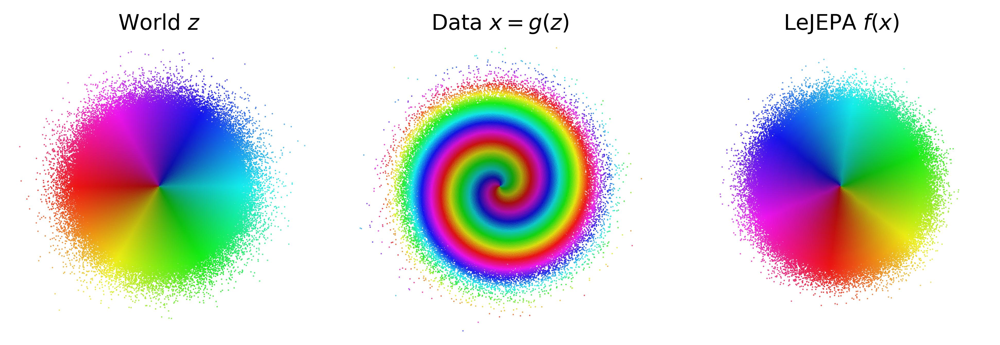

**The claim:** train a representation to pull positive pairs together while forcing its embeddings to be an isotropic Gaussian, and (in a Gaussian world with Ornstein-Uhlenbeck transitions) the only way to win is to recover the true latent variables up to a rotation. The paper proves this is an *if and only if*: the Gaussian latent distribution is the **unique** choice for which LeJEPA is *linearly identifiable*. **My verdict:** the forward theorem is clean, correct, and genuinely illuminating; the converse and the "Lean-verified" framing are weaker than they sound, because the load-bearing analysis facts are assumed rather than proven, and the central Gaussian-world assumption is exactly the one their own robotics experiment violates.

<!-- truncate -->

## TL;DR

- **Claim.** LeJEPA (alignment loss + Gaussianity regularization) learns a *linearly identifiable* representation, meaning the composed map from true latents to embeddings is $h(z) = Qz$ for an orthogonal $Q$, if and only if the latent variables are Gaussian.
- **Method of proof.** Expand any candidate map in the Hermite basis. The Ornstein-Uhlenbeck transition attenuates a degree-$d$ Hermite component by exactly $\rho^d$, so any nonlinearity strictly lowers the cross-view correlation that alignment maximizes. Linear is therefore the unique optimum. The converse runs the same spectral machinery backwards through Sturm-Liouville theory: demanding a linear top eigenfunction forces a linear score function, which forces a Gaussian.
- **Results.** Near-perfect linear recovery ($R^2 > 0.999$) up to 1024-dim latents on synthetic Gaussian worlds; recovery peaks sharply at the Gaussian in a distribution sweep; on real pixel-based robot trajectories (non-Gaussian) recovery collapses below $R^2 = 0.5$, as the converse predicts.
- **Verdict.** Believe the forward direction (Theorem 1): it is the real contribution and it is tight. Treat the converse, the approximate bound, and the "formally verified" claim as *suggestive but qualified*: each leans on axiomatized lemmas or on assumptions (isotropy, dimension match, exact whitening) that the paper's own data shows are fragile.

## Notation

| Symbol | Meaning |
| --- | --- |
| $z, z' \in \mathbb{R}^n$ | True latent variables, and the second view of a positive pair |
| $n$ | Latent dimension, taken equal to the encoder output dimension |
| $\rho \in (0,1)$ | Autocorrelation of the Ornstein-Uhlenbeck (OU) transition |
| $\eta \sim \mathcal{N}(0, I_n)$ | Transition noise, independent of $z$ |
| $g$ | Unknown nonlinear generative map; the observation is $x = g(z)$ |
| $f$ | Learned encoder; the embedding is $y = f(x)$ |
| $h = f \circ g$ | Composed map from latent space to representation space |
| $J_h(z)$ | Jacobian of $h$ at $z$ |
| $Q \in O(n)$ | Orthogonal recovery matrix ($QQ^\top = I_n$) |
| $\mathcal{L}(h)$ | Alignment loss $\mathbb{E}[\lVert h(z') - h(z)\rVert^2]$ |
| $\mathrm{He}_k$, $\hat h_k$ | Probabilist's Hermite polynomial of degree $k$, and its normalized version $\mathrm{He}_k/\sqrt{k!}$ |
| $\alpha \in \mathbb{N}^n$ | Multi-index; total degree $\lvert\alpha\rvert = \alpha_1 + \cdots + \alpha_n$ |
| $H_\alpha(z)$ | Multivariate Hermite basis function $\prod_j \hat h_{\alpha_j}(z_j)$ |
| $c_\alpha^{(i)}$ | Hermite coefficient of component $h_i$ at multi-index $\alpha$ |
| $w_d^{(i)}$ | Variance fraction of $h_i$ at degree $d$: $\sum_{\lvert\alpha\rvert = d}(c_\alpha^{(i)})^2$ |
| $T$ | Transition operator $(T\varphi)(z) = \mathbb{E}[\varphi(z') \mid z]$ |
| $\delta$ | Alignment gap (excess loss above the linear optimum) |
| $\varepsilon$ | Covariance deviation $\lVert \mathrm{Cov}(h(z)) - I_n \rVert_F$ |
| $D$ | Normalized alignment gap $\delta / (2\rho(1-\rho))$ |
| $\mathcal{D}$ | Sturm-Liouville generator of the latent process |

## The question: what makes a representation a World Model?

The paper opens with a sharp definition. A learned representation deserves the name *World Model* when it **linearly recovers the world's latent variables**. The motivation is practical: every time we evaluate a representation by *linear probing*, we are implicitly asking whether the model encodes the latents as a linear readout. If the representation scrambles position with color or velocity with texture, a linear probe cannot disentangle them, and the representation will fail when the world shifts. Linear identifiability is thus framed as a *necessary* (not sufficient) condition for faithful probing.

The gap the paper fills: no identifiability result existed for JEPAs, because prior collapse-prevention tricks (stop-gradient, clustering) leave the embedding distribution unspecified. LeJEPA changes this by *explicitly* regularizing embeddings toward an isotropic Gaussian (via SIGReg), which is exactly the structure the proof needs.

## The World and the Learner

The setup is a clean two-part contract.

**The World** specifies a joint distribution $p(z, z')$ over positive pairs. Three assumptions define the admissible class:

1. **Independence**: the latent coordinates are mutually independent, and so are their transitions.
2. **Stationarity**: both views share the same marginal, $p(z) = p(z')$.
3. **Additive noise**: $z'_i = m_i(z_i) + \eta_i$ with $\eta_i$ independent of $z_i$.

These are then specialized to the **Gaussian World**: $z \sim \mathcal{N}(0, I_n)$. The justification is maximum entropy (the Gaussian assumes the least structure for a fixed mean and covariance) plus a central-limit argument (task-relevant latents are aggregates of many micro-variables). Given Gaussian latents, stationarity plus additive noise *forces* the transition to be Ornstein-Uhlenbeck:

$$
z' = \rho\, z + \sqrt{1-\rho^2}\;\eta, \qquad \eta \sim \mathcal{N}(0, I_n), \quad \eta \perp z.
$$

Here is why this specific form is forced. We need $z'$ to have the same marginal $\mathcal{N}(0, I_n)$ as $z$ while being an additive-noise perturbation. Compute the moments of the candidate above: $\mathbb{E}[z'] = 0$; $\mathrm{Var}(z') = \rho^2 I_n + (1-\rho^2) I_n = I_n$ (signal variance plus noise variance, since $z \perp \eta$); and $\mathrm{Cov}(z, z') = \rho\,\mathrm{Var}(z) = \rho I_n$. The coefficient $\sqrt{1-\rho^2}$ is precisely what makes the noise "top up" the variance back to one. The Gaussian is the unique distribution for which a channel of this form preserves the marginal, because the Gaussian is the fixed point of convolution up to rescaling. The parameter $\rho$ tunes how correlated the two views are: $\rho \to 1$ means nearly identical views, $\rho \to 0$ means independent.

**The Learner** is LeJEPA, written entirely in terms of the composed map $h = f \circ g$. Because $g$ is an arbitrary fixed nonlinearity and $f$ is unconstrained (the paper requires only measurability), proving things about $h$ proves them about any encoder expressive enough to invert $g$. The objective is

$$
\min_h \; \underbrace{\mathbb{E}\!\left[\lVert h(z') - h(z)\rVert^2\right]}_{\textbf{Alignment}} \qquad \text{s.t.} \qquad \underbrace{h(z) \sim \mathcal{N}(0, I_n)}_{\textbf{Gaussianity}}.
$$

The Gaussianity constraint models the idealized success of SIGReg. Now the key simplification. Gaussianity implies whitening, $\mathrm{Cov}(h(z)) = I_n$, which fixes $\mathbb{E}[\lVert h(z)\rVert^2] = \mathbb{E}[\lVert h(z')\rVert^2] = n$. Expanding the squared norm,

$$
\mathcal{L}(h) = \mathbb{E}[\lVert h(z')\rVert^2] + \mathbb{E}[\lVert h(z)\rVert^2] - 2\sum_{i=1}^n \mathbb{E}[h_i(z')\,h_i(z)] = 2n - 2\sum_{i=1}^n \mathbb{E}\!\left[h_i(z')\, h_i(z)\right].
$$

So **minimizing alignment distance is the same as maximizing the cross-view correlation** $\sum_i \mathbb{E}[h_i(z')h_i(z)]$. The whole problem reduces to: among measure-preserving maps, which achieves the highest correlation between the two views? This reframing is the hinge of the entire paper.

## Spectral analysis: the tool behind everything

The world's transition $z \to z'$ induces a **transition operator** on functions: $(Th_i)(z) = \mathbb{E}[h_i(z') \mid z]$. This is linear, with eigenfunctions $\varphi_k$ and eigenvalues $1 = \lambda_0 > \lambda_1 \geq \lambda_2 \geq \cdots \geq 0$. The eigenfunctions with the largest eigenvalues are the features that are *most predictable across views*, the "slowest" features of the process.

For the Gaussian world the eigenfunctions are known in closed form: they are the **Hermite polynomials**, and the eigenvalue of a degree-$d$ Hermite polynomial is exactly $\rho^d$ (Mehler's formula). This is the analogue of Fourier modes for Gaussian variables. Any unit-variance, zero-mean function $h_i$ decomposes into a degree-1 (linear) part, degree-2 (quadratic) part, and so on, with variance fractions $w_1, w_2, \ldots$ summing to 1. The cross-view correlation then reads off directly:

$$
\mathbb{E}\!\left[h_i(z')\, h_i(z)\right] = w_1 \cdot \rho + w_2 \cdot \rho^2 + w_3 \cdot \rho^3 + \cdots \;\leq\; \rho,
$$

with equality iff $w_1 = 1$, i.e. $h_i$ is linear. Read this slowly: the correlation a function achieves is a *weighted average* of $\rho, \rho^2, \rho^3, \ldots$, and since $\rho^d < \rho$ for $d \geq 2$, **any nonlinear distortion strictly lowers the correlation**. That single inequality is the engine of Theorem 1.

For non-Gaussian worlds, the operator still has ordered eigenfunctions, but they are characterized by a **Sturm-Liouville** equation rather than being Hermite polynomials. The slowest non-constant eigenfunction $\varphi_1$ is always monotonic (so you always get identifiability up to a monotone warp), but it is affine only for the Gaussian. That is the engine of the converse.

## Theorem 1 (Forward): LeJEPA learns the World Model

> **Theorem 1.** In the Gaussian world, any measurable $h$ with $h(z) \sim \mathcal{N}(0, I_n)$ satisfies $\mathcal{L}(h) \geq 2(1-\rho)\,n$, with equality iff $h(z) = Qz$ for some orthogonal $Q \in O(n)$. At the optimum, $h(z') \mid h(z) \sim \mathcal{N}(\rho\,h(z), (1-\rho^2)I_n)$.

The proof is worth reconstructing in full, because it is the paper's best work and it is elementary once the Hermite machinery is in place.

### Step 1: the transition attenuates degree $d$ by $\rho^d$

The goal is to show $\mathbb{E}_\eta[\mathrm{He}_k(z')] = \rho^k\,\mathrm{He}_k(z)$ for the scalar OU channel $z' = \rho z + \sqrt{1-\rho^2}\,\eta$. The trick is the exponential generating function of the Hermite polynomials,

$$
\sum_{k=0}^\infty \frac{t^k}{k!}\,\mathrm{He}_k(x) = \exp\!\left(tx - \tfrac{t^2}{2}\right),
$$

which packs all degrees into one exponential, so we can act on all of them simultaneously. Substitute $x = z' = \rho z + \sqrt{1-\rho^2}\,\eta$ and use independence of $\eta$ from $z$ to factor:

$$
\exp\!\left(t\rho z - \tfrac{t^2}{2}\right) \cdot \exp\!\left(t\sqrt{1-\rho^2}\,\eta\right).
$$

The first factor is constant in $\eta$. For the second, apply the Gaussian moment generating function $\mathbb{E}[e^{s\eta}] = e^{s^2/2}$ with $s = t\sqrt{1-\rho^2}$, giving $\exp\!\big(\tfrac{t^2(1-\rho^2)}{2}\big)$. Now watch the exponents combine:

$$
t\rho z - \frac{t^2}{2} + \frac{t^2(1-\rho^2)}{2} = t\rho z - \frac{t^2\rho^2}{2} = (\rho t)z - \frac{(\rho t)^2}{2}.
$$

The $-t^2/2$ and the $+t^2/2$ cancel, leaving exactly the generating function again but with $t \mapsto \rho t$. Matching coefficients of $t^k/k!$:

$$
\mathbb{E}_\eta\!\left[\mathrm{He}_k(z')\right] = \rho^k\,\mathrm{He}_k(z).
$$

This is where the geometric decay $\rho^k$ comes from, and the paper is careful to flag that it is **specific to the Gaussian**: the Gaussian MGF $e^{s^2/2}$ is precisely what cancels the $e^{-t^2/2}$ in the Hermite generating function. For any other distribution the cancellation fails and the eigenvalues no longer decay geometrically.

### Step 2: degrees do not mix across views

To handle an arbitrary $h_i$ we need the cross terms. Using the law of iterated expectations and Step 1,

$$
\mathbb{E}\!\left[\hat h_k(z')\,\hat h_j(z)\right] = \mathbb{E}_z\!\left[\rho^k\,\hat h_k(z)\,\hat h_j(z)\right] = \rho^k\,\delta_{jk},
$$

where the last equality is orthonormality of the Hermite basis. The multivariate version factorizes over coordinates (independent latents, diagonal noise), giving **Mehler's formula**:

$$
\mathbb{E}\!\left[H_\alpha(z')\, H_\beta(z)\right] = \prod_{j=1}^n \rho^{\alpha_j}\,\delta_{\alpha_j \beta_j} = \rho^{\lvert\alpha\rvert}\,\delta_{\alpha\beta}.
$$

The Kronecker delta means the degree-2 part of one view correlates only with the degree-2 part of the other, never with the degree-1 part. The Hermite basis **diagonalizes the transition**.

### Step 3: nonlinearity strictly costs correlation

Expand $h_i = \sum_{\lvert\alpha\rvert \geq 1} c_\alpha^{(i)} H_\alpha$ and apply Mehler. All cross terms vanish:

$$
\mathbb{E}\!\left[h_i(z')\, h_i(z)\right] = \sum_{\lvert\alpha\rvert \geq 1} (c_\alpha^{(i)})^2\,\rho^{\lvert\alpha\rvert} = w_1\rho + w_2\rho^2 + \cdots \leq \rho,
$$

the inequality because each $\rho^d \leq \rho$ and the weights sum to 1. Equality needs $w_d\rho^d = w_d\rho$ for every $d$, which forces $w_d = 0$ for $d \geq 2$ (since $\rho^d < \rho$ strictly there). So $w_1 = 1$ and $h_i(z) = \langle q_i, z\rangle$ with $\lVert q_i\rVert = 1$: a linear function.

The authors note that this *closes both gaps* in the naive information-theoretic argument (which would say "data processing inequality means nonlinear cannot beat linear"). That argument fails because the joint $(h_i(z), h_i(z'))$ need not be Gaussian. Mehler's formula sidesteps it by computing the correlation exactly using only the joint Gaussianity of $(z, z')$, and the strict inequality additionally rules out a *tie*.

### Steps 4 and 5: assembly and recovering the dynamics

Summing over components gives $\sum_i \mathbb{E}[h_i(z')h_i(z)] \leq \rho n$, hence $\mathcal{L}(h) \geq 2(1-\rho)n$. At equality every $h_i$ is linear, so $h(z) = Qz$ with unit-norm rows; the Gaussianity constraint $QQ^\top = I_n$ upgrades this to orthogonal. Finally, $h(z') = \rho\,h(z) + \sqrt{1-\rho^2}\,Q\eta$, and since $Q$ is orthogonal, $Q\eta \sim \mathcal{N}(0, I_n)$ stays standard and independent. So the encoder recovers **both** the latents (up to rotation) **and** the true transition dynamics. The only residual ambiguity is the global rotation, which is inherent to the isotropic Gaussian and unavoidable.

## Theorem 2 (Converse): the Gaussian is unique

> **Theorem 2.** For any world satisfying the three assumptions, if *every* minimizer of the alignment loss under whitening is linear ($h(z) = Qz$), then $z$ is Gaussian.

The mechanism is to run the spectral story in reverse using the Sturm-Liouville generator of a scalar latent process under constant diffusion $K$:

$$
\mathcal{D}\varphi = \frac{1}{p(z_i)}\frac{d}{dz_i}\Big[K\,p(z_i)\,\varphi'(z_i)\Big].
$$

The crucial fact from classical oscillation theory: the $k$-th eigenfunction has exactly $k-1$ interior zeros, so $\varphi_1$ is always monotonic. Linear identifiability demands $\varphi_1$ be *affine*. Suppose $\varphi(z_i) = a z_i + b$ is an eigenfunction. Then $\varphi' = a$ is constant, and the operator collapses to $\mathcal{D}[az_i + b] = a\,K(\log p)'(z_i)$. The eigenvalue equation $\mathcal{D}\varphi = -\lambda\varphi$ becomes

$$
a\,K(\log p)'(z_i) = -\lambda(az_i + b) \;\Longrightarrow\; K(\log p)'(z_i) = -\lambda z_i - \lambda b/a.
$$

The score function $(\log p)'$ is forced to be *linear* in $z_i$. Integrate:

$$
\log p(z_i) = -\frac{\lambda}{2K}\left(z_i + \frac{b}{a}\right)^2 + C,
$$

which is a Gaussian (the sign is fixed by normalizability: the density must be integrable, so the quadratic must open downward). No other density has a linear score. Independence lifts the per-coordinate conclusion to the joint. This is a genuinely elegant inversion: in *linear* ICA the Gaussian is the one distribution where separation *fails*; here, in the nonlinear setting, it is exactly what *enables* it.

> ⚠️ Worth flagging: the converse hypothesis is "*every* minimizer is linear," and the argument really only uses "*an* affine eigenfunction exists." There is also a technical caveat the paper acknowledges (heavy-tailed densities like Laplace give the generator a continuous spectrum where the discrete eigenfunction picture does not apply). The authors argue this does not matter because *assuming* an affine eigenfunction already forces Gaussianity, but the logic is "if a linear minimizer exists with the eigenfunction structure, then Gaussian," which is slightly narrower than "non-Gaussian implies no linear minimizer." It is the right conclusion, stated a touch more strongly than the proof delivers.

## Theorem 3 (Approximate identifiability): graceful degradation

Real training never reaches the exact optimum, so the paper bounds the recovery error when alignment is only $\delta$-suboptimal and whitening only $\varepsilon$-approximate.

> **Theorem 3.** With approximate alignment $\mathcal{L}(h) \leq 2(1-\rho)\,\mathrm{tr}(\mathrm{Cov}(h(z))) + \delta$ and approximate whitening $\lVert \mathrm{Cov}(h(z)) - I_n\rVert_F \leq \varepsilon$, setting $D = \delta/(2\rho(1-\rho))$, there exists $Q \in O(n)$ with $\mathbb{E}[\lVert h(z) - Qz\rVert^2] \leq D + (\varepsilon + D)^2$.

The proof is a three-step accounting in the Hermite basis. First, split $h$ into a linear part $Mz$ (with $M_{ij} = \mathbb{E}[h_i(z)z_j]$, the degree-1 coefficients) and a nonlinear residual $\nu$ (degrees $\geq 2$). The loss decomposes exactly by degree:

$$
\mathcal{L}(h) = 2\sum_{i=1}^n \sum_{\lvert\alpha\rvert \geq 1} (1 - \rho^{\lvert\alpha\rvert})\,(c_\alpha^{(i)})^2.
$$

Bounding degree-$\geq 2$ terms with $1 - \rho^{\lvert\alpha\rvert} \geq 1 - \rho^2 = (1-\rho)(1+\rho)$ and substituting the Pythagorean identity $\mathrm{tr}(\mathrm{Cov}(h)) = \lVert M\rVert_F^2 + W_{\mathrm{nl}}$ isolates the nonlinear energy:

$$
W_{\mathrm{nl}} \leq \frac{\delta}{2\rho(1-\rho)} = D.
$$

The denominator $2\rho(1-\rho)$ is the **spectral gap** between degree-1 and degree-2 eigenvalues, and it controls sensitivity: when $\rho \to 0$ or $\rho \to 1$ the gap closes and the bound blows up. Step 2 uses whitening plus a polar decomposition $M = QP$ to show $\lVert M - Q\rVert_F \leq \varepsilon + W_{\mathrm{nl}}$. Step 3 stitches them with an exact Pythagorean split (linear and nonlinear parts are Hermite-orthogonal, so the cross term vanishes):

$$
\mathbb{E}[\lVert h(z) - Qz\rVert^2] = \lVert M - Q\rVert_F^2 + W_{\mathrm{nl}} \leq (\varepsilon + D)^2 + D.
$$

The interpretation the paper draws (and validates empirically) is asymmetric: in practice $\delta$ dominates, because approximate whitening is nearly free while alignment is the hard part. A remark worth keeping: this theorem needs *no* distributional assumption on $h(z)$ beyond zero mean and approximate whitening, so the full Gaussianity condition of Theorem 1 can be relaxed to second moments. That is why VICReg (which only whitens) matches SIGReg at the Gaussian-latent optimum.

## Theorem 4 (Optimal planning): why orthogonality is enough

> **Theorem 4.** If $h(z) = Qz$ with $Q \in O(n)$, then for any finite-horizon control problem whose stage and terminal costs are $O(n)$-invariant in the state, planning in the learned latent gives the identical value and the identical optimal action sequence as planning in the true latent.

The proof is almost a one-liner once stated correctly. The pushforward dynamics in $\hat z = Qz$ coordinates have the same joint law as $(Qz_0, \ldots, Qz_T)$ under the true dynamics. Apply the invariance $\ell(Qz, a) = \ell(z, a)$ with $R = Q$, and every per-step cost is unchanged almost surely. Sum, take expectations, and the objective is identical for every action sequence, so the minima and minimizers coincide.

The appendix grounds this with worked cases: goal-reaching ($\lVert z - z^*\rVert^2$ is rotation-invariant when state and goal rotate together), and full **LQR**, where the Riccati equation is *covariant* under $(A, B, W, P) \mapsto (QAQ^\top, QB, QWQ^\top, QPQ^\top)$ so the feedback gain transforms as $\hat K = KQ^\top$ and the action $\hat a_t = -\hat K \hat z_t = -K z_t$ is exactly the true LQR action. The honest scoping is good here: this is a statement about the *encoder* only. The action-conditioned transition $\hat p(\hat z' \mid \hat z, a)$ still has to be learned; the theorem just certifies the encoder does not corrupt that downstream problem, because rotation maps each function class to itself.

## The second proof: Dirichlet energy and Mazur-Ulam

The appendix offers an independent geometric proof in the infinitesimal-noise limit $z' = z + \sqrt{\epsilon}\,\eta$. A first-order Taylor expansion turns the loss into the **Dirichlet energy** $\mathcal{L}(h) = \mathbb{E}[\lVert J_h(z)\rVert_F^2]$. Measure preservation gives $\mathbb{E}[\ln\lvert\det J_h\rvert] = 0$. Then AM-GM ($\lVert J_h\rVert_F^2 = \sum \sigma_i^2 \geq n\,(\prod\sigma_i)^{2/n}$) plus Jensen on $x \mapsto e^{(2/n)x}$ yields $\mathcal{L}(h) \geq n$, with equality forcing all singular values to 1, i.e. $J_h^\top J_h = I_n$ everywhere. A norm-preserving Jacobian makes $h$ a global isometry, and **Mazur-Ulam** says every surjective isometry of a normed space is affine, so $h(z) = Qz$. This route is less general (needs a $C^1$ diffeomorphism and $\rho \to 1$) but gives a vivid picture: the map cannot stretch or compress any direction anywhere.

## The Sturm-Liouville and SFA connection

The longest appendix situates the result against **Slow Feature Analysis** (Wiskott-Sejnowski; Sprekeler et al.). The punchline: SFA's objective *is* the alignment loss and SFA's constraints *are* whitening, so JEPA-style training is SFA with learned features. Sprekeler's analysis gives identifiability up to *permutation* via sequential (greedy) extraction with distinct per-dimension rates; this paper gives identifiability up to *orthogonal rotation* via simultaneous optimization with isotropic rates. The tradeoff is real and clearly stated: simultaneous optimization is scalable and stable but can only resolve the latent subspace up to rotation, because whitening is rotation-invariant. A necessary condition surfaces here that is easy to miss in the main text: the simultaneous approach needs $\max_\alpha K_\alpha < 2\min_\beta K_\beta$ (the fastest latent no more than twice as fast as the slowest), otherwise a second harmonic of a slow latent outranks the first harmonic of a fast one and the recovered subspace is wrong. **Isotropy is not a convenience; it is load-bearing.**

## Lean verification: read the fine print

The paper states all five results are "verified in Lean 4 with zero `sorry`." This is true but needs unpacking, and the authors are commendably transparent in their Table 3. The genuinely hard analytical facts are **axiomatized**, not proven:

- Mehler's formula and the $\rho^d$ contraction (the heart of Theorem 1)
- "degree-1 concentration implies linearity" and "Gaussian + linear implies orthogonal"
- "affine score implies Gaussian density" (the heart of Theorem 2)
- AM-GM, Jensen for $\exp$, and Mazur-Ulam (the heart of the Dirichlet proof)
- the polar-decomposition and Pythagorean bounds (the heart of Theorem 3)
- the trajectory pushforward (the heart of Theorem 4)

What is *machine-checked* is the bookkeeping *between* these axioms: that a weighted average of $\rho, \rho^2, \ldots$ is $\leq \rho$ with equality iff $w_1 = 1$, that the spectral gap is positive, that the final bound is monotone, and so on. I confirmed this directly in `Hermite.lean`: `correlation_le_rho` and `equality_forces_degree_one` are verified, while `mehler_summability`, `correlation_eq_spectral_sum`, `linear_of_degree_one`, and `orthogonal_of_gaussian_linear` are `axiom` declarations. This is normal practice when Mathlib lacks the objects (it has no Hermite polynomials under the Gaussian measure yet), and the axioms are all classical results. But the honest reading is: **Lean verifies the algebra, not the analysis.** The phrase "all proofs verified in Lean" oversells what a skeptical reader should take away.

## Experiments

The empirical program is well matched to the theory, one experiment per theorem.

**Forward (Theorem 1).** In 2D, four nonlinear mixings (a measure-preserving spiral, a sinusoidal shear, a parabolic shear, a RealNVP coupling) are all inverted up to rotation. The spiral is the cleverest control: it is measure-preserving, so SIGReg is *already satisfied in input space*, which proves that Gaussianity of the observations alone is not enough; alignment is what breaks the symmetry. Scaling to $N = 1024$ with a RealNVP mixing and a matched-architecture encoder (so any failure is optimization, not expressivity), SIGReg and VICReg hold $R^2 > 0.999$; InfoNCE degrades at scale because its fixed-width Gaussian kernel underflows once $\lVert z\rVert^2 \approx N$.

**Converse (Theorem 2).** Sweeping the latent through the generalized-normal family, linear recovery peaks sharply at $\alpha = 2$ (the Gaussian). On real DMC Reacher pixels, the OU (Gaussian) condition reaches $R^2 = 0.95$ at $\rho = 0.99$, but SAC-policy *trajectories* (genuinely non-Gaussian, anisotropic, with joint-limit wrapping) never exceed $R^2 = 0.5$. This is the converse in the wild, and it is the most important experiment in the paper because it is the one place the theory's assumptions are *violated by real data*.

**Approximate bound (Theorem 3).** Across grid, 2D, scaling, and gennorm runs, the actual recovery error lies below the predicted $D + (\varepsilon + D)^2$ (two near-zero outliers attributed to finite-sample noise). A decomposition confirms $\delta$ predicts recovery far better than $\varepsilon$: whitening is easy, alignment is the binding constraint.

**Planning (Theorem 4).** Straight lines in a well-identified latent decode to near-straight joint-space paths and oracle-quality control cost; the Trajectory encoder's plans curve and inflate cost. Across all encoders, control cost tracks $R^2$ monotonically.

## Critical Analysis

The forward theorem is the real contribution and it is excellent: tight, correct, and the Hermite argument is the right tool deployed cleanly. My reservations are about everything wrapped around it.

**The central assumption is the one the data violates.** The entire forward guarantee rests on Gaussian latents with isotropic OU transitions. The paper's own Reacher trajectory experiment shows that the moment you use *real* data from a *real* policy, the marginals go non-Gaussian, the rates go anisotropic, and recovery collapses below $R^2 = 0.5$. The authors frame this as confirming the converse, which is fair, but it cuts the other way too: it means the positive result applies to a regime (isotropic random-walk exploration) that is *not* how agents actually collect data. The practical recommendation, "explore approximately isotropically during pretraining," is a real constraint on applicability that the abstract's confident framing ("turns an empirically successful recipe into a mathematical guarantee") glosses over. The guarantee is for a sanitized world.

**Isotropy is a hidden necessary condition.** Buried in the SFA appendix is the requirement $\max_\alpha K_\alpha < 2\min_\beta K_\beta$. Outside this window the simultaneous objective recovers the *wrong* subspace (a second harmonic of a slow latent instead of a first harmonic of a fast one). Real latents almost certainly have heterogeneous timescales (position and lighting do not evolve at the same rate), so this is not a corner case. It deserves to be in the main-text theorem statement, not the appendix.

**The dimension-match assumption is doing silent work.** Everything assumes encoder output dimension equals true latent dimension, $m = n$. The limitations section admits that for $m < n$ the Gaussianity constraint does not determine which subspace is chosen or whether the network resorts to superposition, and for $m > n$ extra dimensions must collapse or encode redundancy. Since nobody knows the true $n$ for real data, this is arguably the most consequential open problem, and the clean theorems do not touch it.

**The converse is slightly oversold.** As flagged above, the theorem assumes "every minimizer is linear," uses "an affine eigenfunction exists," and has a heavy-tail caveat where the discrete spectral picture breaks. The conclusion (Gaussian is the unique linearly-identifiable choice) is almost certainly true and morally well-supported, but the stated biconditional is cleaner than the proof. The non-Gaussian generalization the appendix sketches (i.i.d. latents identifiable up to rotation *composed with a shared monotone warp*) is actually the more honest characterization of what the spectral argument buys, and it is relegated to "future work."

**"Verified in Lean" means less than it sounds.** As detailed above, every step a non-expert would *want* checked (Mehler, the linearity implication, Mazur-Ulam, the score-to-Gaussian step) is an axiom. The verified content is high-school-to-undergraduate inequality manipulation. This is fine and standard, but pairing it with "every logical step from premises to conclusions is machine-checked" invites a misreading. The premises *are* the mathematics.

**Evidence-to-claim gaps.** The scaling experiment uses a *matched* RealNVP encoder for a RealNVP mixing, which removes expressivity as a confound but also makes inversion architecturally easy; it does not test whether a generic deep encoder finds the optimum on a hard mixing. The planning result decodes via 1-nearest-neighbor retrieval against a 10k-frame library, which conflates encoder quality with library density, and uses only $K = 30$ start-goal pairs. These are illustrative rather than stress tests. And the whole empirical program is population-level: no analysis of sample complexity or optimization dynamics, exactly the regime where a practitioner gets bitten.

**What I would have most wanted.** An experiment that *keeps the data realistic and asks how much identifiability survives*: take real trajectories and measure recovery as a function of a controllable "isotropization" knob (reweighting, resampling, or AnInfoNCE-style per-dimension correction), to quantify the gap between the theory's world and ours. The paper shows the clean case works and the messy case fails; the interesting science is the dose-response curve in between.

To be fair: the paper is unusually honest about its own limitations, the spiral control experiment is genuinely clever, the SFA connection is scholarly and generous, and the Theorem 1 / Theorem 2 inversion of the classical ICA story is a real conceptual contribution. The criticism is about the distance between a precise theorem and the sweeping "provably learn a World Model" framing, not about the correctness of the core mathematics.

## Verdict

**Believe:** Theorem 1. In a Gaussian world with isotropic OU transitions, LeJEPA's optimum is linear identifiability up to rotation, and the Hermite proof is correct and tight. The reduction of "minimize alignment" to "maximize cross-view correlation" to "any nonlinearity costs $\rho^d$" is genuinely clarifying and is the lasting idea here.

**Doubt:** the reach of the framing. The result is a population-level, exact-optimum, Gaussian-latent, isotropic-transition, dimension-matched statement. Each of those qualifiers is a real restriction, and the paper's own robotics experiment lives outside the safe region. "Provably learn a World Model" is true for *that* world, not necessarily ours.

**Discount:** the Lean verification as a correctness signal. It is a nice engineering artifact and the algebra is sound, but the mathematics that matters is axiomatized.

**Watch next:** (1) lifting identifiability to the *action-conditioned* transition under a persistent-excitation condition, which the authors flag as the natural sequel and which is where this becomes a theory of *control*, not just encoding; (2) the $m \neq n$ regime and its interaction with superposition; (3) the non-Gaussian "rotation plus shared monotone warp" generalization, which may be the result that actually applies to real data.
