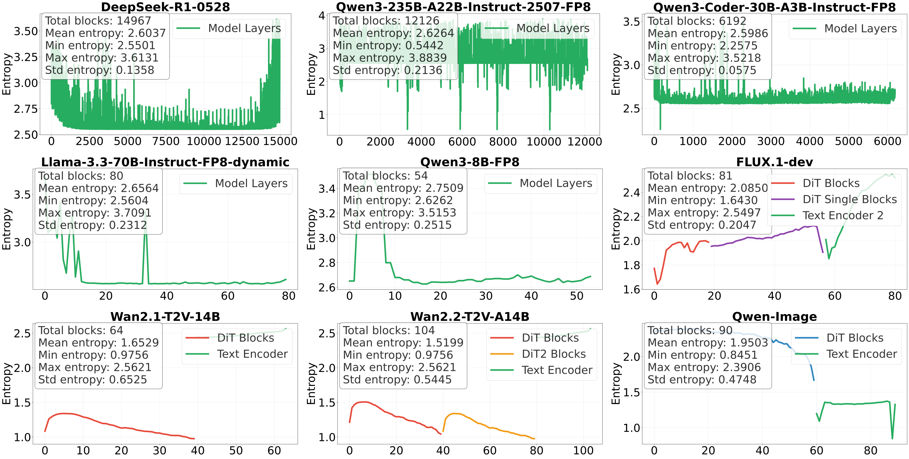
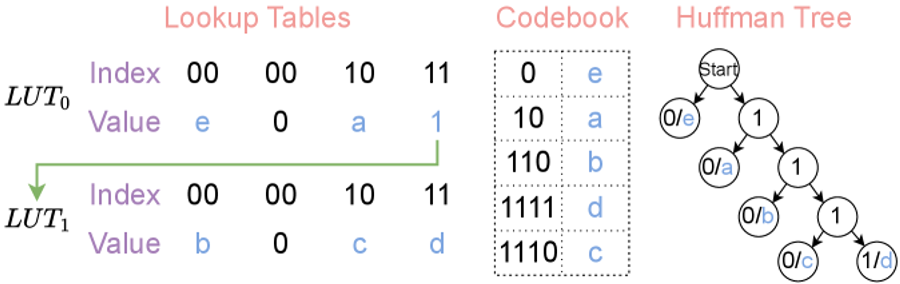
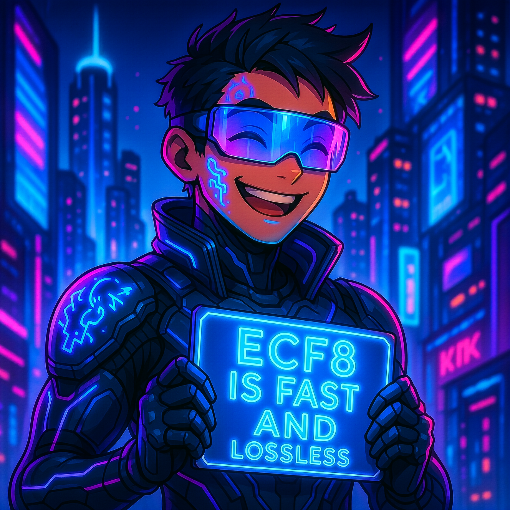
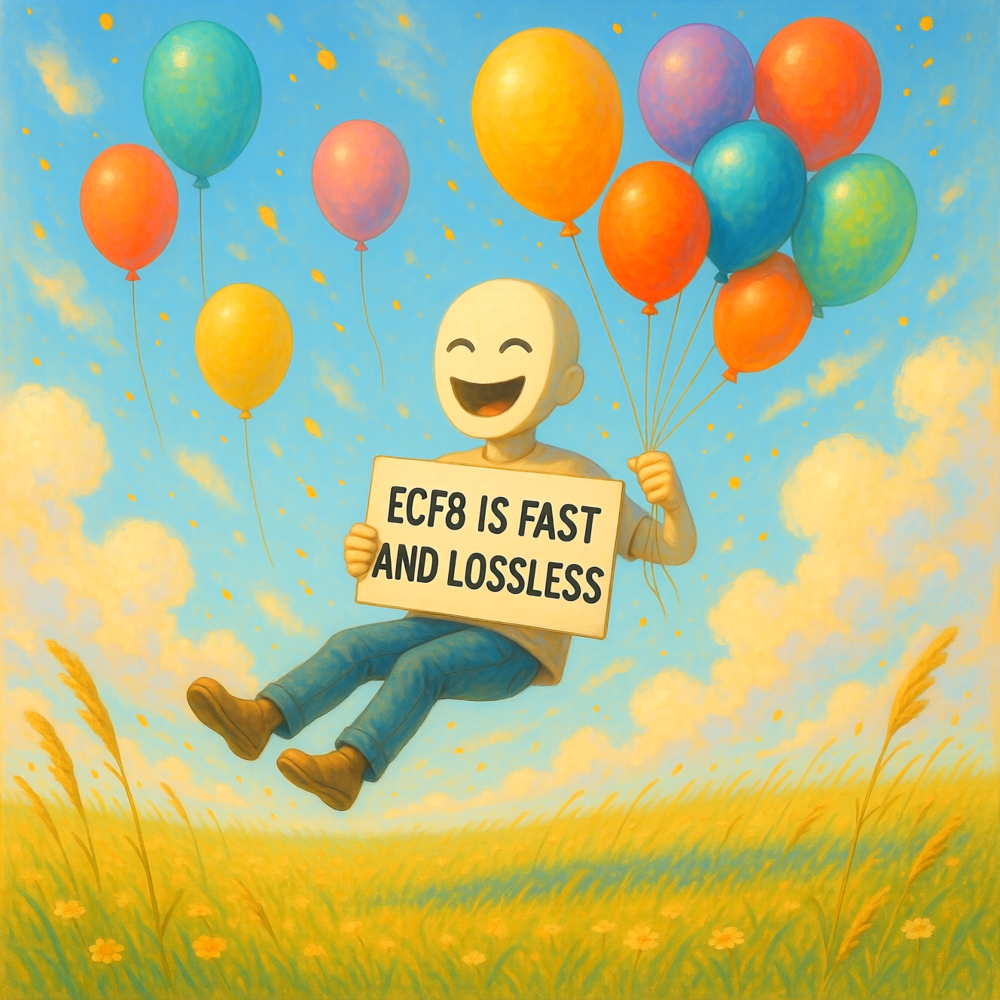
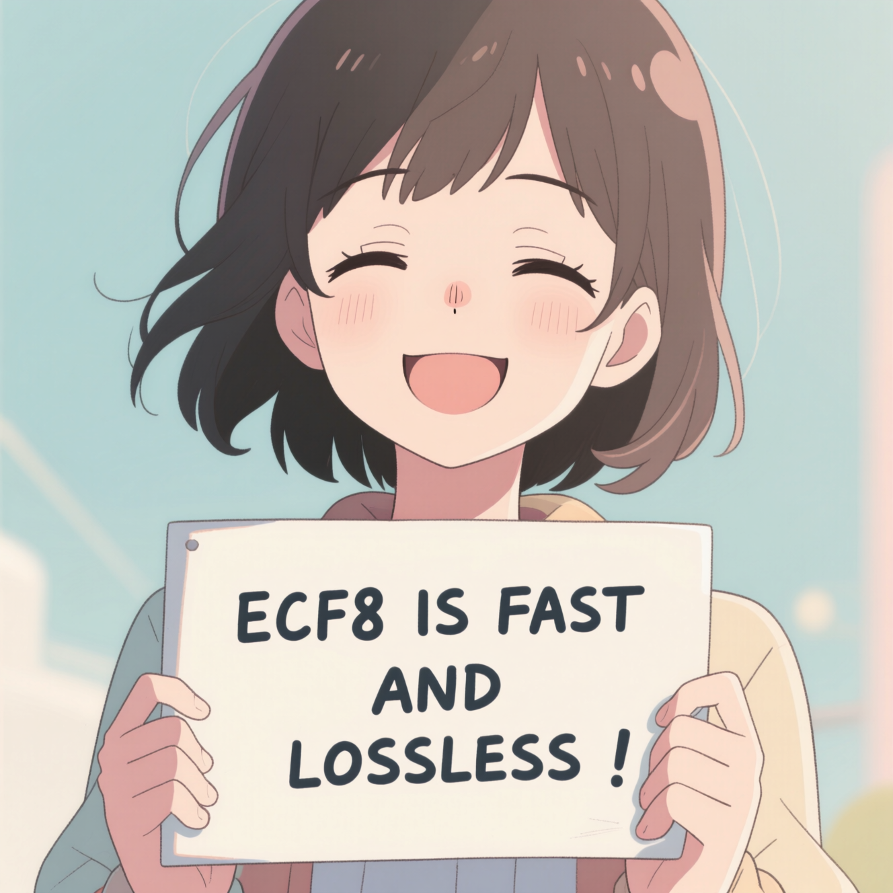
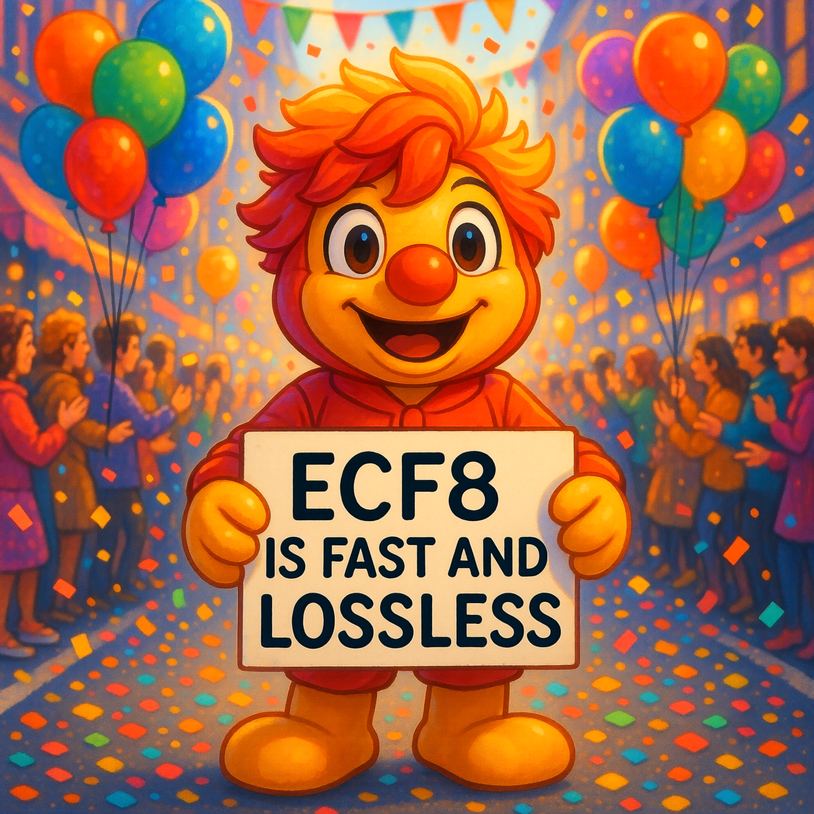

**Zeyu Yang**, Tianyi Zhang, Jianwen Xie, Chuan Li, Zhaozhuo Xu, Anshumali Shrivastava

*International Conference on Learning Representations (ICLR), 2026*

[[arXiv]](https://arxiv.org/abs/2510.02676) [[OpenReview]](https://openreview.net/forum?id=XI1CeufywD) [[Code]](https://github.com/zeyuyang8/ecf8)

  

    
Single GH200 GPU (96 GB) · DiffSynth · Playback at 4× Speed

    <button class="ecf8-demo-btn" id="ecf8GenBtn" onclick="ecf8Generate()">Generate Image</button>
  

  

    

      

        ECF8 (Ours)
        13s
      

      

        
        

Generating...

        
      

      

        

        
0.0s / 13s0%

      

    

    

      

        FP8 Baseline
        24s
      

      

        
        

Generating...

        
      

      

        

        
0.0s / 24s0%

      

    

  

  
<strong>Pixel-identical outputs.</strong> ECF8 finished in 13s, <strong>85% faster</strong> than FP8 (24s) with pixel-to-pixel identical outputs.

Modern GenAI models are enormous. DeepSeek-R1 alone has 671 billion parameters. Even after converting to FP8, serving these models eats up massive amounts of GPU memory and bandwidth. The standard response is lossy quantization: throw away some precision and hope the outputs don't degrade too much. But what if you didn't have to lose anything at all?

In this work, we show that you can losslessly compress FP8 model weights by exploiting a simple observation about how neural networks store information. The result is **ECF8**, a format that saves up to **26.9% memory** and speeds up inference by up to **177.1%**, while producing outputs that are **bit for bit identical** to the original model.

<!-- truncate -->

## A Curious Pattern in the Bits

The starting point of this work is an empirical finding that surprised us. When we looked at the exponent bits of FP8 model weights across a wide range of architectures (LLMs, diffusion transformers, vision models), we found that these exponents are remarkably concentrated. Out of the 4 exponent bits in FP8, the Shannon entropy is typically only around **2 to 3 bits** per layer. In other words, most of the exponent values are redundant.

Here's what this looks like across 9 different models. LLMs are on the top two rows, diffusion transformers on the bottom:

The pattern is strikingly consistent: no matter the architecture, the model size, or the modality, exponent entropy stays low. We call this **exponent concentration**.

## Why Does This Happen?

This isn't just an empirical curiosity. There's a solid explanation for it. The weights of neural networks trained with SGD are known to follow heavy tailed, $\alpha$-stable distributions. We prove that when weights come from such distributions, the entropy of the exponent field is tightly bounded. For the Gaussian case ($\alpha = 2$), the bounds fall between **1.6 and 2.67 bits**.

This analysis also gives us a theoretical compression floor: the minimum number of bits needed for a full floating point representation works out to roughly **FP4.67**. In other words, there's still significant room beyond FP8 for lossless compression, and exponent concentration is the key to unlocking it.

## How ECF8 Works

The idea behind ECF8 is straightforward. If the exponent bits have low entropy, encode them with fewer bits using Huffman coding and leave the rest untouched.

In practice, making this work efficiently on GPUs is the hard part. Our pipeline has three main components:

1. **Entropy aware encoding:** We build Huffman codes from the empirical exponent distribution of each layer, with a maximum code length of 16 bits for GPU compatibility.

2. **Hierarchical lookup tables:** For fast decoding, we use cascaded 256 entry subtables that can be traversed in parallel:

3. **GPU optimized decoding kernel:** A five phase pipeline (memory init, data load, parallel counting, coordinated decode, global writeback) using 64 bit sliding windows and shared memory. Decompression happens just in time with a single preallocated buffer.

## Results

We tested ECF8 across 9 models spanning LLMs and diffusion transformers, up to 671B parameters. Here's what we found.

### Weight Compression and Throughput

| Model | Params | Memory Reduction | Throughput Gain |
|:------|:------:|:----------------:|:---------------:|
| DeepSeek-R1-0528 | 671B | 14.8% | 150.3% |
| Qwen3-235B-A22B | 235B | 14.4% | 35.9% |
| Llama-3.3-70B | 70B | 13.4% | 11.3% |
| Qwen3-Coder-30B | 30.5B | 14.3% | 23.7% |
| Qwen3-8B | 8B | 9.8% | 12.6% |
| FLUX.1-dev | 16B | 14.1% | **177.1%** |
| Wan2.1-T2V-14B | 14B | 25.4% | 55.1% |
| Wan2.2-T2V-A14B | 30B | **26.9%** | 108.3% |
| Qwen-Image | 20B | 21.0% | 126.6% |

The diffusion models benefit the most because their exponent distributions are even more concentrated, enabling higher compression ratios. FLUX.1-dev sees a nearly **3x throughput improvement**.

### LLM Inference: Latency and Batch Size

| Model | Latency Reduction | Max Batch Size |
|:------|:-----------------:|:--------------:|
| DeepSeek-R1-0528 | 60.1% | 2 → 16 |
| Qwen3-235B-A22B | 26.4% | 32 → 64 |
| Llama-3.3-70B | 10.2% | 32 → 48 |
| Qwen3-Coder-30B | 19.2% | 16 → 32 |
| Qwen3-8B | 11.2% | 16 → 24 |

On DeepSeek-R1, ECF8 cuts per request latency by **60%** and increases the maximum batch size from 2 to 16, an **8x improvement**. This is because the bottleneck for large models is memory bandwidth, and ECF8 directly reduces the amount of data that needs to move.

### Diffusion Models: End to End Speedup

| Model | E2E Latency Reduction | Memory Savings |
|:------|:---------------------:|:--------------:|
| FLUX.1-dev | 45.9% | 12.1% |
| Wan2.1-T2V-14B | 3.3% | 7.6% |
| Wan2.2-T2V-A14B | 4.0% | 17.8% |
| Qwen-Image | 55.9% | 7.9% |

Qwen-Image sees a **55.9% end to end speedup**, and every generated image is pixel identical to the uncompressed model's output.

### It's Actually Lossless

This is worth emphasizing: ECF8 is not "approximately lossless" or "nearly lossless." The outputs are **bit for bit identical**. Here are images generated by the ECF8 compressed Qwen-Image model. They match the original FP8 model down to every pixel:

| | |
|:---:|:---:|
|  |  |
|  |  |

## How This Compares to Other Approaches

**Compared to lossy quantization (GPTQ, AWQ, SqueezeLLM):** These methods trade output quality for compression. ECF8 gives you compression for free: no calibration data, no quality loss, no retraining. You can use it as a direct replacement.

**Compared to DFloat11:** DFloat11 targets BF16 weights and achieves ~30% compression. ECF8 targets the increasingly standard FP8 format and provides a theoretical framework explaining *why* compression works, rather than treating it as a purely empirical observation.

## Takeaway

The weights of trained neural networks have a hidden structure in their exponent bits, one that's universal across architectures and modalities, and that emerges naturally from the dynamics of SGD. ECF8 exploits this structure to compress FP8 weights losslessly, delivering real speedups on real models, with zero compromise on output quality.

If you're serving large models and care about exact reproducibility, give [ECF8](https://github.com/zeyuyang8/ecf8) a try.
