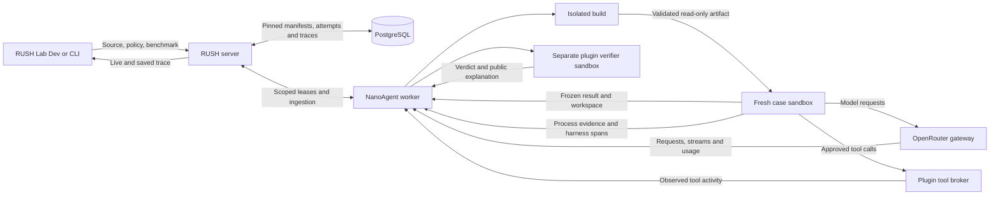

# Uploaded harness benchmarks in RUSH Lab

Members publish a benchmark for an installed plugin's task: cases plus a pinned run configuration (OpenRouter model, endpoint, limits, prompts). Anyone then runs a harness (a source project they upload, or a reference harness) on a benchmark, choosing only the policy, and sees every member's results. Every run keeps a complete trace its owner can open from RUSH Lab Dev or the CLI. The unit under test is the whole harness: local computation, tools, model calls and retries. The plugin's deterministic task verifier decides every case verdict and the run's score.

The comparison is the plugin benchmark's (`nanoagent/examples/benchmark/`): NanoAgent working a plugin task with the task's tools, against other harnesses working the same cases from a prompt with their own tools. On the server every participant, NanoAgent included, is an uploaded source that follows the harness contract, and each participant is its own run. Any two runs of the same task verifier can be compared.

## Contracts and code map

- [Uploaded harness contract](../contracts/uploaded-harness-v1.md) and its [schema](../../src/nanoagent/uploaded/uploaded-harness-v1.schema.json): the wire protocol between a harness and the worker (package and build, request and result, policies, network, scoring, prompt, OpenRouter boundary, token accounting, tool, exec and event interfaces, durable replay).
- [RUSH benchmark API](../contracts/rush-benchmark-api.md): the member, publishing and worker HTTP APIs, with every route, field, status code and limit.
- Server: `helpinghands/src/server/routes/benchmark*.js`, `helpinghands/src/server/benchmark/` (pure rules: `prompt.js`, `limits.js`, `plan.js`, `compare.js`, `rules.js`, `validate.js`, `harness.js`), `helpinghands/src/server/postgres/benchmark*.js`, migrations `0052` to `0055` (`benchmark*.sql`).
- Worker, CLI and engine: `nanoagent/src/nanoagent/uploaded/` (`worker.py`, `rush_worker.py`, `runner.py`, `sandbox.py`, `gateway.py`, `broker.py`, `execservice.py`, `collector.py`, `projection*.py`, `timing.py`, `compare*.py`, `case_sets.py`, `reference.py`, `source_zip.py`, `answer.py`, `client.py`, `reference_harnesses/`), `nanoagent/deploy/worker/`.
- Desktop: `helpinghands/src/components/Benchmark/` (screens), `helpinghands/src/runner/worker.mjs` (starts and checks the worker).

This document does not restate the contracts. It describes how the pieces fit and why, the trace and timing model, the tests and the open work.

## Benchmarks and harness identity

Cases are authored and validated first with the plugin benchmark's `examples/benchmark/step1_make_cases.py`. A case file names the plugin and task and holds the shared context, inputs to answer and inputs to refuse with the expected reference error. A model may propose a case, but code validates the input and the reference or verifier behavior; no model is a judge.

A **benchmark** is a case set plus a pinned run configuration: model, endpoint profile, limits (internet access included), the coding template and the task instructions. It belongs to one plugin version, is immutable once published and is named. Any signed-in member may publish for any published plugin version, and every signed-in member reads every benchmark with its case set, never the references. Naming, republishing and the visible case-set fields are in the [API](../contracts/rush-benchmark-api.md#benchmarks).

Publishing (CLI `examples/uploaded_benchmark/step1_publish_benchmark.py`, RUSH Lab's Create Plugin Benchmark screen) shares `nanoagent.uploaded.case_sets`. It pins the plugin package digest, runs the same deterministic validation, pins each case's reference once with the plugin's reference tool (in the app on the member's own computer, so references never reach the browser), and derives every field (task description, schemas, tools, egress hosts, case digests) from the package and case file. The member supplies the case file, the plugin version, a name and optional overrides of the defaults. Reference failures, missing cases, invalid schemas, limits above what the member's worker allows, an endpoint it does not serve and a model it does not price are publication errors that store nothing, never invented around. The case set under a benchmark is an implementation detail.

A **harness** is `(owner, name)` at a `version`, read from the `name`, `version` and `dialects` its `harness.yaml` declares, so identity comes from the ZIP and two members may both have `foo`. The first upload of a version pins its source sha256 so a version always means one archive; the same ZIP runs any number of times, each run its own row. The reference harness names are reserved so a member upload cannot impersonate one. Rules and codes: [contract](../contracts/uploaded-harness-v1.md#package-build-and-entry-point), [API](../contracts/rush-benchmark-api.md#post-sources).

## Run setup

A run takes a benchmark, a policy and a harness source, and nothing else. The server pins everything a run needs (case set, rendered prompts, limits, endpoint, model, dialects, source) so a retained run stays readable and rerunnable after the plugin is uninstalled or republished.

- **Participant policy.** `task_tools` (NanoAgent's side: the harness works the task with the task's tools through the broker) or `coding` (every other harness: the harness gets the coding prompt, uses its own tools and writes `answer.json`). The server cannot tell which side a source is on, so any member can choose either policy for any source; a harness that does not support the policy fails its attempts like any other harness failure. Both policies are scored by the same verifier.
- **Prompt.** The benchmark pins both prompts because the runner picks the policy: the coding template (default: `prompt` in `examples/benchmark/configs/step2_single_run.yaml`) and the task instructions (default: the plugin manifest's). The run pins each case's exact rendered text and digest. There is no per-run override.
- **Limits.** Every limit has a visible default, is set when the benchmark is published and is pinned with it, so none applies that the run's effective configuration does not show. Defaults live in `helpinghands/src/server/benchmark/limits.js` and the [defaults endpoint](../contracts/rush-benchmark-api.md#get-defaults). A run has no concurrency: how many attempts run at once is the runner's own setting in RUSH Lab (Local Runner Health Check, Advanced settings; default 1, at most the machine's CPUs). The build has limits of its own because its output volume and `/tmp` are tmpfs charged to the build's memory; the [contract](../contracts/uploaded-harness-v1.md#limits-capabilities-and-the-network) gives the figures.
- **Internet access.** On by default, public addresses only. Model calls must still go through the gateway; bypasses cannot be detected, so runs with internet access are marked unverified egress in comparisons. Under `task_tools` the tool container reaches only the hosts the plugin declares. Network rules: [contract](../contracts/uploaded-harness-v1.md#limits-capabilities-and-the-network).
- **Model, endpoint profile and dialects.** The model and endpoint profile are the benchmark's; the dialects are the harness manifest's. A preview resolves all of this without queueing; submit rejects a stale preview and uses an idempotency key. A worker advertises its endpoint label, maximum limits and the models it prices, and a run only goes to the submitting member's worker, and only if it can give the benchmark's limits and price its model.

## Harness interfaces

The harness implements one operation, `run(request) -> result`. `harness.yaml` declares the build and run argument vectors for the language's pinned toolchain (C++, Rust, Go, Python, TypeScript, Java, JavaScript). RUSH owns timeout and cancellation; the plugin owns scoring. RUSH provides language-neutral HTTP interfaces that SDK helpers can wrap:

| Operation | Responsibility |
| --- | --- |
| `call_model(request) -> response or stream` | Send the native request through the attempt's OpenRouter gateway. Every physical request is captured, retries included. |
| `call_tool(name, arguments, cause?) -> result` | Invoke an approved plugin tool and capture its actual arguments and result. The proposal id, tool name and arguments are verified before a call is labeled as matching a model proposal. |
| `exec(argv, cwd, timeout_ms) -> exec result` | Send a command to `exec_url` for bounded stdout, stderr and termination evidence. It runs in the attempt sandbox under the same limits. The sandbox's tracer observes managed and direct subprocess execs and exits. |
| `start_span(...)` and `end_span(...)` | Send harness-reported events to `events_url` for the agent root, subagents, memory and in-process tools. |

## OpenRouter endpoint configuration

The harness side (dialect routes, credential, first-prompt rule) is the contract's [OpenRouter boundary](../contracts/uploaded-harness-v1.md#openrouter-boundary). The worker's YAML independently configures where the gateway forwards (`deploy/worker/worker.openrouter.yaml` and `worker.mock.yaml`), so acceptance can select a scripted endpoint explicitly.

```yaml
# Production worker profile
openrouter:
  label: openrouter
  mode: openrouter
  upstream_base_url: https://openrouter.ai/api/v1
```

```yaml
# Acceptance worker profile
openrouter:
  label: mock
  mode: mock
  upstream_base_url: http://openrouter-mock:8080/api/v1
  mock_hosts: [openrouter-mock]
```

The key is never in the YAML: both profiles read it from the worker's `OPENROUTER_API_KEY` environment variable, the member's own key in production and a synthetic one in acceptance. Production only permits the approved OpenRouter HTTPS origin. The acceptance profile permits its named mock host. The worker validates mode, URL and credential at startup, and the run pins the endpoint profile label, which the member sees.

## Architecture



1. **Queue and pin.** The server resolves the case set, plugin package, source, rendered prompts, limits, endpoint, model and dialects, and queues only after the run holds durable references to the actual source, package, case set, private references and build dependencies. An authorized rerun uses the retained artifacts and creates a new attempt. Uninstalling or republishing a plugin leaves a retained run readable.
2. **Build and isolate.** A microVM per sandbox, from pinned images. Each toolchain version defines its build and runtime images, dependency resolver and offline validation policy. The full verified dependency closure is staged before a network-less build in a disposable sandbox; declared outputs are validated and mounted read-only. Each case then gets a fresh sandbox with an unprivileged identity, immutable inputs, bounded writable paths and enforced process, CPU, memory, disk and output limits. The process tracer must pass its startup probe in every runtime image before member source is accepted.
3. **Fence and observe.** The current lease and attempt token govern admission at the gateway, tool broker and command service, and trace ingestion. Each physical model request is admitted with a unique record and its bounded spend reserved against the attempt, member and workspace budgets before dispatch. Uncertain calls stay reserved until reconciliation or are settled at the reserved bound. Cancellation or lease loss revokes admission, drains in-flight local work and keeps confirmed or uncertain spend. An expired attempt is interrupted and a rerun needs a new attempt.
4. **Freeze and score.** The worker stops new calls and every workspace writer (harness descendants, tool work, managed commands), takes a bounded snapshot, reads the result without following links, and gives the frozen outcome and private references to the isolated verifier. Execution status, verdict and trace coverage are recorded independently. A reliable timeout or invalid result is scored as an execution failure; a worker interruption, verifier exception or missing scoring evidence leaves the score unavailable and keeps the trace.
5. **Store and replay.** A per-attempt event stream and span index go into PostgreSQL with bounded redacted payloads and artifacts. Cursors are persisted with events and sealed with a watermark. The desktop resumes from a cursor and reads history from storage with the upstream offline. Late accounting is versioned and never rewrites trace events. See the contract's [durable replay](../contracts/uploaded-harness-v1.md#durable-replay).

## Local worker

The worker runs on the member's own computer, so no deployment host is needed, and nothing needs installing: it is NanoAgent's own process, and every sandbox is a microVM that the `microsandbox` package (a NanoAgent dependency, its runtime bundled in its wheel) boots with the platform's hypervisor: Apple's Hypervisor framework on Apple silicon, KVM on Linux, the Windows Hypervisor Platform. Railway runs no hypervisor (see `plugin-sandbox.md`), so both Railway services (RUSH, and a NanoAgent that runs no model or plugin) stay as they are.

```text
Member's computer
  RUSH Lab (lab.mjs) -- per connection --> NanoAgent (sessions)
                     -- per connection --> python -m nanoagent.uploaded.worker (the bundled NanoAgent)
                                            microVMs: build, case, tool (microsandbox)
                                            nanoagent.uploaded.worker -- HTTPS --> RUSH /api/benchmark-worker
                                                                      -- HTTPS --> openrouter.ai (member's key)
```

The worker only connects out. The one thing it listens on is each attempt's services, on a loopback port that only that attempt's case VM is allowed to reach.

- **Scope.** The worker runs only its member's runs, on that member's OpenRouter key. It authenticates with a worker credential the member minted (stored hashed, revocable, good only on `/api/benchmark-worker/`). RUSH hands it only runs whose owner is that member, and checks a run's limits against that member's own worker's advertised capabilities (`worker_unavailable` when it is not running). Capabilities come from the computer's CPUs and physical memory, not from a server-sized config.
- **Sandboxes.** `nanoagent.uploaded.sandbox` boots each build, case and tool server in its own microVM from the toolchain's pinned OCI image, with a network policy that denies everything but what that VM is given: nothing for a build, the attempt's service port for a case (and public addresses when the run has internet access), the egress proxy of the plugin's declared hosts for a tool VM. CPU and memory are the VM's; the workspace and result directories are host directories with a quota; `/rush/request.json` is written into the VM read-only. The harness runs as an unprivileged user beneath a root `strace`, and freezing a case pauses its whole VM. At startup the worker reaps `rush-*` sandboxes a previous run left behind, because a laptop quits mid-attempt far more often than a server does.
- **Guest tools.** Two pinned binaries are mounted read-only into the VMs: a static `strace` (built once per machine from its release tarball, sha256-pinned, in the digest-pinned gcc image with no network), which records the process evidence in every runtime image whatever its libc, and uv's static Linux release (sha256-pinned), which prepares and runs plugins in the tool VM. They are cached in the worker's scratch folder.
- **Credentials.** RUSH Lab mints the member's worker credential and starts the worker per connection with the member's OpenRouter key from Settings (`OPENROUTER_API_KEY`, never in YAML or on the wire). Adding, changing or removing the key starts, restarts or stops the worker without an app restart; a restart interrupts attempts in flight, whose leases then expire. `npm start` runs the worker from the checkout's `.venv` with a dev credential (`helpinghands/scripts/dev/start-local.mjs`, `mint-worker-credential.mjs`).
- **Health.** The Benchmark screens show the worker's state (ready, no OpenRouter key, unsupported computer, failed) and one Local Runner Health Check tab runs the checks in order, each with its fix: sandbox support on this computer, key, startup proofs (plugin sandbox, leftover cleanup, guest tools, a tracer probe per toolchain, the egress fence), claiming from RUSH. A missing key is a waiting state, not a failure. A crashed worker gets one automatic restart.
- **Resilience.** Losing RUSH backs off (doubling up to `poll.max_outage_s`) and retries, logging the outage and recovery once. An attempt whose lease ran out while the computer slept is dropped on waking, not finalized late.
- **Trust.** Members are trusted: no anti-tampering. The claim carries each case's reference to the member's machine, so references are not hidden from whoever runs a benchmark, and elapsed and CPU figures are that machine's and are not reconciled across machines.

## Code design

Interfaces are defined where they are consumed: Python `Protocol` for worker dependencies, plain functions for single operations, dependencies passed explicitly, adapters wired by entry points that validate YAML at startup. Tests pass small fakes directly.

| Component | Responsibility |
| --- | --- |
| RUSH server | Resolve plugins, validate previews, pin run inputs by digest, queue idempotent submissions, own PostgreSQL writes for leases, budgets, scores and traces, authorize every read including payloads. |
| NanoAgent worker | Build the pinned source, run each case in a fresh sandbox, run the attempt-scoped gateway, broker and command service, freeze and score, report evidence. Reuses case preparation and the plugin verifier runner. |
| CLI and RUSH Lab | Use the same server API to submit runs and read results. Orchestration and scoring stay in the server and worker. |

| Consumer | Dependency | Test double |
| --- | --- | --- |
| Worker loop | Lease client claims and renews attempts. | Scripted lease expiry or revocation. |
| Attempt runner | Sandbox supervisor builds and starts a case; the case handle waits, drains writers and reads the bounded result and snapshot. | Scripted case handle failing at each phase. |
| Scoring | Plugin verifier evaluates a frozen outcome. | Fixed verdicts or errors. |
| Gateway | Admission reserves and settles spend; transport returns the native response or stream. | Scripted transport and admission failures. |
| Trace recorder | Journal appends evidence by event identity and seals at the final cursor. | Recording fake; PostgreSQL for transaction tests. |

A monotonic clock is injected where durations are measured. Result validation, trace projection, timing and comparison are deterministic functions of typed inputs. One gateway admission and recording path serves every dialect, with dialect-specific parsing. Toolchains are pinned profiles; a toolchain that needs different dependency staging implements a resolver.

## Trace evidence and how it is assembled

| Source | Evidence collected | Identity and limits |
| --- | --- | --- |
| Worker and supervisor | Pinned prompt and case, build and run lifecycle, timeout or signal, result envelope, workspace snapshot and diff | The worker creates the attempt ID before launch. A final diff captures what changed on disk; individual file operations would need observed file events. |
| OpenRouter gateway | Submitted and effective request, dialect, frames and order, HTTP errors, final response, tool proposals, first-byte and completion times, usage and cost | One call ID per physical request. Provider response ID and generation ID are recorded separately, with response headers. |
| Plugin tool broker | Request, validated arguments, execution times, result or error | Proposal IDs, tool name and canonical arguments are verified. Changed arguments are an adaptation linked to the proposal. A claimed link to an unknown proposal or different tool is rejected. |
| Process tracer and managed exec | Process creation and lineage, `execve`/`execveat`, argv, working directory where captured, descendant exits, signals, forced teardown. Managed exec also captures its streams. | Joined by sandbox ID, process group and start identity. Trace loss and stream capture limits are recorded. A managed command links to its process by supervisor launch ID. Environment values are omitted. |
| Harness telemetry | Agent and subagent scope, decisions, memory activity, in-process tools, user-supplied links | Each emitter supplies an ID and sequence. Events stay marked harness-reported; references are validated. |
| Plugin verifier | Case verdict, final score, duration, approved explanation | Scores frozen outcomes against private inputs. Only score, verdict and approved explanation are published. |

1. **Collect and persist.** Attempt and source are stamped on the trusted side of each boundary. Source sequence, precise times, capture status and payload references are preserved. Credentials and private material are redacted before member-visible data is written. Retries of the same ingestion must preserve event identity and digest. Source health, coverage, loss, truncation and redaction are kept with the attempt, including on failure or cancellation.
2. **Normalize.** Chat Completions tool fragments are reassembled by choice and tool index, Responses calls by output item and call IDs, Anthropic content by block ID and index. Native frames stay inspectable. Every projected action references its evidence and the parser version. A model proposal, a brokered invocation and the result sent into a later request each keep their own evidence. One usage record per physical request; a later generation lookup enriches it and leaves unavailable values unknown.
3. **Join by evidence.** One attempt tree holds the harness phase; the build and the verifier are not in it (a failed build is the attempt's `build_failed` status and reason, the verifier's result its verdict, explanation and verifier error). Containment links group spans under an agent or subagent. Causal links connect a proposal to its invocation, a command to its process and exit, and a result to the model turn that received it, each storing the IDs and method. A direct subprocess with no verified link to a tool call is shown under the process tree with its own evidence. Timing drives the waterfall, source sequence local order and gaps, explicit links causality.
4. **Project and seal.** Events, summary spans, links and payload references are written with a monotonically increasing per-attempt cursor; a transaction seals the sequence with its final cursor and coverage. An interrupted source leaves a partial trace. The same data serves live SSE, history, span links, comparison and ATIF export (`nanoagent/trajectory/atif.py`).

### Worked trace example

On a pinned `config.yaml` case, gateway call `m1` records the exact prompt and a streamed proposal `call_1` to validate the file. The broker accepts `(m1, call_1)`, records the actual validation arguments and returns its result. Call `m2` carries that result back. In parallel, managed command `cmd1` records `go test ./pkg/config` while the tracer records the matching process start and exit; the command payload holds stdout and stderr. The worker captures the workspace diff and result, then the verifier produces its verdict. The app shows this as a transcript, a span tree grouped by agent scope, and a waterfall where validation and the command overlap. Selecting the tool row shows the proposal and observed invocation together; selecting the command shows exact argv, streams and exit evidence. All of it is reassembled from stored data with the upstream offline.

## Primary metrics and timing analysis

Total tokens, input, output, cache reads, cache writes and total elapsed time come first in the CLI summary, the case header and comparison. The [token normalization rules](../contracts/uploaded-harness-v1.md#token-accounting) apply to every physical request, retries and errored calls included. Known subtotals and missing-call counts are tracked for incomplete fields. Usage sums over the selected attempts; the original attempt and each rerun are independently selectable. Suite elapsed time is measured on the coordinator from first case dispatch through the last case's execution outcome. Queue, build, scoring and submission-to-final time are reported separately.

| Timing metric | Definition |
| --- | --- |
| Total case time | Worker monotonic wall time from harness launch through harness exit and quiescence of its subprocesses and in-flight tools. Includes inference, local work, retries and waiting. Queue, build, snapshot and verifier times are not reported. |
| Time with no OpenRouter request in flight | Total case time minus the union of upstream request intervals clipped to the case window. A measured wall-clock figure. Local work done while a request is in flight shows in the waterfall and CPU time. |
| Measured time outside OpenRouter waits | Total case time minus observed intervals in which every live harness branch is blocked waiting for upstream data. Concurrent local work counts, even during an upstream request. Requires harness wait instrumentation and full activity coverage. |
| Local CPU time | Measured user and system CPU time for the harness, descendants, managed commands and plugin tools from isolated runtime counters, never counting a process twice. Tool wall durations are separate. CPU time can exceed wall time on parallel cores. |
| Estimated time without OpenRouter latency | Each observed upstream duration is replaced by a modeled duration from that call's recorded input and output tokens and the pinned reference token rate. The longest dependency path is recomputed with local work, sequencing, joins, gateway overhead and backoff preserved. |

Lifecycle and upstream timing are recorded on a common worker monotonic clock. Upstream I/O is timed from dispatch through terminal response, error or cancellation; response availability is recorded at headers and frame boundaries, with local backpressure accounted separately, so a tool launched on an early frame can be placed before the stream ends. For time outside waits, each live branch's OpenRouter wait intervals and the response boundary that unblocked it are recorded; only intervals where every live branch (including branches reached through a join) is blocked on upstream I/O are subtracted. The reported timing provenance is shown, and **Unknown** appears wherever branch or wait coverage is incomplete.

The reference rate is positive and finite, set in the worker YAML (`timing.reference_tokens_per_second`, default 100) and pinned with the timing method in the run manifest. It applies to every physical model call with recorded usage, retries included.

For each request and response, modeled upstream seconds are `(input_tokens + output_tokens) / reference_tokens_per_second`; cached input and reasoning are counted once through the inclusive totals. A buffered response is released at the modeled end. A streamed response accounts for input before the first data frame and spreads output time across frames in proportion to their original byte lengths, saved by the gateway before redaction; tool calls that start before the stream ends use modeled frame availability. Recorded responses, errors and control flow stay fixed.

The dependency graph is acyclic, built from individual activities with recorded predecessors and local execution order. It respects explicit forks and joins and keeps scheduling and backoff delays as local activity. Harness-reported dependencies keep their provenance and are validated against observed operations. The graph with observed durations must reproduce measured elapsed time within the pinned clock tolerance. **Unknown** is shown when token, clock or dependency evidence is incomplete, and timing evidence and coverage are persisted. A reconciled accounting update versions the estimate alongside the accounting record.

Example: after 0.1 s of setup a harness starts an 8 s upstream call and a 5 s local command in parallel, waits for both, then spends 0.2 s finalizing. Total case time is 8.3 s, with no request in flight for 0.3 s. Measured time outside OpenRouter waits is 5.3 s, because the model is the only blocker for the last 3 s of the call. If the request and response total 600 tokens, the modeled call takes 6 s at 100 tokens per second, and the latency-adjusted estimate is 6.3 s. When coverage proves zero dispatched model requests, both equal total case time. An opaque harness can still show total case time, CPU time and time with no upstream request in flight.

## Native trace experience

The case's transcript, span tree and waterfall open together; selecting a tool call, model turn, command or verifier event focuses it in every view. Members search and filter by event kind, error, subagent and provenance. The inspector shows model input and output with token classes, tool arguments and results, command and exit, and the verifier explanation. The waterfall highlights upstream waits and overlapping local work and shows the latency-adjusted estimate with its reference rate. Parallel calls and retries are linked explicitly; truncated or missing payloads and harness-reported evidence are labeled. Recorded strings render as inert content and large payloads load only when selected. The layout follows ideas from Laminar's trace view (a compact timeline with a choice of transcript or tree, synchronized selection, summaries first and detail on selection).

## Comparison

Any two runs with the same task verifier (plugin package digest and task id) can be compared; case sets, selections, policies, models, prompts and limits may differ. The comparison aligns cases by pinned content digest (not case id), shows shared cases side by side and lists cases present in only one run. Every difference in effective configuration is shown: policy, model, endpoint profile, dialects, limits including internet access, egress hosts, selection and prompt source. A prompt difference is a line diff of the template or instructions and of the rendered prompts of shared cases. Runs with internet access are marked unverified egress.

Two sealed attempts of the same pinned case can also be compared action by action (`GET /compare/attempts`, computed by `nanoagent.uploaded.compare` from stored events and payloads). The header shows each harness revision, prompt digest, endpoint profile, resolved model and provider, dialect, limits and coverage, and flags differences and unknown fields before any delta. Latency-adjusted estimates are compared only under the same timing method and reference rate.

1. **Link within each attempt.** Model proposals are connected to tool invocations and results by recorded IDs, commands to process exits by sandbox identity and lifetime, and parent spans and dependencies by explicit edges. A proposed call, an executed call and a retry stay distinct actions with their own evidence.
2. **Align across attempts.** Deterministic ordered matching of exact action keys within comparable agent scopes. The key is action kind, target and canonical input (argv and working directory for commands; typed arguments with sorted object keys for tools). Siblings form a parallel group when a recorded fork and join, or trusted overlapping intervals with no causal path, establish it; within a group, exact keys match independent of completion order and duplicate counts are preserved. Between exact matches, changed inputs are paired only when a same-kind, same-target pairing is unique. Extra calls are **Only in A** or **Only in B**; ordering or pairing that the links and clock cannot resolve is marked ambiguous.
3. **Show the recorded change.** Each aligned row opens field-level input and output diffs, original payloads, status or exit signal and links to both timelines, with stdout and stderr where captured, workspace diffs and verifier results. Sequence, concurrency, duration, token and cost changes are separate fields. Incomplete or redacted fields are **Unknown**, and an action is asserted absent only where that side has coverage for it. **First action difference** jumps to the earliest changed action or group of parallel actions; **Show differences** collapses equal rows.

For example, two harnesses both read `config.yaml`; one runs `go test ./...`, the other calls a validation tool and runs `go test ./pkg/config`. The tool call is an extra action and the commands a changed argv pair if the pairing is unique. Both can differ even when the verdict is the same.

## Scoring

The plugin's ordinary `verify_task` scores both policies against the case's pinned private reference. The verdict table and explanation codes are in the [contract](../contracts/uploaded-harness-v1.md#benchmark-scoring), and the rules match the plugin benchmark's local `judge`. A coding-policy `answer.json` is read from the frozen workspace by `nanoagent.uploaded.answer`, which follows the local benchmark's `read_answer`, so the verifier sees the same answer shape the local benchmark checks. Setup or reference errors stop preparation. Execution errors, refusals, verifier errors and unavailable scores stay distinguishable.

## Reference harnesses

`nanoagent/src/nanoagent/uploaded/reference_harnesses/` holds uploadable sources at locked versions. They ship inside the NanoAgent package, so RUSH Lab's bundled NanoAgent carries them. `nanoagent.uploaded.reference.build_reference` zips one deterministically under its own name, with a version derived from a short sha256 of its files: the same reference always reruns under one version, and a changed one (or a changed NanoAgent tree, for `nanoagent`) is a new version. Reference ZIPs reach RUSH only through the reference routes (the CLI's `reference:`, the app's "Use a reference harness"), never through the member upload path that refuses their names.

| Harness | Policy | Toolchain and notes |
| --- | --- | --- |
| `nanoagent` | `task_tools` | `python-3`. `assemble.py <folder>` copies the unmodified engine modules the task path imports from `src/nanoagent` beside `main.py` and `taskharness/`. It works the task as `run_task` does: tool calls through the broker (with `cause` for agent tasks; decide-task calls are harness-initiated and nest under a harness span per decider batch), model calls through the gateway, a submission as `answered`, a text-only ending as `refused`. Its config turns `require_parameters` off because the gateway sets provider routing itself. |
| `claude-code` | `coding` | `javascript-22`; speaks `anthropic_messages`. |
| `codex` | `coding` | `javascript-22`; speaks `responses`. |
| `pi` | `coding` | `javascript-22`; `chat_completions`. |
| `dsh` | `coding` | `javascript-22`; `chat_completions`. The largest build (591 MiB in 44,506 files). |
| `hermes` | `coding` | `python-3`; `requirements.txt` compiled with hashes by `uv pip compile`. |
| `shell` | `coding` | `shell-1` (Python 3.12, Node 22, npm, git, curl; `package-lock.json` staged as `javascript-22`'s, `clis.txt` as `python-3`'s); all three dialects. The Terminal, the Harness tab's only view: interactive bash in the case workspace (prompt.md, request.json), `OPENAI_*`/`ANTHROPIC_*` pointing at the gateway with the attempt token, `RUSH_MODEL`, `RUSH_PROMPT`, and `claude`, `codex`, `pi`, `hermes` and `dsh` (headless) on its PATH at the versions their reference harnesses lock, each configured for the gateway as its reference harness configures it (`bin/`). Its exit status is the member's, so it always exits 0 and is scored on answer.json. See below. |

### Bring your own harness: the Terminal and `rush save`

A session of `shell` (`nanoagent harness harness=shell`, the tab's Terminal) is a member's own terminal in the harness VM. They install and run any agent there (`pip install` and `npm install -g` land in `.rush/`); the model is reached only through the gateway, which records every call. The gateway's first-prompt rule (until one call completes, each carries the pinned prompt) is off for a session of `shell` or of a harness saved from one (the claim's `run.prompt_bound`), since its agent is whatever the member runs; it holds for every reference harness and benchmark run. In the Harness tab the case's input is what the plugin's model fills from the task's description; `nanoagent harness` takes the first line typed. Sessions run with `internet_access` (the default limit every session already has), so `pip install` works; a direct call to a model API with a key of the member's own is not stopped and is not recorded: no gateway span, tokens or cost. The process evidence (strace: `execve`, `clone`, `chdir`) shows only the commands that ran, so it can flag such a call only when a command's argv names the API host (`curl https://api.openai.com/…`), never one an SDK makes inside a process.

`rush save <name> [-- <command>]` in that shell (`reference_harnesses/shell/rush.py`) makes what they built a harness of theirs. The snapshot is the workspace as it is, minus the case's files (prompt.md, request.json, answer.json) and `.rush/`; a link fails the save. Packages `pip install` put in `.rush/python` (the user site; the system's is read-only) become a `requirements.txt` hashed for the VM's platform, wheels only, which the harness's build installs offline from the worker's verified closure: a rerun downloads nothing in the VM. The saved harness carries the terminal's own files too (`build.sh`, `bin/`, the CLIs' locks), so it builds and runs as the terminal does, CLIs included. The manifest's `run.argv` is `[python, /harness/shell.py, <command>]`, the command as typed after `--` (so `"$RUSH_PROMPT"` there is the next case's), or the last command typed before `rush save`; `shell.py` puts the files back in the workspace with the new case's prompt.md and request.json and runs it with the same environment. The version is a sha256 of the content. The ZIP goes from the attempt's services (`POST /harness`, checked by `inspect_zip` as any source) to RUSH (`POST /api/benchmark-worker/attempts/{id}/harness`, sessions only), which keeps it as the member's upload; `harness=<name>` then runs its latest version under `coding`. Every session run, one-shot ones included, is a session (`benchmark_run.session`), which the member's benchmark results never list; `interactive` marks the ones a member works in.

The worker keeps each built harness under its scratch folder's `builds/`, keyed by the source's digest, the build image and the architecture, and every later attempt of that source runs on it: only a source's first attempt resolves its dependencies and builds (the terminal's five CLIs make that the slow one).

Every build runs from its lockfile in the network-less build. `reference_harnesses/regenerate_locks.py [--check]` reproduces each JavaScript harness's `package-lock.json` from its `package.json` with `npm install --package-lock-only --ignore-scripts`, prunes platform packages to Linux x64 or arm64 with glibc, drops WebAssembly fallbacks and fills missing integrity values from the registry; `--check` fails when a committed lock differs. Hermes reaches openrouter.ai directly for model metadata and side calls and probes a non-OpenRouter endpoint for model metadata, so a mock endpoint cannot fully dictate its run; it is left out of the mock-driven acceptance. Its real runs on OpenRouter are unaffected.

## CLI steps and RUSH Lab screens

The CLI (`nanoagent/examples/uploaded_benchmark/`, YAML configuration, no `argparse`) calls the server API through `nanoagent.uploaded.client`. Each step has a config in `configs/` and a run script in `runs/`:

| Step | What it does |
| --- | --- |
| `step1_publish_benchmark.py` | Publishes a benchmark from a case file and plugin package (`plugin_source: market` or a local `folder` whose SHA-256 must match): plugin version, name, model, endpoint profile, limit overrides, coding template and task instructions. |
| `step2_submit_run.py` | `submit`, `rerun` or `cancel`. A submit takes the harness (a folder, a ZIP, or `reference:` one of NanoAgent's reference harnesses), the benchmark by plugin, version and name, and the policy; an idempotency key makes a repeated submit return the same run; `follow` waits until every attempt is sealed and prints the summary. |
| `step3_trace.py` | Reads an attempt: saved events by cursor or live follow, span search, payloads verified against their digests, accounting. |
| `step4_compare.py` | Compares two runs of one task verifier, optionally two attempts of one case, with differences-only and first-difference options. |
| `step5_results.py` | Run summaries: `scope: mine` (the caller's runs) or `all` (every member's runs of one benchmark), grouped by `owner/harness@version` with the two policies apart. |

RUSH Lab's Benchmark page (`helpinghands/src/components/Benchmark/`) has the same flow: **Create Plugin Benchmark** (plugin, task, case file, model, endpoint, both prompts, limits), **Benchmark Your Harness** (benchmark cards by plugin version, the selected benchmark's case set, policy, a ZIP upload or a reference harness, preview, run), **Your Benchmark Results** (run cards with live progress, a run's attempts, rerun, cancel, run comparison), **All Benchmark Results** (plugin, plugin version, benchmark; run summaries of every member's runs, Coding and Task tools apart), the saved trace (transcript, span tree, waterfall, inspector, metrics) and the comparison screens for two runs and for two attempts. Other members' rows open nothing: their traces are not shared. The desktop app bundles NanoAgent, the relay and the plugin page kit; a benchmark change is checked in the rebuilt RUSH Lab Dev (`npm start`, then `npm run desktop:dev` in `helpinghands/`).

## End-to-end acceptance

### CLI gate

The mock-driven suite drives the full workflow from the CLI with YAML configuration, a scratch PostgreSQL database and real workers on this machine, their sandboxes microVMs. It uses the [acceptance-probe plugin](../../test/plugins/acceptance-probe) and its [cases](../../test/acceptance/benchmark/cases/probe_cases.json), the [scripted OpenRouter upstream](../../test/acceptance/benchmark/mockllm), mock dependency registries and the real source build, sandbox, gateway, broker, process collector, verifier, persistence, replay and comparison. Assertions are deterministic over machine-readable CLI output and stored evidence.

```bash
.venv/bin/python -m pytest test/acceptance/uploaded -m uploaded_acceptance
```

| Test (`test/acceptance/uploaded/`) | Pass condition |
| --- | --- |
| `test_core_engine`, `test_nanoagent_harness` | NanoAgent's engine, uploaded as a Python source, builds and runs in the real worker against the scripted upstream: exact first user prompt, a streamed proposal executed by the broker, a follow-up turn using the result, an atomically submitted answer, the expected verdict and score, token counts reconciled against the upstream ledger, and the sealed trace reopened with the upstream stopped. |
| `test_policies_and_scoring` | Answer and refusal cases, refusal mismatch, invalid input, no-reference tasks, verifier rejection, harness failure and timeout; identical outputs under both policies get identical verdicts; the coding policy gets no plugin tools; `answer.json` reading; the exact first prompt, defaults and override; a republished or uninstalled plugin leaves queued runs and reruns on the retained artifacts; verifier errors leave scores unavailable and private inputs never reach member data. |
| `test_source_support` | All seven language fixtures build and run with real toolchains. Traversal, duplicate paths, links, prebuilt binaries, oversized expansion and unknown toolchains are rejected before execution; a missing or altered locked dependency fails the build. |
| `test_gateway_tools` | Two mock upstreams selected by worker YAML only; token scope and destination; invalid URLs, missing credential, alternate models, unauthorized tools and direct outbound requests rejected; all three dialects, fragmented and parallel proposals, retries and midstream errors; tool isolation; a link to a different tool rejected, changed arguments kept as an adaptation. |
| `test_complete_trace` | A subagent, parallel tool calls, direct and managed nested commands, bounded streams, a workspace edit, the prompt and the verifier; event origins and correlation; forged usage and a lost tracer show as partial with existing evidence intact. |
| `test_metrics` | Exact token classes per dialect, cumulative stream counters, retries, missing usage and known zero; deterministic clock fixtures for serial, overlapping, parallel-branch and early-launched-tool cases; the estimate stays fixed when only upstream delay changes and moves with the reference rate; unknown where evidence is incomplete. |
| `test_compare` | Two scripted attempts with a changed input, an extra call, a retry, repeated identical calls and reordered parallel completion: exact field diffs, duplicate counts, no false difference from order, explicit ambiguity, unknown when evidence is dropped, and zero new upstream requests. |
| `test_reopen` | After the mock upstream stops and the worker restarts, a fresh CLI process reads the same cursor, prompts, digests, usage and verdict with zero model requests. |
| `test_recovery_access`, `test_hardening_worker` | Duplicate submit, stream reconnect, lease expiry, cancellation with a stream and a writing tool in flight, concurrent spend-cap races, a crash after upstream acceptance: one reservation per physical request, no reissue of uncertain calls, no stale admission, no writes after the snapshot, no post-seal events, no cross-member or cross-workspace access. |
| `test_reference_harnesses` | Claude Code and Codex build from their locks and run under the coding policy against the scripted provider, writing `answer.json` through their own shell tool. |
| `test_plugin_benchmarks` | Two members, two plugin versions, everything through the CLI steps: version-tied benchmark names and idempotent republish; publish refusals that store nothing; the benchmark, not the runner, fixes model, limits, prompt and cases; harness identity from the manifest and its version pin; dialects from the manifest; the case-set view without private references; run counts, runners and results across members with other members' evidence unreadable; run summaries equal to run detail; a reference harness accepted under its own name and a member upload of that name refused. |

Required before merging a benchmark change: `uploaded_acceptance` and `rush_server` are deselected by `addopts` and need a real RUSH server, PostgreSQL and the worker image, so CI cannot run them. Run both on a host that has them and record the result on the PR:

```bash
.venv/bin/python -m pytest test/acceptance/uploaded -m uploaded_acceptance
.venv/bin/python -m pytest test/uploaded/test_rush_server_smoke.py -m rush_server
```

For an unexpected failure: reproduce from artifacts, fix the cause (a test or fixture error against the documented contract), rerun the failing scenario, then the suite. Host unit tests (`test/uploaded`) and the server tests (`npm test`, `npm run test:postgres` including `benchmark-acceptance.mjs`) run alongside.

### Local plugin benchmark acceptance

`nanoagent/examples/benchmark/` has its own mock-driven suite (`test/acceptance/benchmark/`) that replaces only the LLM provider with the scripted `mockllm` server (one OpenRouter mock with the three dialects, strict 599 on unknown endpoints, a ledger of every request and server-side timestamp). Everything else is real: plugin unpack through a fake `psql` serving the acceptance-probe package, environment setup, reference pinning, each harness, profiling, verification, the batch runner and the report. Checks use only outer interfaces: the CLI steps, the artifacts they write, and the HTTP traffic. Validity predicates (layout, arithmetic, verdict consistency, timeline, no secret in any file) hold for any run, and conservation checks compare a run with the ledger (tokens exactly, cost from distinct prices, model and tool time within per-harness tolerances in `tolerances.yaml`). The scenario catalog covers one-shot and two-step answers, parallel tools, retry, wrong and malformed answers, the three refusal outcomes, provider errors, no answer and the setup failures. External-harness tiers are deselected by default and run with markers such as `harness_claude` and `harness_codex`; Hermes is left out for the reason above.

### Real benchmark

After mock acceptance passes, verify through the entry point being changed with a real run: the CLI against live OpenRouter (`-m real_openrouter`, needs `OPENROUTER_API_KEY` in the repository `.env`, spends money) and the rebuilt RUSH Lab Dev app. Use representative plugins and cases from `examples/benchmark/configs` with at least one known-solvable case, save run IDs, pinned inputs, scores, token and timing metrics and traces, check that the trace reflects actual calls and commands, and reopen it without a new generation. Fix any defect the live run exposes, rerun the affected acceptance checks, then repeat the real run.

## Decisions

- Multi-harness comparison is multiple individual runs, one per harness. Any harness that follows the contract is allowed; NanoAgent is one uploaded source.
- NanoAgent's run normally pins `task_tools`; every other harness normally pins `coding`. Any member can choose either policy for any source; an incompatible choice shows up as failed attempts, not a submission error.
- A benchmark is a case set plus a pinned run configuration, immutable and tied to one plugin version. A run takes the policy and the harness and nothing else: model, endpoint, limits, prompts and cases are the benchmark's, dialects the manifest's. Both prompts are pinned at publication because the runner picks the policy.
- Cases are authored and validated separately; benchmarks are published from the CLI or RUSH Lab with every case-set field derived from the plugin and case file. Publishing is open to any member.
- Every member sees run summaries of a benchmark's runs, never the evidence behind another member's row; the run, attempt and event routes stay owner-only. Other members' rows come only through `security definer` functions that return public columns, and row-level security on `benchmark_run` stays owner-only.
- The plugin's task verifier is the only scoring mode, the same for both policies, and it is deterministic code: scoring never uses a model.
- Any runs with the same task verifier can be compared, aligning cases by content; the comparison shows configuration differences and a prompt diff.
- Harness-initiated broker calls (no `cause`), such as a decide task's tool calls, count toward a complete trace; their link to the decision that produced them is harness-reported.
- The gateway sets `provider.require_parameters` for structured-output requests; harnesses do not send `provider`.
- Only the harness container gets internet access (public only). Model calls must go through the gateway; runs with internet access are marked unverified egress. The tool container reaches only the plugin's declared hosts.
- Budgets, timeouts and build limits are pre-filled, visible defaults pinned with the benchmark and shown with the run and in comparisons.
- The worker runs on the member's computer in a container, on the member's OpenRouter key, and claims only that member's runs. Members are trusted, so references are not private from whoever runs a benchmark and timing is not reconciled across machines.

## Future features

- **Shared traces and harness archives.** A database of every run's trace and harness ZIP that other members can open from All Benchmark Results. Today only run summaries are shared. The [API contract](../contracts/rush-benchmark-api.md#future-shared-traces-and-harness-archives) shapes it so this follows without reshaping.
- **Exec shim for coding-policy harnesses.** Claude Code and Codex run their shell tools in their own process, so the trace shows the model's `Bash` or `exec_command` proposals and the traced process tree side by side, joined only by time, with no command output for direct subprocesses. A shim that routes those shell commands through `exec_url` would give a verified proposal-to-process link and captured streams, as managed exec does today.
- **Worker capability refresh while busy.** A worker advertises its capabilities with each claim, and the advertisement expires after 300 s (`CAPABILITY_WINDOW_S`). A worker busy with a long attempt stops claiming, so its label drops out of previews with `worker_unavailable`.
- **Tamper evidence and verification beyond trust.** Hash-chained attempt logs, signed worker attestations (image digest plus the worker's key), server-side spot re-runs on a trusted worker, and private references again for case sets whose publisher wants them.
- **Comparable timing across machines.** Label each row with the machine it ran on (CPUs, memory, architecture) and let Compare group or normalize by it.
- **Platforms.** The sandboxes need a hypervisor microsandbox supports: Apple silicon Macs (verified), Linux with `/dev/kvm` and Windows with the Windows Hypervisor Platform (each still needs one verified run); Intel Macs are not supported. RUSH Lab Dev builds for macOS and Windows; Linux desktops are not supported.
- **Packaged-app acceptance.** The app flow is verified by one real benchmark in RUSH Lab Dev (publish, run, trace); rerun, compare and reopen are not exercised in the packaged app, and there is no automated packaged UI acceptance.
- **Timing coverage.** Measured time outside waits and the latency-adjusted estimate are **Unknown** for harnesses that emit no harness spans, and parallel-branch timing can be Unknown in real runs because of gateway delivery lag.
- **Warm-up measurement.** A `prepare(config) -> Ready` operation would let a suite measure warm-up separately from case execution.
- **File-operation events.** The trace captures the final workspace diff; individual file operations would need observed file events.
- **Coding-harness reasoning text.** ATIF trajectories of coding harnesses carry reasoning token counts but not the reasoning text.
- **Hermes against a mock.** Hermes's hard-coded OpenRouter URLs keep it out of the mock-driven suites; it would need those URLs to follow `base_url` upstream.
- **Local benchmark suite on Linux with bwrap, and dsh timing slack.** That suite has not run on Linux with bwrap in CI, and dsh's model time comes from its own step events, so its tolerance may need widening if the occasional overshoot recurs.
